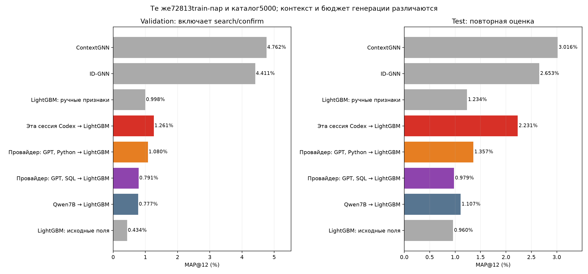
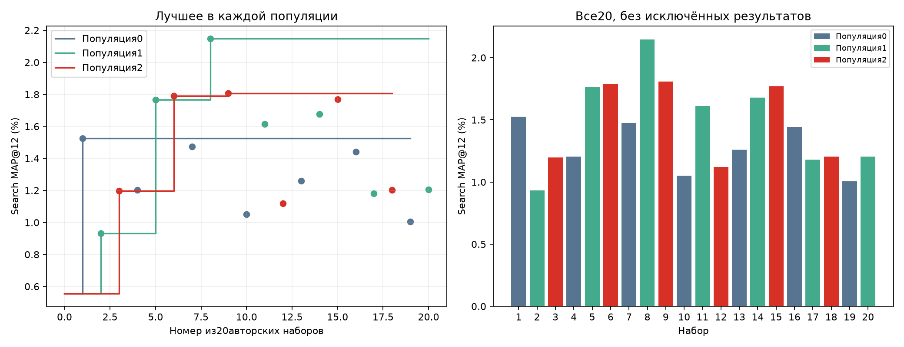
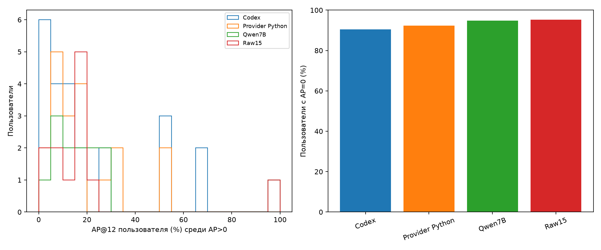
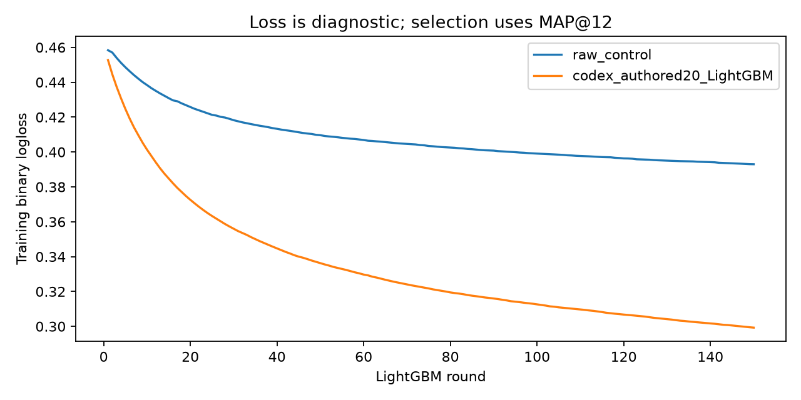

# H007: ровно20 наборов от текущей сессии Codex

**Реальный эксперимент, не smoke. Точная модель этой сессии не аттестована.**
Текущая сессия самостоятельно написала общий Python код и20адаптивных решений; внешних API запросов0.
Ровно20 новых обученных LightGBM,20 различных числовыхtrain-матриц. Raw контроль переиспользован изH006, не является21-м авторским набором.
Три популяции: [7, 7, 6]. Лучший родитель своей популяции проверен для каждого шага; цепочка хешей подтверждает фиксацию до получения search-оценки.
Победитель поconfirmation: набор9 (null=raw). Итоговые прогнозы независимо пересчитаны из замороженных моделей.

| Метод | Validation MAP,% | Heldout88 MAP,% | Test MAP,% |
|---|---:|---:|---:|
| LightGBM: исходные поля | 0.434422 | 0.557370 | 0.959630 |
| Qwen7B → LightGBM | 0.777180 | 0.473485 | 1.107143 |
| Провайдер: GPT, SQL → LightGBM | 0.791444 | 0.290404 | 0.979030 |
| Провайдер: GPT, Python → LightGBM | 1.079708 | 0.359999 | 1.357362 |
| Эта сессия Codex → LightGBM | 1.260603 | 0.673947 | 2.231032 |
| LightGBM: ручные признаки | 0.998319 | 0.767688 | 1.233880 |
| ID-GNN | 4.410716 | 1.244619 | 2.653413 |
| ContextGNN | 4.761926 | 2.100379 | 3.015575 |

## Все20результатов

| № | Популяция | Родитель | Признаков | Search MAP,% | Confirmation MAP,% |
|---:|---:|---:|---:|---:|---:|
| 1 | 0 | raw | 12 | 1.526199 | — |
| 2 | 1 | raw | 21 | 0.931328 | — |
| 3 | 2 | raw | 23 | 1.197607 | — |
| 4 | 0 | 1 | 20 | 1.203046 | — |
| 5 | 1 | 2 | 25 | 1.765715 | — |
| 6 | 2 | 3 | 26 | 1.791295 | 0.993457 |
| 7 | 0 | 1 | 19 | 1.473214 | — |
| 8 | 1 | 5 | 31 | 2.148015 | 0.591856 |
| 9 | 2 | 6 | 26 | 1.806486 | 1.053248 |
| 10 | 0 | 1 | 19 | 1.049624 | — |
| 11 | 1 | 8 | 36 | 1.614076 | — |
| 12 | 2 | 9 | 30 | 1.119637 | — |
| 13 | 0 | 1 | 11 | 1.260293 | — |
| 14 | 1 | 8 | 28 | 1.677489 | — |
| 15 | 2 | 9 | 24 | 1.768663 | — |
| 16 | 0 | 1 | 18 | 1.441310 | — |
| 17 | 1 | 8 | 30 | 1.181176 | — |
| 18 | 2 | 9 | 28 | 1.203215 | — |
| 19 | 0 | 1 | 16 | 1.005704 | — |
| 20 | 1 | 8 | 35 | 1.205808 | — |

Подробные решения и обоснования до оценки:

- 1: Популярность, активность, давность и разнообразие покупок. Начальная популяция0: компактная временная основа и повторные покупки. Контроль — raw15; новые метрики ещё не известны.
- 2: Продуктовая семья и тип: частота, давность и сглаженные предпочтения. Начальная популяция1 независимо от популяции0. Проверяю близость кандидата к личной истории продуктовых семей и типов, с поправкой на глобальную популярность.
- 3: Личные предпочтения и совместные покупки категорий. Начальная популяция2: считаю сходство разных категорий по общим покупателям на прошлой90-дневной истории, убирая диагональ. Этот коллективный сигнал дополняет личные частоты; валидационных результатов ещё нет.
- 4: Развитие временной основы: скорости изменения популярности. Родитель1 дал search1.526199%. Сохраняю все12признаков, добавляю относительные короткие/длинные тренды товара и пользователя и тренды типов/секций. Это проверка, помогает ли свежесть популярности сверх абсолютных счётчиков.
- 5: Более широкие личные предпочтения вместо узкой продуктовой семьи. Родитель2 дал search0.931328%. Узкая продуктовая семья может иметь мало повторений; убираю её отдельные счётчики, сохраняю тип и добавляю более общие секцию/цвет, их давность и30-дневные доли. Ценовой разрыв и разнообразие дополняют сигналы пользователя.
- 6: Совместные покупки типов и секций на90и365днях. Родитель3 дал search1.197607%. Делаю коллективный сигнал менее разреженным: оставляю типы/секции, добавляю365-дневный горизонт вместо графов цвета/группы одежды. Дополняю недавними личными предпочтениями и относительным ценовым отклонением.
- 7: Возврат к компактной основе с непрерывным затуханием. Расширение4 дало1.203046% против1.526199% у1; возвращаюсь к лучшему родителю1. Вместо множества отношений окон добавляю экспоненциальное затухание14/30дней и долю/относительную давность повторных покупок.
- 8: Широкие предпочтения с плавной свежестью интереса. Набор5 улучшил собственную ветку с0.931328% до1.765715%. Сохраняю его25признаков и добавляю затухающие предпочтения типа/секции/цвета, вес повторной покупки и масштабированное ценовое отклонение. Проверяю непрерывную давность сверх фиксированного30-дневного окна.
- 9: Длинная история совместных покупок без коротких графов. Набор6 поднял search ветки с1.197607% до1.791295%, но изменял несколько компонентов сразу. Проверяю более простой вариант с365-дневными графами типов/секций;90-дневные убираю, добавляю разнообразие пользователя и число уникальных покупателей товара. Остальные признаки6 сохраняю.
- 10: Компактная временная основа плюс ценовая совместимость. В этой популяции и тренды4(1.203046%), и затухание7(1.473214%) не обошли1(1.526199%). Снова беру1, проверяю другое направление: историческую цену кандидата относительно среднего/разброса бюджета пользователя и цены типа.
- 11: Улучшенный набор интересов с относительной давностью категорий. Набор8 улучшил5 с1.765715% до2.148015%, поэтому сохраняю все31признак8. Добавляю разницу между давностью категории и последней покупкой пользователя, ценовой межквартильный размах и совместимость исторического канала. Получается36признаков — прежний предел.
- 12: Длинные коллективные связи и свежие личные интересы. Набор9 дал1.806486% против1.791295% у6 — небольшое улучшение, но по установленному правилу родитель9. Сохраняю его26признаков и дополняю плавно затухающими личными предпочтениями типа/секции/цвета и весом повторной покупки, чтобы совместить долгую коллективную историю с текущими интересами.
- 13: Компактный ранжировщик повторных покупок без общих счётчиков пользователя. Родитель1 остаётся лучшим1.526199%; добавление цен10 ухудшило до1.049624%. Теперь сокращаю общие пользовательские/длинные счётчики и акцентирую давность/частоту конкретного товара и его продуктовой семьи. Это структурное упрощение, а не смена параметровLightGBM.
- 14: Менее избыточные затухающие предпочтения с уровнем отдела. У8 search2.148015%, расширение11 до36признаков дало лишь1.614076%. Возвращаюськ8; убираю часть абсолютных счётчиков категорий, уже представленных долями и давностью, и оставляю стандартизированный ценовой разрыв вместо двух его версий. Добавляю30-дневную и затухающую долю отдела как более общий уровень интереса.
- 15: Абляция коллективных связей: те же личные и временные признаки без графов. У9 search1.806486%, добавлениезатухания12 снизило до1.119637%. Проверяю, нужны ли сами графы: удаляю только graph_t365/graph_s365 из9, сохраняя все остальные24признака. Такое сравнение поможет выбрать направление последних шагов этой популяции.
- 16: Компактная основа с частотой и давностью личных категорий. После четырёхнеудачных расширений лучшимвветкеостаётся1(1.526199%); упрощение13 дало1.260293%. Сохраняю12признаков1 и проверяю новый для этой ветки сигнал: прямые личные счётчики и давность секции, продуктовой семьи и цвета, вместо дополнительных глобальных трендов/цен.
- 17: Точечная абляция избыточного абсолютного ценового отклонения. Родитель8 остаётся лучшим2.148015%; добавление11 и многокомпонентное сокращение14 хуже(1.614076%,1.677489%). Теперь меняю ровноодинпризнак: убираю абсолютныйprice_gap, оставляя масштабированныйprice_z. Проверяю более контролируемое сокращение коррелирующей информации.
- 18: Длинные коллективные связи по типу, секции, цвету и группе одежды. Удалениеграфов15 дало1.768663% против1.806486% у9 — небольшой спад, потому сохраняю9какродителя. Последний шаг этой популяции расширяет365-дневный коллективный сигнал двумя уровнями:цветом и группой одежды. Не возвращаю затухание, которое в12 ухудшило результат.
- 19: Компактная основа плюс возрастная совместимость аудитории товара. Лучший0по-прежнему1(1.526199%); личные категории16 дали1.441310%, а предыдущие временные/ценовые варианты не улучшили1. Последний шаг ветки проверяет отдельный источник информации: возраст исторических покупателей товара/типа и его отклонение от возраста пользователя. Добавляю четыре признака к неизменённому1.
- 20: Сохранение лучшего набора и явные недавние счётчики интересов. Родитель8 остаётся2.148015%; удаление толькоprice_gap в17 снизило до1.181176%, поэтому сохраняю все31признак8. В последнем разрешённом наборе добавляю явные счётчики типа за7дней, секции/цвета за30дней и покупок пользователя за7дней. Часть информации связана с долями, но такие координаты могут быть удобнее деревьям. Это ровно20-й набор, дальше поиск не продолжается.

## Равные условия downstream

72813 фиксированных train-пар/4804user-times/8cutoffs; LightGBM binary150/31leaves/4CPU/seed42, до36новых признаков + те же15raw, точные источникиworker/FeatureEngine/валидатораH006v2.
Search128×весь каталог5000 направляет адаптацию. После20наборов top3search+raw сравниваются на других88confirmationпользователях. Победитель зафиксирован до heldout88/val304/test250. Test не использован для выбора.
Проверены пустая история, отсутствующие группы, порядок строк, batching, числовая уникальность всех20матриц. Синтетические эталоны проверяют счётчики, цены/квантили, возраст, каналы, затухание и граф категорий; не обучают дополнительные модели.

## Что нельзя заключать

Это не аттестация эталонной GPT-6.1 Sol. Ни имя текущего движка, ни веса провайдера не подтверждаются метриками.
Я знаю историю прошлых экспериментов; контекст текущей сессии, использование инструментов и объём кода отличаются от провайдерского промпта и2048выходныхтокенов. Полной эквивалентности бюджета генерации нет. Популяционные родители независимы, но внутренний контекст этой сессии не разделён на3изолированные LLM.
Все20 были написаны и оценены в явной последовательности. Предварительные неоценённые черновики сохранены отдельно; скрытого перебора других моделей/гиперпараметров не проводилось.
У провайдерского Python было20оценённых программ, но18числовыхматриц; здесь20/20. Сравнение отражает весь процесс поиска, не изолирует только свойства языковой модели.
Одинseed и250ранее просмотренныхtest-пользователей. Paired bootstrap исследовательский, не неопределённость между запусками. Большая разница результатов сама по себе не доказывает подмену модели.
Токены/время генерации текущей сессии не измерены. Нулевыеgenerated_tokens/seconds в совместимыхtrial-записях означают отсутствие метрики внешнегоAPI, а не нулевые реальные затраты на генерацию.

## Парные интервалы разницы наtest

| Сравнение | Разница, п.п. | 95% интервал, п.п. |
|---|---:|---|
| Codex minus Provider Python | +0.873670 | [+0.084233; +1.863966] |
| Codex minus Provider SQL | +1.252001 | [+0.279492; +2.498932] |
| Codex minus Qwen7B | +1.123889 | [-0.282199; +2.605458] |
| Codex minus Raw15 | +1.271402 | [-0.141449; +2.802509] |

## Код выбранного набора

```python
def modify_features(X, history):
    specs = {'i_n7': (['article_id'], 'n', 7), 'i_n30': (['article_id'], 'n', 30), 'i_n0': (['article_id'], 'n', 0), 'i_r': (['article_id'], 'r', 0), 'u_n30': (['customer_id'], 'n', 30), 'u_n0': (['customer_id'], 'n', 0), 'u_r': (['customer_id'], 'r', 0), 'p_n0': (['customer_id', 'article_id'], 'n', 0), 'p_r': (['customer_id', 'article_id'], 'r', 0), 'ut_n0': (['customer_id', 'product_type_no'], 'n', 0), 'us_n0': (['customer_id', 'section_no'], 'n', 0), 'ud_n0': (['customer_id', 'department_no'], 'n', 0), 'uc_n0': (['customer_id', 'colour_group_code'], 'n', 0), 'upc_n0': (['customer_id', 'product_code'], 'n', 0), 't_n0': (['product_type_no'], 'n', 0), 's_n0': (['section_no'], 'n', 0), 'ut_n30': (['customer_id', 'product_type_no'], 'n', 30), 'us_n30': (['customer_id', 'section_no'], 'n', 30), 'i_price': (['article_id'], 'price', 0), 'u_price': (['customer_id'], 'price', 0), 'u_std': (['customer_id'], 'std', 0), 'i_n365': (['article_id'], 'n', 365), 'u_uniq': (['customer_id'], 'uniq', 0), 'i_uniq': (['article_id'], 'uniq', 0)}
    derived = {'t_share': ('ratio', 'ut_n0', 'u_n0', 3), 's_share': ('ratio', 'us_n0', 'u_n0', 3), 'd_share': ('ratio', 'ud_n0', 'u_n0', 3), 'c_share': ('ratio', 'uc_n0', 'u_n0', 3), 'pc_share': ('ratio', 'upc_n0', 'u_n0', 3), 't_lift': ('lift', 'ut_n0', 'u_n0', 't_n0'), 's_lift': ('lift', 'us_n0', 'u_n0', 's_n0'), 't_share30': ('ratio', 'ut_n30', 'u_n30', 3), 's_share30': ('ratio', 'us_n30', 'u_n30', 3), 'price_gap': ('gap', 'i_price', 'u_price'), 'price_z': ('scaledgap', 'i_price', 'u_price', 'u_std', 0.01), 'i_trend7': ('ratio', 'i_n7', 'i_n30', 3), 'i_trend30': ('ratio', 'i_n30', 'i_n365', 5), 'user_diversity': ('ratio', 'u_uniq', 'u_n0', 1)}
    outputs = ['i_n7', 'i_n30', 'i_n0', 'i_r', 'u_n30', 'u_n0', 'u_r', 'p_n0', 'p_r', 't_share', 's_share', 'd_share', 'c_share', 'pc_share', 'graph_t365', 'graph_s365', 't_lift', 's_lift', 't_share30', 's_share30', 'price_gap', 'price_z', 'i_trend7', 'i_trend30', 'user_diversity', 'i_uniq']
    out = pd.DataFrame(index=X.index)
    if history.empty:
        for name in outputs:
            out['f_' + name] = 0.0
        return out
    memo = {}
    def lookup(series, keys):
        names = [k if k in ('customer_id','article_id') else 'raw_i_'+k for k in keys]
        if len(keys)==1:
            return X[names[0]].map(series).to_numpy(dtype=float)
        index = pd.MultiIndex.from_arrays([X[k].to_numpy() for k in names], names=keys)
        return series.reindex(index).to_numpy(dtype=float)
    def graph(name):
        code = name[6:7]
        days = int(name[7:])
        column = {'t':'product_type_no','s':'section_no','c':'colour_group_code','g':'garment_group_no'}[code]
        h = history.loc[history.days_ago<=days,['customer_id',column]].drop_duplicates()
        values = np.zeros(len(X),dtype=float)
        if h.empty:
            return values
        table = pd.crosstab(h.customer_id,h[column])
        b = table.to_numpy(dtype=float)
        norms = np.sqrt((b*b).sum(axis=0))
        sim = (b.T @ b) / np.maximum(norms[:,None]*norms[None,:],1.0)
        np.fill_diagonal(sim,0.0)
        scores = (b @ sim) / np.maximum(b.sum(axis=1,keepdims=True),1.0)
        rows = table.index.get_indexer(X.customer_id)
        cols = table.columns.get_indexer(X['raw_i_'+column])
        valid = (rows>=0)&(cols>=0)
        values[valid] = scores[rows[valid],cols[valid]]
        return values
    def get(name):
        if name in memo:
            return memo[name]
        if name.startswith('graph_'):
            value = graph(name)
        elif name in specs:
            keys,stat,window = specs[name]
            h = history if window==0 else history.loc[history.days_ago<=window]
            group = h.groupby(keys,sort=False)
            if stat=='n': s = group.size()
            elif stat=='r': s = group.days_ago.min()
            elif stat=='price': s = group.price.mean()
            elif stat=='std': s = group.price.std(ddof=0)
            elif stat=='q25': s = group.price.quantile(0.25)
            elif stat=='q75': s = group.price.quantile(0.75)
            elif stat=='age': s = group.customer_age.mean()
            elif stat=='uniq':
                col = 'article_id' if keys==['customer_id'] else 'customer_id'
                s = group[col].nunique()
            elif stat=='ch2':
                temp = h.assign(weight=(h.sales_channel_id==2).astype(float))
                s = temp.groupby(keys,sort=False).weight.mean()
            else:
                scale = 14.0 if stat=='dec14' else 30.0
                temp = h.assign(weight=np.exp(-h.days_ago/scale))
                s = temp.groupby(keys,sort=False).weight.sum()
            value = lookup(s,keys)
            if stat in ('n','uniq','dec14','dec30'):
                value = np.nan_to_num(value,nan=0.0)
        else:
            args = derived[name]
            op = args[0]
            if op=='rawgap': value = np.abs(X[args[1]].to_numpy(dtype=float)-get(args[2]))
            else:
                a,b = get(args[1]),get(args[2])
                if op=='ratio': value = a/(b+args[3])
                elif op=='gap': value = np.abs(a-b)
                elif op=='subtract': value = a-b
                elif op=='scaledgap': value = np.abs(a-b)/(get(args[3])+args[4])
                elif op=='match': value = a*b+(1.0-a)*(1.0-b)
                else: value = np.log1p(((a+0.5)/(b+5.0))/((get(args[3])+5.0)/(len(history)+5.0)))
        memo[name] = value
        return value
    for name in outputs:
        out['f_'+name] = get(name)
    return out.replace([np.inf,-np.inf],np.nan)

```







