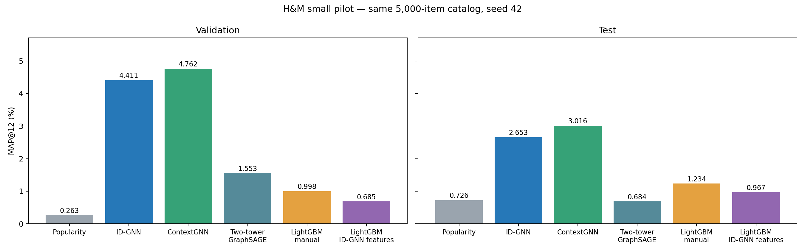
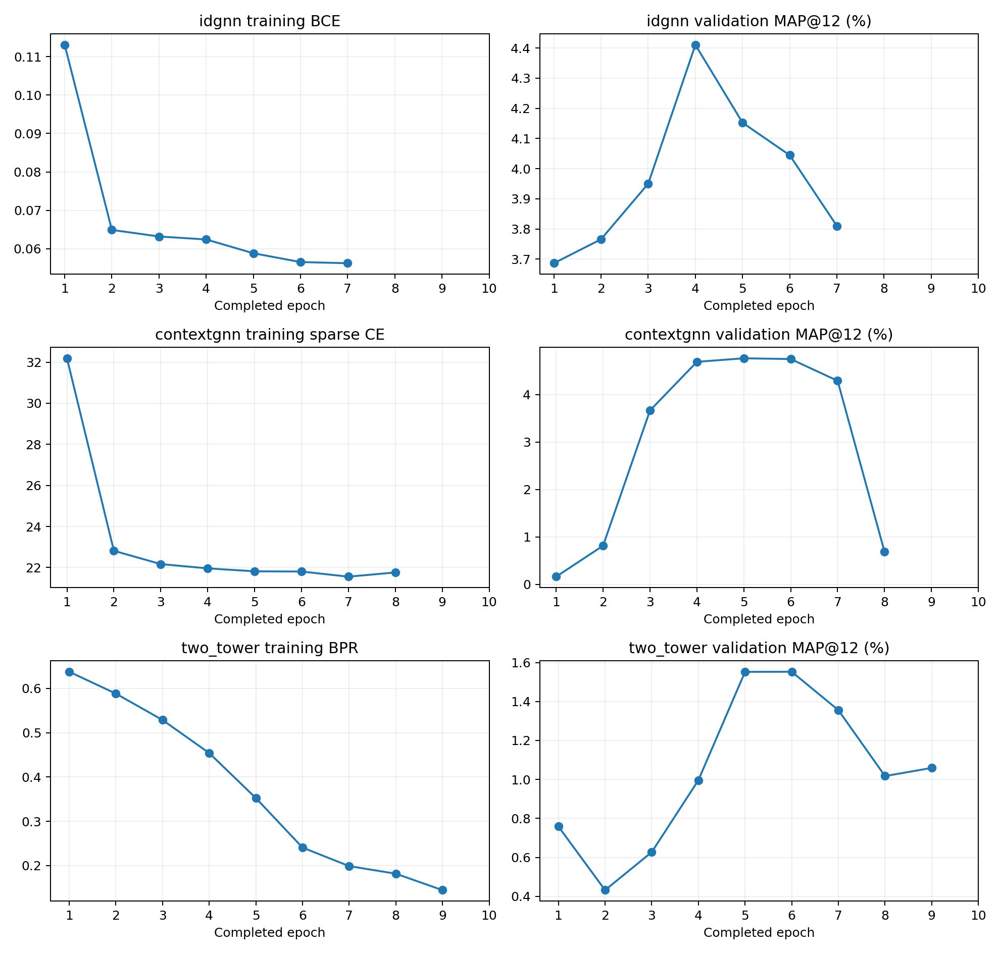

# ContextGNN: малый H&M пилот

Все 5 моделей обучены/пересчитаны и проверены. Seed42, полный каталог поднабора 5,000 товаров.

Это изменённая подзадача: 5,000 пользователей, 46,442 транзакции, 8 train времён; train4,804, val304, test250 user-time.
Пользователи/каталог выбраны только по pre-validation истории. После ограничения каталога удалены пустые цели; положительное покрытие val37.27%, test33.68%. MAP не сопоставим напрямую с полным H&M/статьёй.

| Модель | Validation MAP, % | Test MAP, % | Обучение + val/tuning, с | Test infer, с |
|---|---:|---:|---:|---:|
| Popularity | 0.26256 | 0.72645 | 0.00 | 0.000 |
| ID-GNN | 4.41072 | 2.65341 | 27.50 | 0.068 |
| ContextGNN | 4.76193 | 3.01558 | 20.95 | 0.055 |
| Two-tower GraphSAGE | 1.55256 | 0.68368 | 38.09 | 0.699 |
| LightGBM + manual | 0.99832 | 1.23388 | 20.12 | 5.045 |
| LightGBM + ID-GNN features | 0.68531 | 0.96667 | 5.41 | 1.747 |

Время inference в таблице измерено после подготовки графа/модели и GPU warm-up, не включает импорт библиотек. Первый независимый вызов может включать существенную GPU инициализацию; timings сохранены в verification.json.

## Сопоставимость и ограничения

Оба LightGBM обучены на одних 72,813 парах (все позитивы + до8history/8uniform negatives). SHA отсортированных ключей/меток совпадает. 126 ручных признаков заново рассчитаны на малом графе. ID-GNN features:64 замороженных координаты перед головой + availability; train representations in-sample, не OOF.
Оценочные файлы обоих LightGBM проверены на точное равенство user×catalog:304×5000 val,250×5000 test. Все модели оцениваются на этих же пользователях и каталоге. ID-GNN присваивает ноль вне локального подграфа; ContextGNN использует глобальные scores.
Нейросети имеют разные objectives (BCE, sparse CE, BPR для двухбашенной), а LightGBM другой бюджет/negative sampling. Сравнение характеризует конвейеры, не изолированный эффект архитектуры. Выбор checkpoints/параметров только по validation; test не использован для подбора.
Разница test ContextGNN−ID-GNN 0.3622 п.п.; парный bootstrap95% по test пользователям [-0.1003; 0.9320] п.п. Это условный интервал по250пользователям, не оценка вариативности обучения по seeds.

## Доступность ID-GNN представлений

| Split | Пар | Без локального вектора | Доля |
|---|---:|---:|---:|
| train | 72813 | 51335 | 70.50% |
| val | 1520000 | 1516257 | 99.75% |
| test | 1250000 | 1247101 | 99.77% |

Отсутствующие локальные векторы заполнены нулями и availability=0. На полном каталоге таких пар существенно больше, чем в прежнем локальном reranking experiment. Это ограничивает LightGBM на ID-GNN признаках и не является свидетельством бесполезности GNN-признаков вообще.

Официальный ContextGNN commit ca4a96985b7ef73c36a40da32e70710ad9b59a1e. Обёртка очищает RHS FUSION cache перед eval, чтобы не использовать прошлую версию матрицы; upstream неизменён.
В статье для полного H&M ContextGNN val3.00%,test2.93%: приведено только как отдельный результат, не цель/сравнение чисел этого поднабора.
[Протокол](../../ContextGNN/PROTOCOL_SMALL.md) · [Манифест](../../data/rel-hm-small-v1/subset_manifest.json)

## Добавление двухбашенной архитектуры

Используется Model из RelBenchGNN/upstream/examples/model.py, как в прежнем большом двухбашенном запуске. Пользователь и товар кодируются отдельными forward с общими параметрами; скор — dot product. Глобальные user/item представления доступны для всех пар малого каталога.
Размеры согласованы с малым пилотом: 64канала,2GNNслоя,ResNet encoder64×2,neighbors32/16,batch128,last sampling,до10эпох,patience3. BPR с same-time in-batch negatives. Неполные timestamp batches сохранены: каждая эпоха содержит все4804train строки.
Прежние четыре модели не переобучались. Предыдущая версия отчёта сохранена в before_two_tower/. Новый run_id hm_twotower_small_seed_42_v1, независимый replay best.pt проверен.
