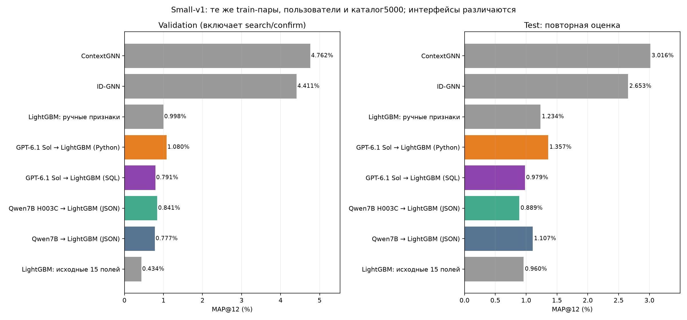
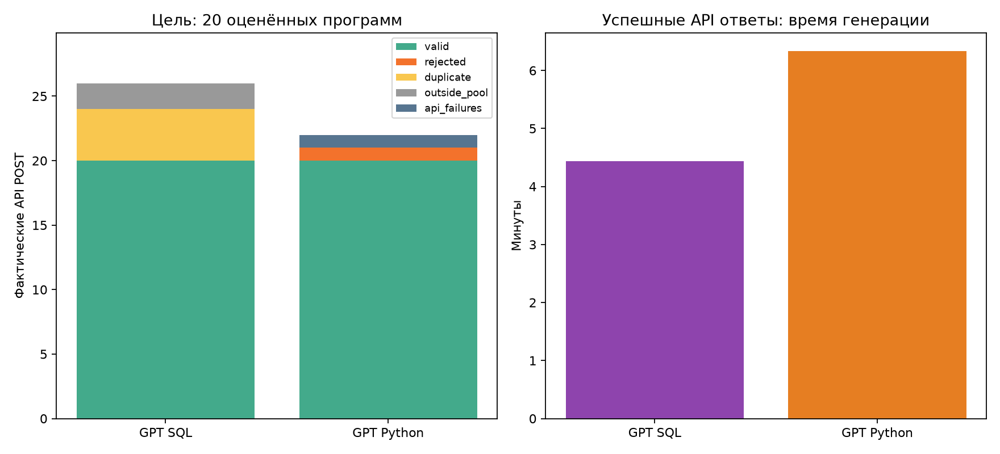
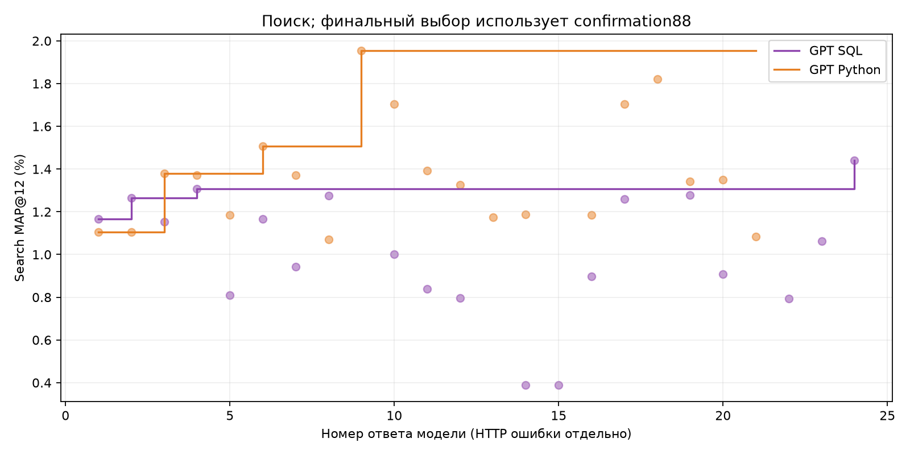
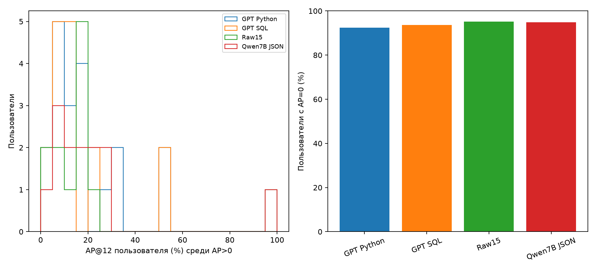
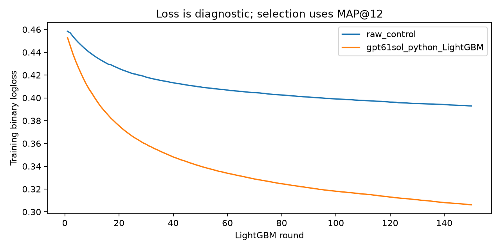

# H006: GPT-6.1 Sol пишет полную Python-функцию

Реальный эксперимент, не smoke. Все итоговые прогнозы независимо пересчитаны из замороженных моделей.
API-запросов: 22; оценённых программ: 20; отказов по контракту кода: 1; дубликатов по AST: 0; ошибок API отдельно: 1.
Выбран ответ 10 (null=raw), validation MAP=1.079708%, heldout88=0.359999%, test=1.357362%.

| Метод | Validation MAP,% | Heldout88 MAP,% | Test MAP,% |
|---|---:|---:|---:|
| LightGBM: исходные 15 полей | 0.434422 | 0.557370 | 0.959630 |
| Qwen7B → LightGBM (JSON) | 0.777180 | 0.473485 | 1.107143 |
| Qwen7B H003C → LightGBM (JSON) | 0.841421 | 0.419823 | 0.888745 |
| GPT-6.1 Sol → LightGBM (SQL) | 0.791444 | 0.290404 | 0.979030 |
| GPT-6.1 Sol → LightGBM (Python) | 1.079708 | 0.359999 | 1.357362 |
| LightGBM: ручные признаки | 0.998319 | 0.767688 | 1.233880 |
| ID-GNN | 4.410716 | 1.244619 | 2.653413 |
| ContextGNN | 4.761926 | 2.100379 | 3.015575 |

## Search и confirmation

Метрика одна — MAP@12; пользователи разные. Search:128 пользователей, каждый набор, оценка возвращается LLM. Confirmation: другие88 пользователей, толькоtop3search+raw после завершения поиска; эти оценки LLM не получает. Победитель выбирается поconfirmation, test не участвует.

| Ответ | Search MAP,% | Confirmation MAP,% |
|---|---:|---:|
| Raw15 | 0.555556 | 0.135281 |
| 9 | 1.954055 | 0.533009 |
| 18 | 1.820126 | 0.493777 |
| 10 | 1.703249 | 0.892447 |

## Неопределённость разницы

Python минус SQL на test: +0.378331 п.п.; исследовательский 95% парный bootstrap-интервал [-0.014632; +0.851182] п.п.
Интервал включает ноль. Более высокий результат этого прогона не устанавливает устойчивое превосходство Python-интерфейса. Полные сравнения с raw/Qwen — paired_test_bootstrap.csv.

## Проверка валидатора

Перед возобновлением v2 пройдены 29 регрессионных проверок (до исходного запуска28): корректный pandas/NumPy, helper-функции, константы, merge/MultiIndex, ошибки синтаксиса/схемы/индекса, сопоставление Python/SQL и отсутствие будущих покупок.
После генерации проверены все 21 ответов: {"accepted_extra_contract_checks_passed": 20, "model_schema_changes_with_empty_history": 1}.
Принятые программы дополнительно проверены в прежнем ограниченном worker: пустая история, отсутствующие группы, нестандартный индекс, permutation/batching. Неограниченный exec модельного кода отклонён автоматической проверкой безопасности и не выполнялся; независимые числовые эталоны написаны аудитором, не моделью.
Отказы разобраны отдельно в validator_review.json. Тесты не доказывают отсутствие всех возможных дефектов.
Независимые аудиторские SQL эталоны подтвердили все11признаковcall3 и17признаковcall5 на8train-cutoffs. Кроме того, все12признаков выбранногоcall10 полностью выражены SQL: на всех72813train-парах подтверждено точное равенство float32 значений. Это прямой пример того, что преимущество не связано с выразительностью Python. Остальные формулы не объявляются автоматически доказанными этими примерами.
Дополнительный аудит до итогового отбора обнаружил другой порядок тех же столбцов на пустой истории в call5. v2 выравнивает столбцы по именам и проверяет empty/absent до обучения. Исходный v1 сохранён, API-бюджет не обнулён, имеющиеся ответы перенесены без повторной генерации. Переиспользованные модели проверены на совпадение матриц по8train-срезам; это продолжение одного потока, не независимый прогон.

## Разнообразие признаков

Цель поиска —20структурно различных оценённых Python программ. Это не гарантия20различных числовых матриц.
По всем72813train-строкам: 18 различных матриц с учётом порядка столбцов; 18 различных мультимножеств числовых столбцов без учёта имён/порядка.
Совпадающие группы: {"ordered_float32_sha256": {"distinct": 18, "duplicate_groups": [[4, 7], [10, 17]]}, "column_multiset_sha256": {"distinct": 18, "duplicate_groups": [[4, 7], [10, 17]]}}
В фактический confirmation вошли ответы [9, 18, 10]: 3 различных числовых матриц.
Дедупликация по AST консервативна и может пропускать эквивалентные программы. Это уменьшает эффективный бюджет поиска; одинаковые варианты могут занять несколько мест вtop3. Диагностика вычислена после заморозки выбора и не используется для переотбора поtest.
Аудит обнаружил также неточность логаresume: уcall8 сохранённыйprompt был заменён реконструированнымv2 текстом, который не отправлялся провайдеру. Реальныйprompt восстановлен из неизменногоrequest.json (он совпадает с сохранённымv1), неотправленный текст сохранён отдельно. Модель, данные, отбор и метрики не изменялись; деталиprompt_log_reconciliation.json в исходном каталоге.

## Условия и ограничения

Те же72813 пары / LightGBM150/31/4CPU / raw15 / seed42 / 3популяции / 20наборов / до300фактическихPOST / до3repair.
Search128×каталог5000 → top3+raw → confirmation88 → frozen heldout88/val304/test250. Raw модель и прогнозы побайтно совпали с предыдущими экспериментами.
Модель/API/sampling как SQL: gpt-6.1-sol, temperature0.8, top_p1, reasoning_effortlow, max_tokens2048, seed42+номер_ответа−1 запрошен. Реализация и гарантии seed провайдера не контролируются.
В Python до36 новых признаков; исходные15 добавляет host. LLM видит схему и3training-примера, полную прошлую историю обрабатывает её код. Саму LLM не дообучаем.
Язык, формат интерфейса и пример в промпте отличаются от SQL; один прогон не изолирует их причинный эффект.
Большинство полученных признаков одинаково выразимы SQL и Python. Эксперимент проверяет поиск через другой интерфейс, а не превосходство языка. Одинаковые числовые матрицы при тех же настройках дают то же обучение LightGBM.
Test ранее просмотрен. Paired bootstrap10k по пользователям исследовательский; это не multi-seed uncertainty.
Исторический Qwen использовал JSON DSL, а baselines имели другие бюджеты настройки. Корректный исполняемый код не гарантирует полезные признаки.
SQL столбец — исправленная оценка исходного потока без новых генераций; 2 исходных ответа вне correctedpool сохранены.
HTTP502 не считается ошибкой модели/валидатора. Usage и время генерации охватывают полученные ответы; денежная стоимость и списание за ошибочный HTTP запрос неизвестны.

## Выбранный Python

```python
def modify_features(X, history):
    import pandas as pd
    import numpy as np

    out = pd.DataFrame(index=X.index)
    h = history
    if h.empty:
        for name in (
            "f_item_count_30d", "f_item_count_90d", "f_item_count_all",
            "f_item_recency", "f_item_price_mean", "f_user_count_30d",
            "f_user_count_all", "f_user_recency", "f_pair_count_all",
            "f_user_section_count", "f_user_product_count",
            "f_user_colour_count",
        ):
            out[name] = 0
        return out

    h = h.assign(_days=pd.to_numeric(h["days_ago"], errors="coerce"))

    for window, name in ((30, "f_item_count_30d"), (90, "f_item_count_90d")):
        counts = h.loc[h["_days"] <= window].groupby("article_id", observed=True).size()
        out[name] = X["article_id"].map(counts).fillna(0).to_numpy()

    item_counts = h.groupby("article_id", observed=True).size()
    out["f_item_count_all"] = X["article_id"].map(item_counts).fillna(0).to_numpy()
    item_recency = h.groupby("article_id", observed=True)["_days"].min()
    out["f_item_recency"] = X["article_id"].map(item_recency).fillna(-1).to_numpy()

    price = pd.to_numeric(h["price"], errors="coerce")
    item_price = price.groupby(h["article_id"], observed=True).mean()
    out["f_item_price_mean"] = X["article_id"].map(item_price).to_numpy()

    for window, name in ((30, "f_user_count_30d"), (None, "f_user_count_all")):
        source = h if window is None else h.loc[h["_days"] <= window]
        counts = source.groupby("customer_id", observed=True).size()
        out[name] = X["customer_id"].map(counts).fillna(0).to_numpy()

    user_recency = h.groupby("customer_id", observed=True)["_days"].min()
    out["f_user_recency"] = X["customer_id"].map(user_recency).fillna(-1).to_numpy()

    pair = h.groupby(["customer_id", "article_id"], observed=True).size()
    keys = pd.MultiIndex.from_arrays(
        [X["customer_id"].to_numpy(), X["article_id"].to_numpy()],
        names=["customer_id", "article_id"],
    )
    out["f_pair_count_all"] = pair.reindex(keys).fillna(0).to_numpy()

    for raw_col, hist_col, name in (
        ("raw_i_section_no", "section_no", "f_user_section_count"),
        ("raw_i_product_code", "product_code", "f_user_product_count"),
        ("raw_i_colour_group_code", "colour_group_code", "f_user_colour_count"),
    ):
        grouped = h.groupby(["customer_id", hist_col], observed=True).size()
        lookup = pd.MultiIndex.from_arrays(
            [X["customer_id"].to_numpy(), X[raw_col].to_numpy()],
            names=["customer_id", hist_col],
        )
        out[name] = grouped.reindex(lookup).fillna(0).to_numpy()

    return out.replace([np.inf, -np.inf], np.nan)

```









