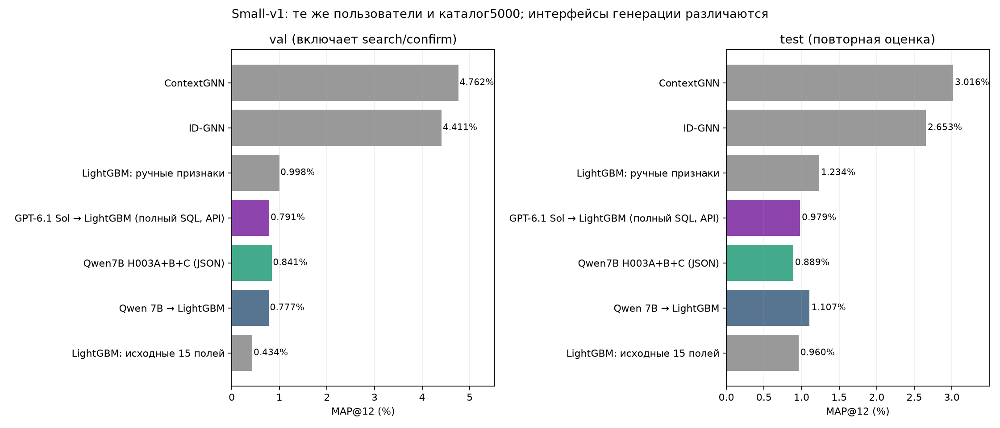
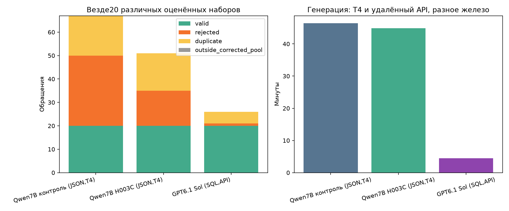
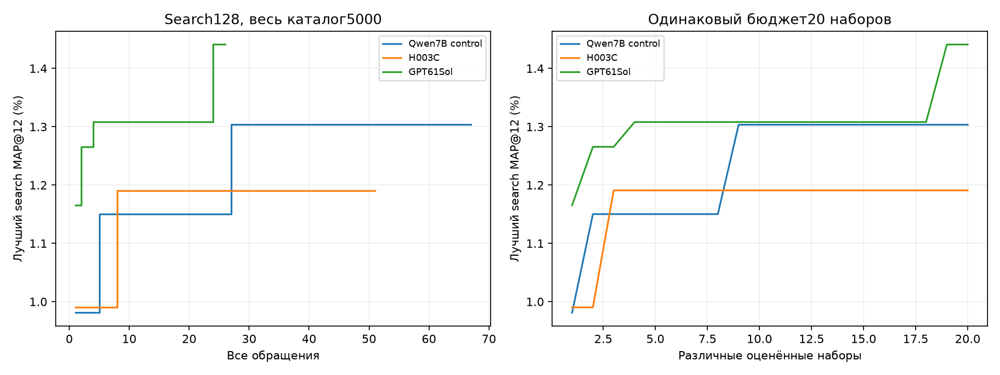
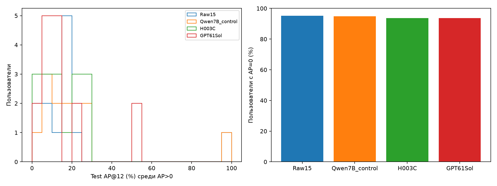
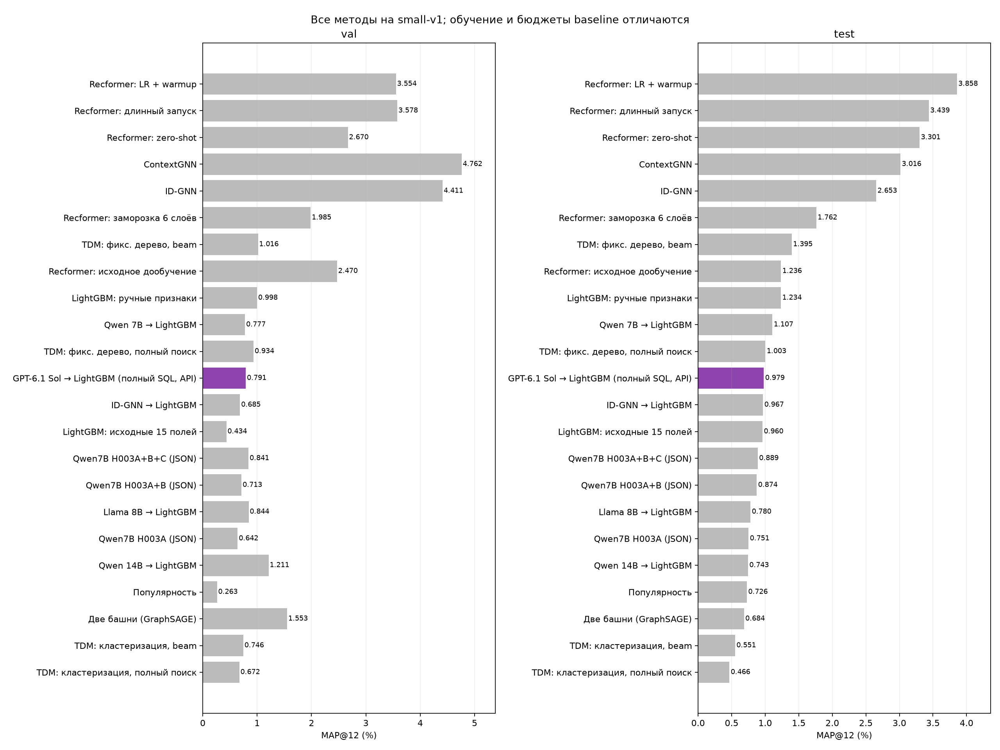

# GPT-6.1 Sol через Tooken Club: small-v1 / полный SQL

Эксперимент выполнен, не smoke. Модель запрошена и возвращена API как gpt-6.1-sol.
Провайдер https://tooken.club/v1; секрет читается из.env, в артефакты не сохраняется.
Независимый CPU audit проверил20 различных обученных программ, метрики/прогнозы,top3+raw/confirmation и4frozen replays(raw/GPT ×val/test).
Raw-control model/predictions байт-в-байт совпадают с прежним контролем.

## Результат

Вызовов:26,успехов20,отказов1,дубликатов5;выбранcall4 (null=raw).
Генерация:4.44мин,APIusage input46569/completion16080токенов.
GPT valMAP=0.791444%,heldout88=0.290404%,test=0.979030%.

| Метод | Validation MAP,% | Heldout88 MAP,% | Test MAP,% |
|---|---:|---:|---:|
| LightGBM: исходные 15 полей | 0.434422 | 0.557370 | 0.959630 |
| Qwen 7B → LightGBM | 0.777180 | 0.473485 | 1.107143 |
| Qwen7B H003A+B+C (JSON) | 0.841421 | 0.419823 | 0.888745 |
| GPT-6.1 Sol → LightGBM (полный SQL, API) | 0.791444 | 0.290404 | 0.979030 |
| LightGBM: ручные признаки | 0.998319 | 0.767688 | 1.233880 |
| ID-GNN | 4.410716 | 1.244619 | 2.653413 |
| ContextGNN | 4.761926 | 2.100379 | 3.015575 |

## Что сравнимо

Те же72813train-пар,4804user-times/8cutoffs,LightGBM150/31/4CPUthreads/raw15,validation304/test250/все5000товаров.
Search128→top3+raw→confirmation88;выбордоheldout/test. Test ранее просматривался: повторная оценка, не новый закрытый test.
ПолныйSQL-интерфейс/prompt/worker/base features происходят из подготовленного Qwen7B full-SQL ноутбука. Его реальных результатов пока нет. Исправление Boolean-валидации, если применено, описано ниже.
Исторические Qwen7B/H003 писали JSON DSL. Поэтому сравнение с ними меняет и модель, и интерфейс; изолировать эффект мощности модели пока нельзя.
GPT API:temperature0.8,top_p1,seed42+call−1 запрошен,reasoning_effort=low,max_tokens2048. Веса/квантизация/детерминизм провайдера не контролируются; сохраняются requested/returned model IDs иusage.
Лимит300 — фактическиеHTTPPOST к модели без автоматических повторов. GET/models — проверка доступа, не генерация.
API и T4 используют разное железо; затраты времени нельзя приписать только модели. Денежную стоимость из usage без тарифов/чека не вычисляем.
Одинseed250test. Paired-bootstrap10k исследовательский, не неопределённость между запусками. Не выбирать новый prompt по этому test.

## Выбранный SQL

```sql
WITH customer_stats AS (
    SELECT
        customer_id,
        count(*) AS purchases,
        count(*) FILTER (WHERE days_ago <= 30) AS purchases_30d,
        count(*) FILTER (WHERE days_ago <= 7) AS purchases_7d,
        count(DISTINCT article_id) AS distinct_articles,
        avg(days_ago) AS mean_days_ago,
        min(days_ago) AS most_recent_days_ago,
        avg(price) AS mean_price,
        stddev_pop(price) AS price_stddev
    FROM history
    GROUP BY customer_id
)
SELECT
    customer_id,
    purchases AS f_customer_purchase_count,
    purchases_30d AS f_customer_purchase_count_30d,
    purchases_7d AS f_customer_purchase_count_7d,
    purchases_30d / nullif(purchases, 0) AS f_customer_recent_purchase_share,
    distinct_articles AS f_customer_distinct_articles,
    mean_days_ago AS f_customer_mean_days_ago,
    most_recent_days_ago AS f_customer_recency_days,
    mean_price AS f_customer_mean_price,
    price_stddev AS f_customer_price_stddev
FROM customer_stats;

WITH article_stats AS (
    SELECT
        article_id,
        count(*) AS purchases,
        count(*) FILTER (WHERE days_ago <= 30) AS purchases_30d,
        count(*) FILTER (WHERE days_ago <= 7) AS purchases_7d,
        count(DISTINCT customer_id) AS distinct_customers,
        avg(price) AS mean_price,
        min(days_ago) AS most_recent_days_ago
    FROM history
    GROUP BY article_id
)
SELECT
    article_id,
    purchases AS f_article_purchase_count,
    purchases_30d AS f_article_purchase_count_30d,
    purchases_7d AS f_article_purchase_count_7d,
    distinct_customers AS f_article_distinct_customers,
    mean_price AS f_article_mean_price,
    most_recent_days_ago AS f_article_recency_days
FROM article_stats;

WITH pair_stats AS (
    SELECT
        customer_id,
        article_id,
        count(*) AS purchases,
        count(*) FILTER (WHERE days_ago <= 30) AS purchases_30d,
        count(*) FILTER (WHERE days_ago <= 7) AS purchases_7d,
        min(days_ago) AS most_recent_days_ago,
        avg(price) AS mean_price
    FROM history
    GROUP BY customer_id, article_id
)
SELECT
    customer_id,
    article_id,
    purchases AS f_pair_purchase_count,
    purchases_30d AS f_pair_purchase_count_30d,
    purchases_7d AS f_pair_purchase_count_7d,
    most_recent_days_ago AS f_pair_recency_days,
    mean_price AS f_pair_mean_price
FROM pair_stats;
```











[Профиль модели у провайдера](https://tooken.club/models/gpt-6-1-sol).