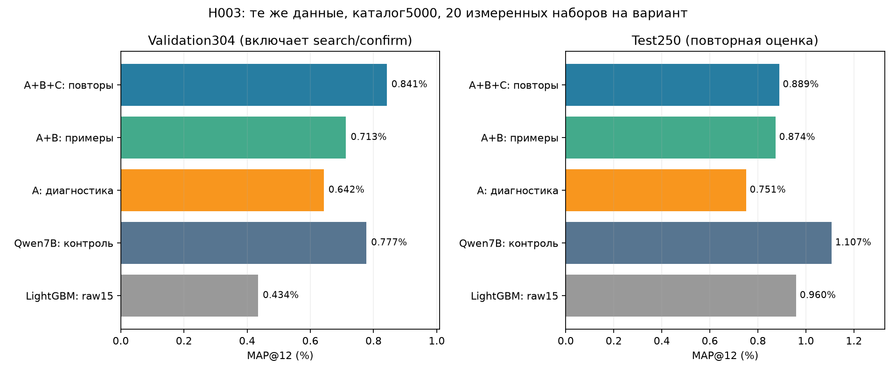
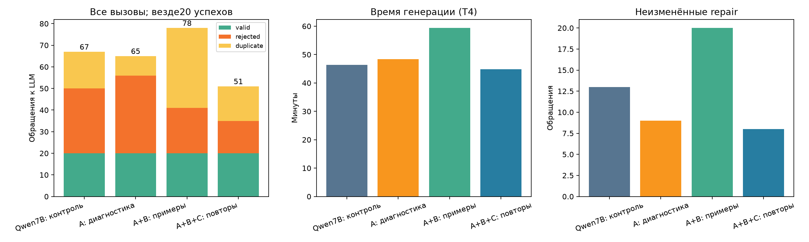
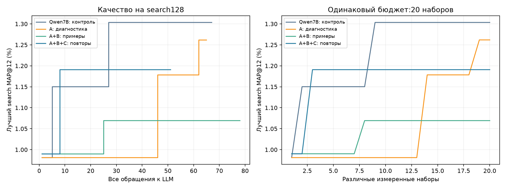
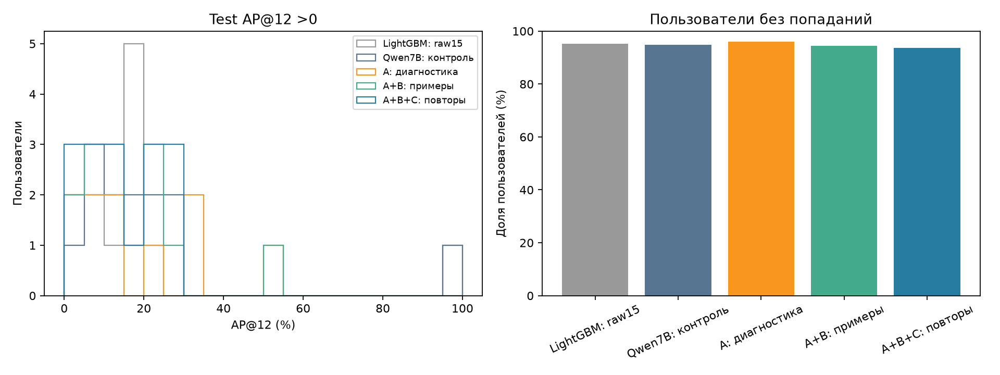
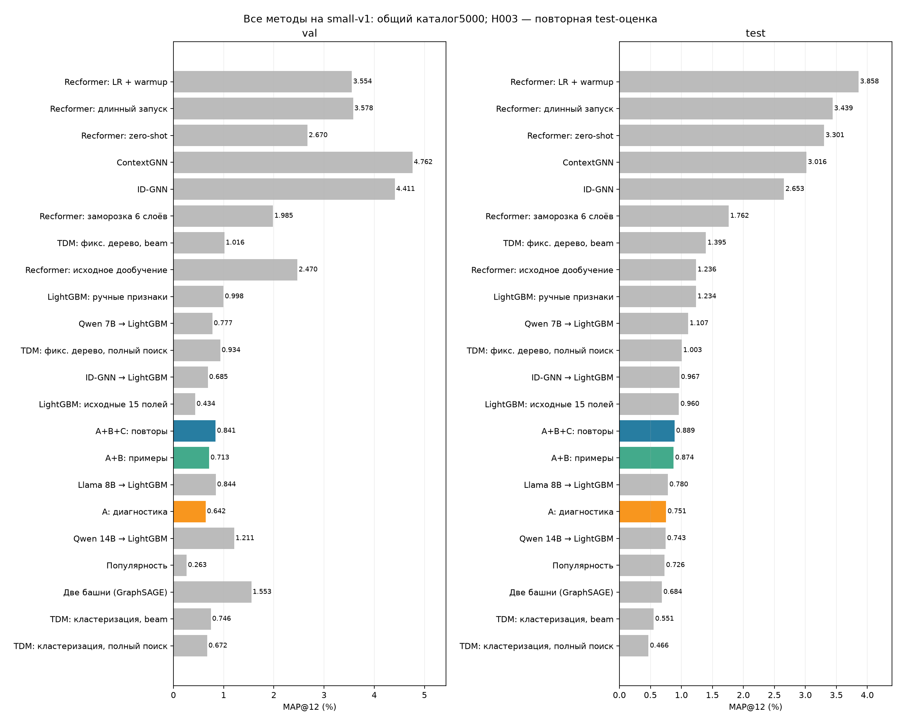

# H003: результат эксперимента Qwen7B

Реальный Kaggle запуск hm_small_qwen7b_h003_v1_6852748fc0e4, все три ветки завершены.
Проверены ZIP/конфиги/исходники/данные, все60различных измеренных программ, выбор top3+raw по confirmation.
Независимый локальный CPU replay raw/A/B/C: val/test top12, AP и MAP совпали точно. Обучения и новых LLM-вызовов не было.

## Эффективность генерации

| Вариант | Вызовы | Успехи | Отказы | Дубликаты | Генерация, мин |
|---|---:|---:|---:|---:|---:|
| Qwen7B: контроль | 67 | 20 | 30 | 17 | 46.42 |
| A: диагностика | 65 | 20 | 36 | 9 | 48.37 |
| A+B: примеры | 78 | 20 | 21 | 37 | 59.37 |
| A+B+C: повторы | 51 | 20 | 15 | 16 | 44.88 |

A: подробной диагностики самой по себе не хватило:65 против67 вызовов; отказов36 против30.
B: отказов21, но дубликатов37; суммарно78вызовов. Примеры не гарантируют разнообразие.
C:51вызов,15отказов,16дубликатов. Против контроля вызовов на23.9%меньше, генерация44.88против46.42мин (на3.3%меньше).
По сравнению сB: на34.6%меньше вызовов. Это один seed; время — одиночные измерения Kaggle, не устойчивый скоростной бенчмарк.
Неизменённых repair:контроль13/40,A9/38,B20/50,C8/23. Контроль считает совпадение JSON безrationale, H003 дополнительно канонические совпадения; числа не полностью идентичны по определению.

## Качество рекомендаций

| Вариант | Val MAP,% | Heldout88 MAP,% | Test MAP,% |
|---|---:|---:|---:|
| LightGBM: raw15 | 0.434422 | 0.557370 | 0.959630 |
| Qwen7B: контроль | 0.777180 | 0.473485 | 1.107143 |
| A: диагностика | 0.642195 | 0.288395 | 0.751212 |
| A+B: примеры | 0.712666 | 0.482955 | 0.873593 |
| A+B+C: повторы | 0.841421 | 0.419823 | 0.888745 |

Ни одна ветка не превысила старый Qwen7B или raw15 по test. При выборе по confirmation raw тоже участвовал.
C выше контроля на полномval304, но ниже наheldout88 иtest: улучшение search/confirmation не доказывает обобщения.
Полныйval304 включает поисковые строки. Нельзя выбирать лучшую модификацию по уже просмотренному test.
Ручной LightGBM test1.233880%,ID-GNN2.653413%,ContextGNN3.015575%. Их обучение/отбор имеют иные бюджеты.

## Что осталось в ошибках

Все194ответа сохранены; A maxinput2787/B3148/C3579, обрезаний0, превышений6144нет. Переполнение контекста не объясняет отказы.
УA сохранялись OVER, неверные aliases AS внутри выражений, группировки по каналу/возрасту, ссылки на отсутствующие f_*.
УB заметны WITHIN GROUP, неизвестные функции/поля, ссылки на f_recent_count/f_purchase_count, отсутствующие в его же наборе.
УC ошибки namespace/ссылок/OVER/строк тоже остались. Группировка по gender и raw_u_gender в других ветках показывает выдумывание полей.
failure_categories.csv содержит многометочную классификацию по ответам; категории пересекаются и не суммируются в число отказов.

Диагностика имела два ограничения:
1. A calls21–23:sum/avg вderived по f_* прошли EXPLAIN одиночного SELECT, но меняли число строк. Настоящий FeatureEngine сохранил rid и отклонил их на preflight. Нужна проверка реальной формы SELECT *, expr, а не одиночного агрегата. Эти3ответа не засчитаны как успехи.
2. Сообщение allowlist про GROUP скрывало реальную SQL-проблему. Все9таких выражений используют quantile_cont(q) WITHIN GROUP: DuckDB1.4.1 отвергает их как Unknown ordered aggregate quantile_cont. Ложных отказов среди этих9выражений не подтверждено. Для разрешённого quantile_cont нужен синтаксис quantile_cont(column,q), проверенный отдельно. Некоторые выражения дополнительно вкладывали агрегат в другой агрегат/FILTER. См.protocol_limit_probes.json. Диагностика должна объяснять диалект, а не только запрет GROUP. Исходники/метрики не исправлялись задним числом.

Выбранные B/C имеют только customer_id history-агрегаты: отсутствуют товарные/customer×товар-category исторические сигналы. Статические raw_i_* остаются; LightGBM может взаимодействовать с ними. Причина низкого MAP этим не доказана.
A содержит customer×department/product_type статистики, но хуже по test; само наличие группировок тоже не гарантирует качества.
Следующий проверяемый шаг: исправить диагностику формы derived и явно описать поддерживаемый синтаксис quantile, затем отдельно проверять разнообразие товарных/парных статистик. Текущие H003-артефакты сохранить.

## Ограничения вывода

Один seed,250testпользователей; paired bootstrap10k в paired_test_bootstrap.csv — исследовательский интервал, не неопределённость между запусками.
Test уже просматривался до H003: это повторная оценка. Бюджет20наборов одинаковый; одинаковый seed не создаёт общую траекторию после изменения prompt/feedback.
H003 подтверждает снижение числа вызовов вC в этом запуске; улучшение MAP не получено. Отдельный причинный/устойчивый эффект требует повторений.

