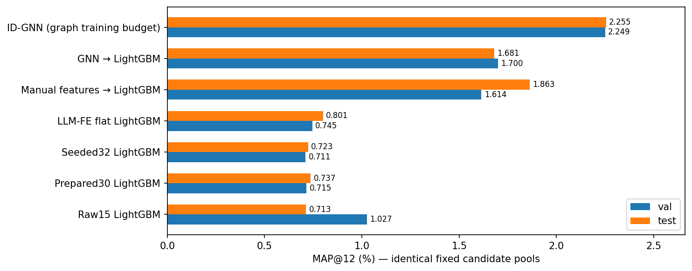
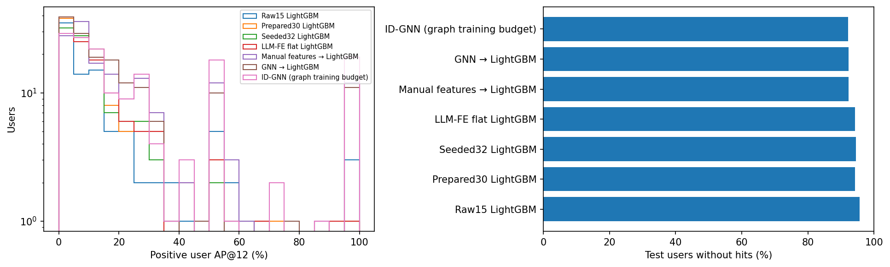
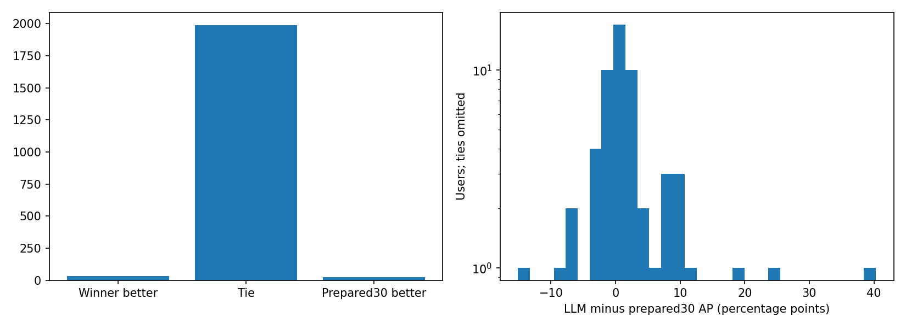
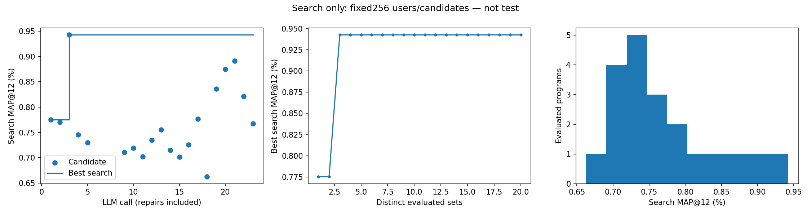
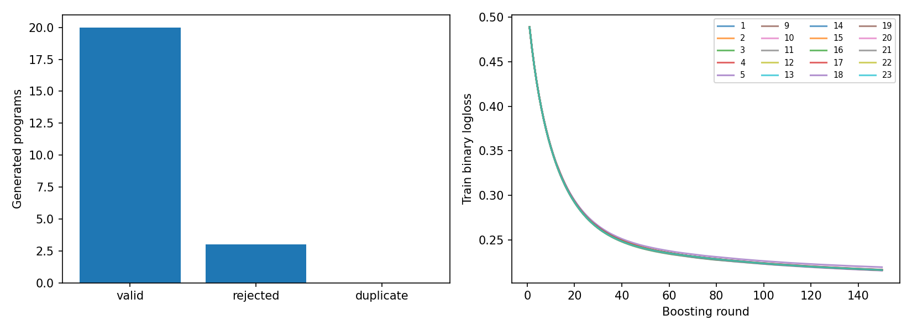
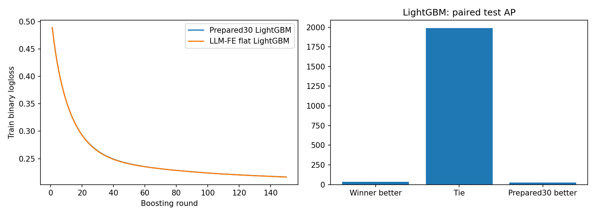

# Llama3.1-8B → Python features → LightGBM: bounded H&M

Flat-table adaptation:15 raw fields+15 human historical aggregates;2 manual seed transforms. Not all features are LLM-generated. All MAP values in percent.
One seed42,180-day selected-cohort history, frozen shared ID-GNN pools.
LightGBM selects features throughout search and confirmation; all new trees use identical803377 training pairs.
Manual and GNN→LightGBM references use those same803377 supervised pairs and these exact evaluation rows/pools.
Tuning protocols, derived seeds and historical representations differ; GNN also used upstream graph training.
Compare pipeline quality on this subset, not differences in isolated feature quality or full-dataset MAP.
Selection uses only search256 + confirmation512; heldout val1024 and test2048 used after freezing.
Native ID-GNN reference used more training data and is contextual, not a matched-budget comparison.
LLM calls23/300; evaluated distinct20/20; target met: True. Raw control selected: False.
All raw/LLM heldout predictions reproduced from saved models in separate CPU processes with1 thread.

| Model | Validation MAP, % | Test MAP, % |
|---|---:|---:|
| Raw15 LightGBM | 1.02687 | 0.71314 |
| Prepared30 LightGBM | 0.71542 | 0.73737 |
| Seeded32 LightGBM | 0.71077 | 0.72335 |
| LLM-FE flat LightGBM | 0.74474 | 0.80095 |
| Manual features → LightGBM | 1.61426 | 1.86288 |
| GNN → LightGBM | 1.69983 | 1.68057 |
| ID-GNN (graph training budget) | 2.24926 | 2.25494 |

Selected program: `candidates/candidate_003/program.py`.

