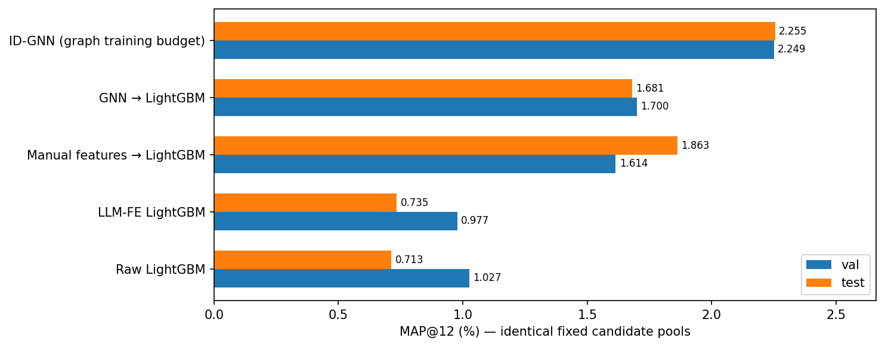
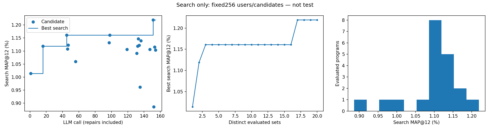
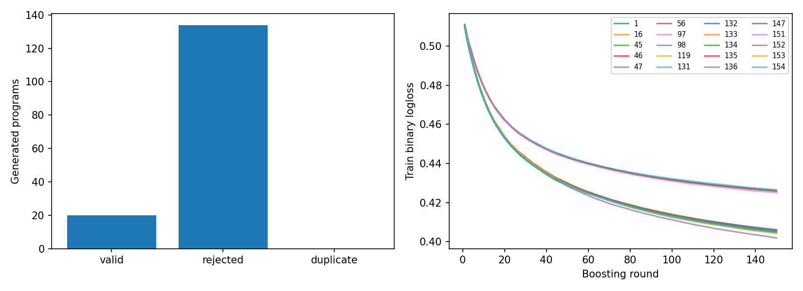

# Аудит H&M Llama v5: завершён, но обнаружена ошибка сопоставления признаков

Источник: features-llama-plus-lightgbm-v3.ipynb. Внутренний протокол — preflight_fulltrain_v5,
интерфейс modify_features(X, history). Это не flat-эксперимент.
Embedded runtimeSHA ноутбука точно совпадают с конфигом архива и локальным evaluator.
Конфиг fingerprint949add5c4fef проверен. Оригинальные ZIP и notebook не изменялись.

20 технически оценённых программ за154 обращения:134 отказа,103 repair calls,51 новых предложений.
132 отказа на preflight,2 синтаксических. LLM generation time9537.4s (~2ч39мин), не полное время запуска.
Все20 сохранённых кандидатов имеют803377 train пар и совпадающие program/model SHA.
Raw и выбранная модель: независимый повтор4 val/test скорингов дал точные top12/AP/MAP.

| Модель | Val MAP@12, % | Test MAP@12, % |
|---|---:|---:|
| Raw LightGBM | 1.02687 | 0.71314 |
| LLM-FE LightGBM | 0.97730 | 0.73457 |
| Manual features → LightGBM | 1.61426 | 1.86288 |
| GNN → LightGBM | 1.69983 | 1.68057 |
| ID-GNN (graph training budget) | 2.24926 | 2.25494 |
| LLM flat (другой проверенный запуск) | 0.74474 | 0.80095 |

## Подтверждённая смысловая ошибка candidate151

F имеет RangeIndex строк0..N-1. Результат history.groupby(article_id) имеет индекс ID товара.
Прямое присваивание Series в F сопоставляет ID товара с НОМЕРОМ строки вместо X.article_id.
Аналогично customer_id ошибочно сопоставляется с номером строки.
Сохранение длины/индекса F не обнаруживает эту ошибку. У выбранной модели28 полей:15raw+13generated.

Проверка128 search пар с одинаковой историей:
- перестановка пар со сбросом технического индекса меняет признаки после обратной перестановки;
- обработка128 строк целиком и двумя блоками64 даёт разные результаты;
- f_article_mean_price отличается от правильного ID-сопоставления у70 из128 пар;
- оба customer-признака отличаются у52 из128 пар; фактический столбец целикомNaN,
  хотя при правильном сопоставлении52 значения должны существовать.

Из20 технически валидных программ этот probe провалили 56, 131, 147, 151.
Остальные не провалили данный ограниченный тест, но это не доказывает полную семантическую корректность.
Ни исправление исходного кода, ни переобучение/выбор другого кандидата по test не выполнялись.

Правильный принцип, иллюстрация (не новая оценённая программа):
```python
mean_price = history_7day.groupby('article_id')['price'].mean()
F['f_article_mean_price'] = X['article_id'].map(mean_price).to_numpy()
```

Итог: численные метрики воспроизводимы, но их нельзя интерпретировать как оценку правильно
сформированных13 исторических признаков. Результат отмечен complete_with_alignment_bug.
Для новой версии необходим контроль соответствия ID, перестановки и разбиения строк до обучения.
В flat host выполняет соединения, а preflight проверяет batch-invariance; у выбранного flat-кода
четыре отношения вычисляются по одной строке, поэтому эта конкретная ошибка отсутствует.

## Сравнение протоколов

| Протокол | Обращения | Технически оценено | Доля успеха | Test MAP, % |
|---|---:|---:|---:|---:|
| X + history v5 |154|20|12.99%|0.73457 (ошибка сопоставления)|
| Flat table |23|20|86.96%|0.80095|

Одинаковыеval1024/test2048 и фиксированные кандидаты; не весь каталог и не полный test.
У flat есть ручные исторические агрегаты и ручной seed; это не чистое сравнение силы LLM.
ID-GNN имеет другой upstream-бюджет. Эти результаты не являются воспроизведением статьи.




