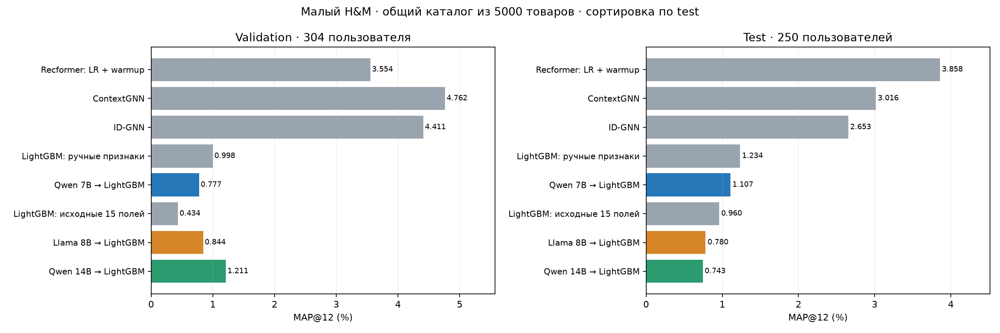
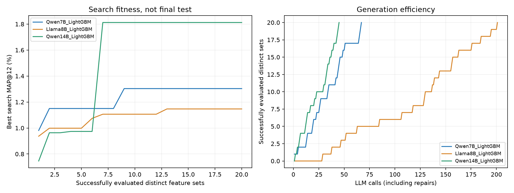
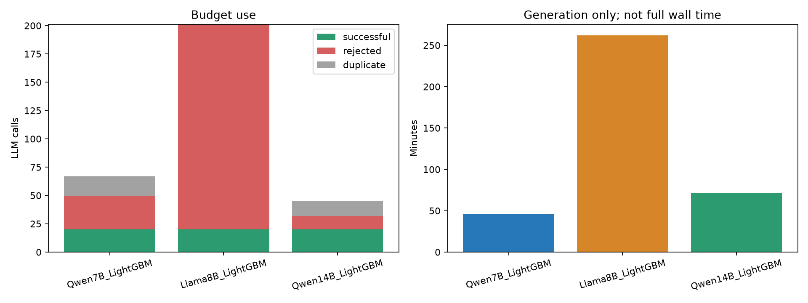
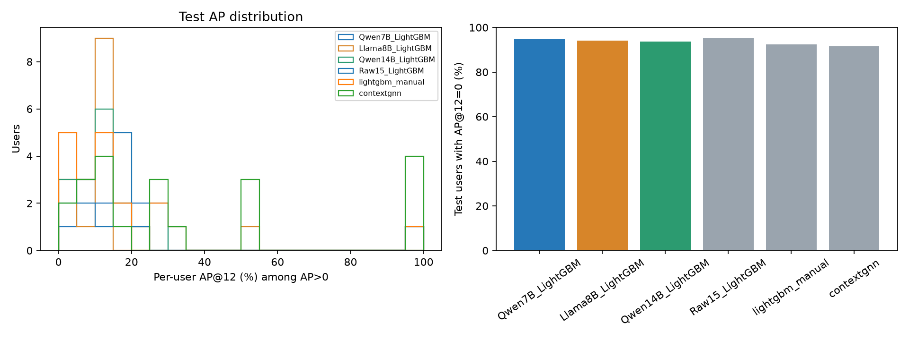
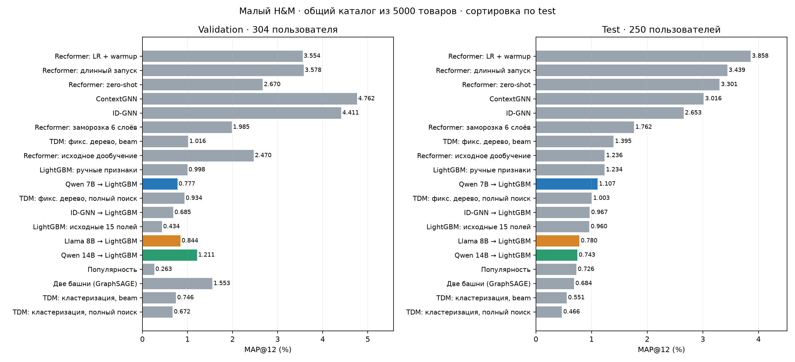

# Qwen7B, Llama8B и Qwen14B: проверенные результаты на малом H&M

Все три LLM завершили поиск20различных оценённых наборов. На test выше Qwen7B; Qwen14B эффективнее по числу вызовов, но выше по test не стала.
Одинаковые72813trainпар,4804user-time/8срезов,raw15,SQL/JSON-интерфейс,LightGBM150/31/4threads,seed42,NF4/FP16.
Search128/confirm88/heldout88; итоговыеval304/test250,все5000товаров. Версии библиотек/GPU и4sharedsourceSHA совпали.
Оба raw-контроля совпали по моделям и всем прогнозам. Все60 оценённых программ/моделей проверены поSHA/схеме/метрикам.
Четыре frozen модели (raw+3LLM) независимо пересчитаны отдельными CPU-процессами: val/test top12/AP/MAP совпали точно.
Нового обучения,генерацииLLM или выбора поtest при аудите не было; исходныеZIP сохранены.

| Модель | Validation MAP,% | Test MAP,% |
|---|---:|---:|
| Raw15_LightGBM | 0.43442 | 0.95963 |
| Qwen7B_LightGBM | 0.77718 | 1.10714 |
| Llama8B_LightGBM | 0.84396 | 0.78034 |
| Qwen14B_LightGBM | 1.21121 | 0.74331 |
| contextgnn | 4.76193 | 3.01558 |
| idgnn | 4.41072 | 2.65341 |
| lightgbm_idgnn | 0.68531 | 0.96667 |
| lightgbm_manual | 0.99832 | 1.23388 |
| recformer_finetuned | 2.47022 | 1.23556 |
| recformer_zero_shot | 2.66996 | 3.30054 |
| two_tower | 1.55256 | 0.68368 |
| Recformer_LR_warmup | 3.55434 | 3.85751 |
| Recformer_freeze6_trained | 1.98481 | 1.76156 |
| Recformer_long_selected | 3.57807 | 3.43889 |
| TDM_fixed_beam | 1.01601 | 1.39519 |
| TDM_fixed_full | 0.93415 | 1.00292 |
| TDM_cluster_beam | 0.74588 | 0.55126 |
| TDM_cluster_full | 0.67246 | 0.46639 |
| popularity | 0.26256 | 0.72645 |

| LLM | Вызовы | Успех | Ошибка | Дубликат | Генерация,мин |
|---|---:|---:|---:|---:|---:|
| Qwen7B_LightGBM | 67 | 20 | 30 | 17 | 46.4 |
| Llama8B_LightGBM | 201 | 20 | 181 | 0 | 262.1 |
| Qwen14B_LightGBM | 45 | 20 | 12 | 13 | 71.6 |

Генерация — сумма сохранённых секунд generate(), без загрузкиLLM/деревьев/оценки. Это не полное время запуска.

## Что выбрано

- Qwen7B candidate005:6агрегатов+5формул. Есть статистики категорий и customer×department; названия discount относятся к price, а не к наблюдаемой скидке.
- Llama8B candidate144:9агрегатов+5формул, все агрегаты по customer_id. f_article_popularity фактически отношение разнообразия покупок клиента; f_temporal_change_rate сравнивает mode с mode−1 и равнаtrue для непустого mode.
- Qwen14B candidate014:13агрегатов+5формул, все по customer_id. Нет исторической популярности конкретного товара или customer×article/category агрегатов; min/max(days_ago) вычисляются корректно, но названия first/last перепутаны.
Это ограничения содержания выбранных признаков, не обнаруженная прежняя ошибка Pandas-сопоставления. Raw item поля присутствуют у всех; деревья могут строить взаимодействия с ними.
Связь отсутствия candidate-specific агрегатов с худшим test правдоподобна, но причинно отдельным опытом не проверена.

## Неопределённость и границы сравнения

Один seed,250test пользователей; парный bootstrap10k,seed42 является разведочной оценкой по пользователям, не многосидовой оценкой и не исправлен за множественные сравнения.
Общийval304 включает search/confirmation. heldout88 не использовался LLM-отбором, но был частью исходного отбора baseline.
Разные методы имеют разные бюджеты graph training/tuning/pretraining. Метрики малого каталога не сравниваются с полным H&M или статьёй.
Точечный порядок test не доказывает устойчивого превосходства моделей; интервалы см. paired_test_bootstrap.csv.

| Разность test | п.п. | 95% парный bootstrap,п.п. |
|---|---:|---|
| Qwen7B_LightGBM − Llama8B_LightGBM | +0.3268 | [-0.1506;+0.9088] |
| Qwen7B_LightGBM − Qwen14B_LightGBM | +0.3638 | [-0.2367;+1.2148] |
| Llama8B_LightGBM − Qwen14B_LightGBM | +0.0370 | [-0.3524;+0.4741] |

Программы победителей:
- [Qwen7B](exports/qwen_llama/qwen/candidates/candidate_005/program.json)
- [Llama8B](exports/qwen_llama/llama/candidates/candidate_144/program.json)
- [Qwen14B](exports/qwen14b/qwen14b/candidates/candidate_014/program.json)