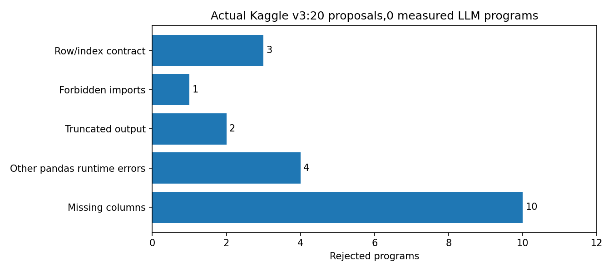

# Аудит реального Kaggle-запуска Llama v3

Это аудит предоставленных артефактов, без нового обучения и без изменения программLLM.
Версия: hm_llmfe_llama31_8b_lightgbm_fulltrain_v3.20 предложений,0 успешно оценённых, исправлений вv3 нет.
Хеши worker/runtime из вложенного.ipynb точно совпали сrun_config.json.
Все отклонения сохранены; ни одна LLM-модельLightGBM не получила searchMAP.
Выбран raw_control. Строка LLM-FE в исходном отчёте повторяет rawMAP и не является результатомLLM-признаков.

| Причина | Число |
|---|---:|
| missing_column | 10 |
| other_pandas_runtime | 4 |
| truncated | 2 |
| interface_import | 1 |
| row_index | 3 |

Время20 попыток: 39.7минут; включаетгенерацию/проверку.

| Попытка | Популяция | Причина | Токены |
|---|---:|---|---:|
| 1 | 0 | KeyError: 'article_id' | 1169 |
| 2 | 0 | KeyError: "['past_purchases'] not in index" | 1899 |
| 3 | 0 | ValueError: Length mismatch: Expected axis has 3 elements, new values have 2 elements | 686 |
| 4 | 1 | ValueError: cannot insert customer_id, already exists | 939 |
| 5 | 1 | KeyError: 'Column not found: price_history' | 795 |
| 6 | 1 | KeyError: "['f_avg_price', 'f_prod_cat', 'f_dept_purchases', 'f_avg_time_between_purchases', 'f_sales_channels', 'f_prod_cat_ratio', 'f_avg_age', 'f_avg_articles_purchased', 'f_dept_proportion', 'f_avg_price_diff', 'f_sales_channels_diff'] not in index" | 1606 |
| 7 | 2 | KeyError: 'days_ago' | 1002 |
| 8 | 2 | Program truncated at output token limit | 2048 |
| 9 | 2 | KeyError: 'Column not found: raw_u_age' | 871 |
| 10 | 2 | No imports/classes/global state/context managers: pd and np are already supplied | 1306 |
| 11 | 2 | ValueError: Return a DataFrame with unchanged X.index and one row per pair | 1750 |
| 12 | 2 | ValueError: cannot reindex on an axis with duplicate labels | 806 |
| 13 | 1 | KeyError: 'raw_i_product_type_no' | 955 |
| 14 | 1 | ValueError: Buffer dtype mismatch, expected 'Python object' but got 'long' | 923 |
| 15 | 1 | KeyError: 'Column not found: days_ago' | 1609 |
| 16 | 0 | KeyError: 'article_id' | 690 |
| 17 | 0 | ValueError: Return a DataFrame with unchanged X.index and one row per pair | 1504 |
| 18 | 0 | IndexError: single positional indexer is out-of-bounds | 1102 |
| 19 | 0 | KeyError: 'Column not found: raw_i_product_type_no' | 626 |
| 20 | 0 | Program truncated at output token limit | 2048 |

## Проверенные примеры

candidate001: history.merge(X,on=customer_id) создаёт article_id_x/article_id_y; последующий groupby(article_id) падает.
До этого агрегаты присоединяются слева кX, а не Xслева кагрегату: возможны неверныепорядок/числострок.
candidate002: past_purchases запрашивается изrecent_transactions, хотя втом столбцы customer_id/article_id/price; также возвращаются имена безf_.
candidate003: groupby().rolling().reset_index() дал3колонки, а код переименовывает ихдвумя именами. rolling(7) —7строк, не7дней.
candidate003 также обращается кraw_u_* вhistory, хотя тамcustomer_age; позже использует отсутствующий X.price.

## Выводы для нового ноутбука

Ясно отделитьX отhistory, показать реальныеexamples обоих, сократить генерации до2–6признаков.
Указать сохранениеX.index/однойстрокинапару, many_to_one merge, именаf_, отсутствиеraw_u_*вhistory.
Проверять программу на небольших реальных временных снимках перед803377-парным обучением.
ВозвращатьLLM короткую ошибку с конкретной строкой еёкода и доступнымистолбцами.
Исправить отчёт: rawfallback не подписывать какLLM-признаки.
Эти изменения улучшаютконтракт/диагностику; они не доказываютуспехгенераций без новогофактическогозапуска.