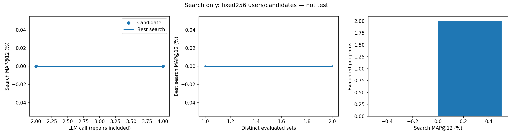
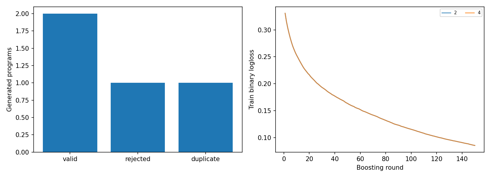

# Search progress

LLM calls: 4/8; evaluated distinct: 2/2; repair calls: 2.
Search validation only; no final test results yet.

| Call | Proposal | Island | Repair | Parent call | Status | MAP@12, % |
|---|---:|---:|---:|---:|---|---:|
| 1 | 1 | 0 | 0 | — | rejected | — |
| 2 | 1 | 0 | 1 | 1 | valid | 0.00000 |
| 3 | 2 | 0 | 0 | — | duplicate | — |
| 4 | 2 | 0 | 1 | 3 | valid | 0.00000 |

