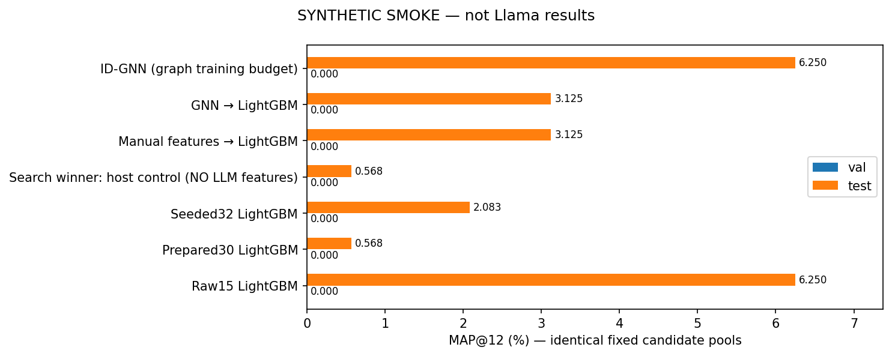
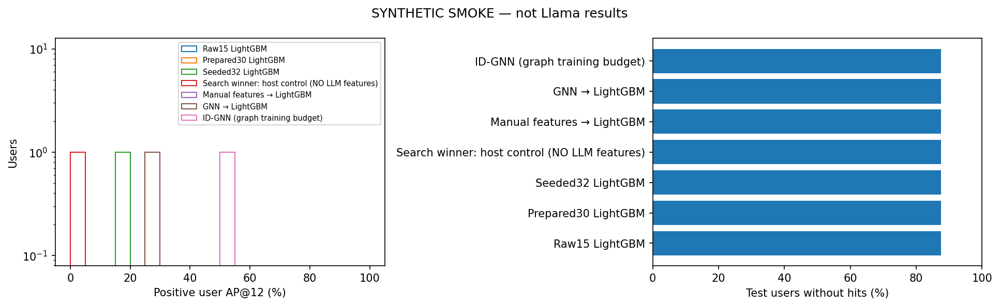
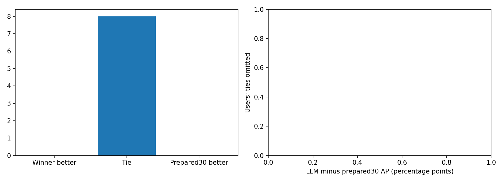
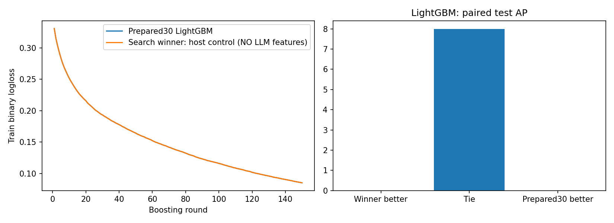

# SYNTHETIC SMOKE — not Llama results

RAW CONTROL SELECTED: the search-winner row contains NO LLM features. Do not report its MAP as the quality of LLM-generated features.
This report tests software using a synthetic generator and tiny data. No real Llama inference or quality experiment.

# Llama3.1-8B → Python features → LightGBM: bounded H&M

Flat-table adaptation:15 raw fields+15 human historical aggregates;2 manual seed transforms. Not all features are LLM-generated. All MAP values in percent.
One seed42,180-day selected-cohort history, frozen shared ID-GNN pools.
LightGBM selects features throughout search and confirmation; all new trees use identical803377 training pairs.
Manual and GNN→LightGBM references use those same803377 supervised pairs and these exact evaluation rows/pools.
Tuning protocols, derived seeds and historical representations differ; GNN also used upstream graph training.
Compare pipeline quality on this subset, not differences in isolated feature quality or full-dataset MAP.
Selection uses only search256 + confirmation512; heldout val1024 and test2048 used after freezing.
Native ID-GNN reference used more training data and is contextual, not a matched-budget comparison.
LLM calls4/8; evaluated distinct2/2; target met: True. Raw control selected: True.
All raw/LLM heldout predictions reproduced from saved models in separate CPU processes with1 thread.

| Model | Validation MAP, % | Test MAP, % |
|---|---:|---:|
| Raw15 LightGBM | 0.00000 | 6.25000 |
| Prepared30 LightGBM | 0.00000 | 0.56818 |
| Seeded32 LightGBM | 0.00000 | 2.08333 |
| Search winner: host control (NO LLM features) | 0.00000 | 0.56818 |
| Manual features → LightGBM | 0.00000 | 3.12500 |
| GNN → LightGBM | 0.00000 | 3.12500 |
| ID-GNN (graph training budget) | 0.00000 | 6.25000 |

Selected program: `raw_control/program.py`.

