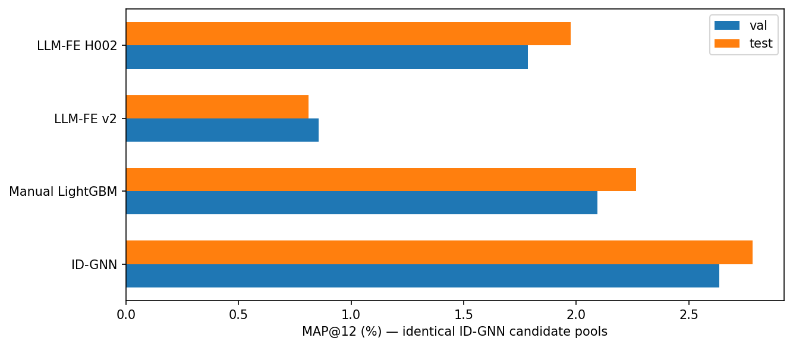
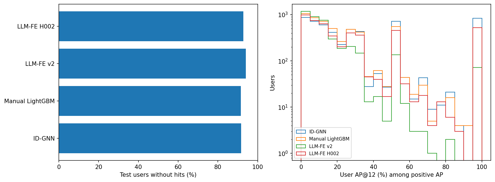
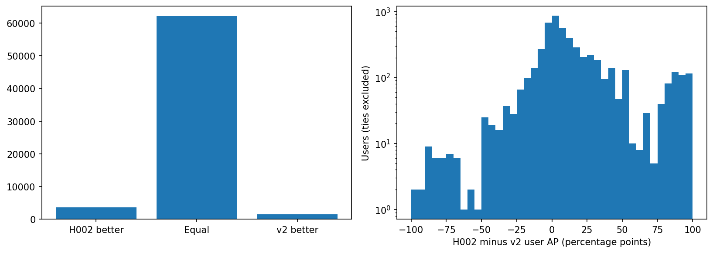
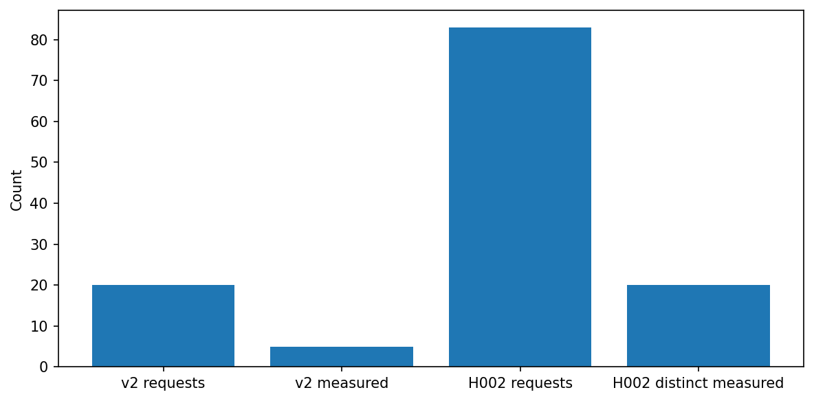
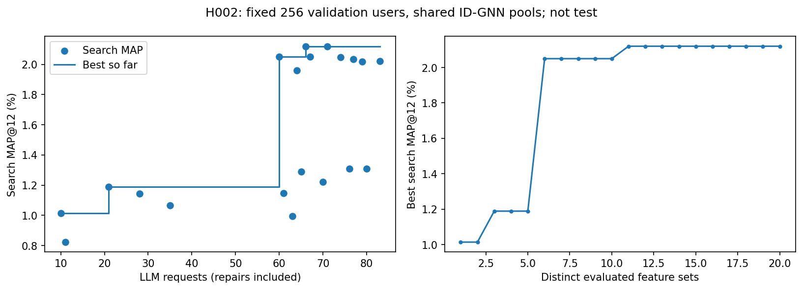
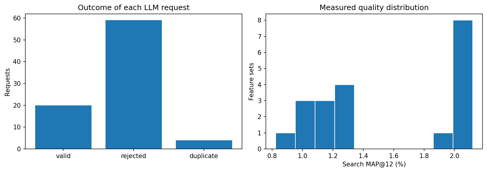
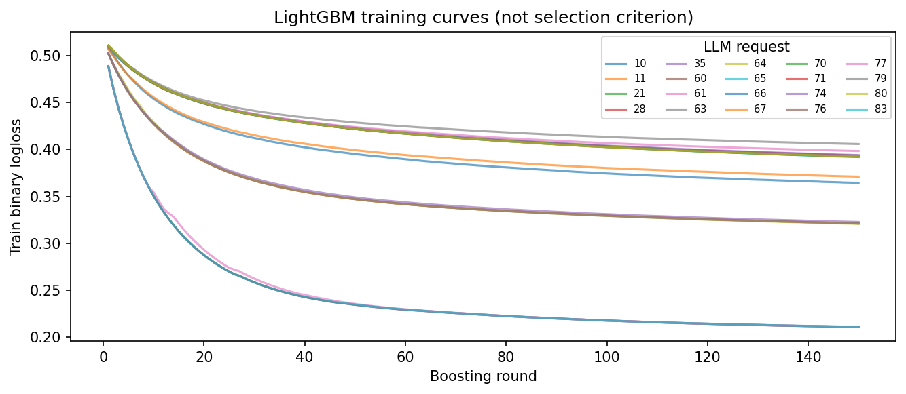

# H002: repair loop and separate successful-set budget

Проверенная итоговая оценка на общих кандидатах ID-GNN. Один seed42.

| Модель | Validation MAP, % | Test MAP, % |
|---|---:|---:|
| ID-GNN | 2.63442 | 2.78432 |
| Manual LightGBM | 2.09318 | 2.26608 |
| LLM-FE v2 | 0.85428 | 0.81175 |
| LLM-FE H002 | 1.78605 | 1.97540 |

Различных оценённых наборов: 20/20; запросов: 83/100; исправлений: 45.
Независимый полный повтор val/test из сохранённой модели на 2 потоках воспроизвёл top12 и MAP.
Поиск256 и confirmation1024 используют непересекающиеся validation строки и сохранённые пулы ID-GNN.
Test использован только после фиксации выбранной программы. Старый полный каталог остаётся приостановленным.
H002 проверяет пакет изменений: бюджет, исправления LLM, уточнение prompt, исправление валидатора и меньший пул поиска.
Причину изменения качества нельзя приписывать только исправлениям: старый search использовал весь каталог.
Контроль v2 уже оценён на test до планирования H002: это следующий исследовательский эксперимент, не нетронутый test holdout.
Те же803377 train пар; LightGBM150 rounds31 leaves, все seeds42; обучение8 потоков вместо2.
Изменения только программ признаков делает LLM; ручные исторические признаки не добавлялись.

Выбранная программа: `/mnt/c/Users/Мишаня/ml/projs/tbank/Features/LLMFeatures/results/qwen25coder7b_seed42_h002_shared_v1/candidates/candidate_060/program.json`.

