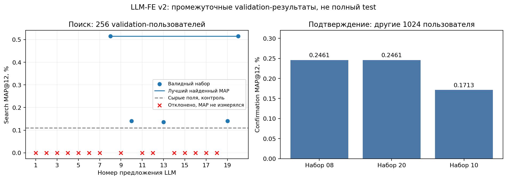
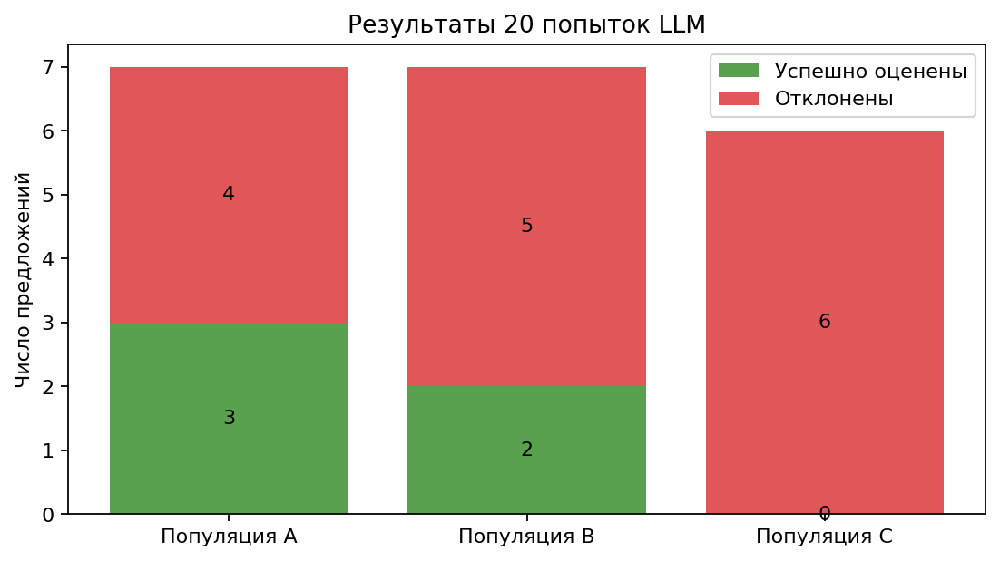
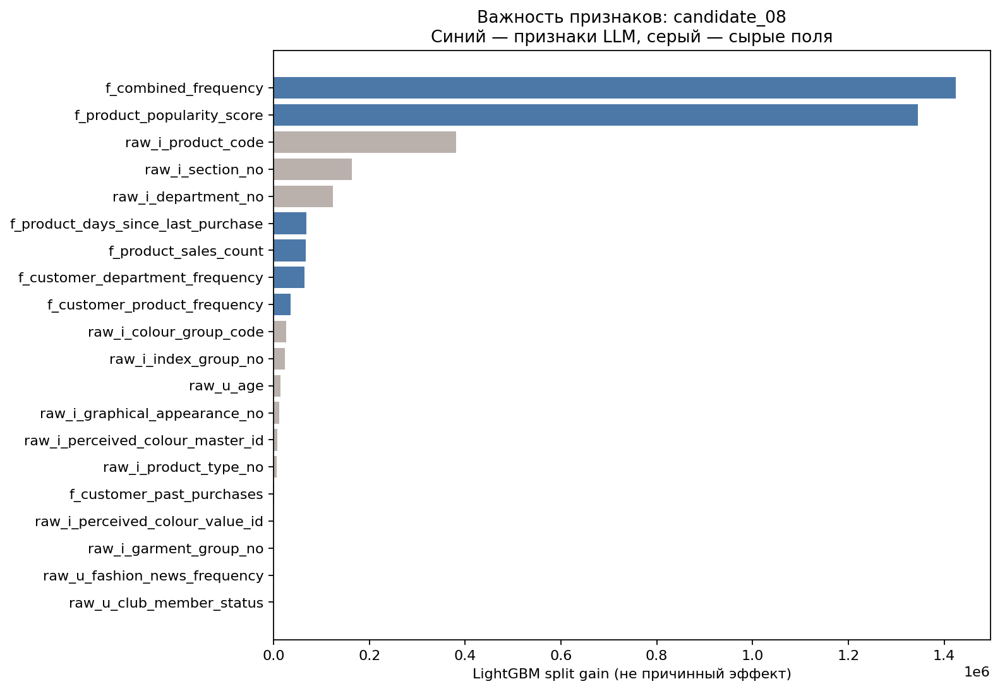
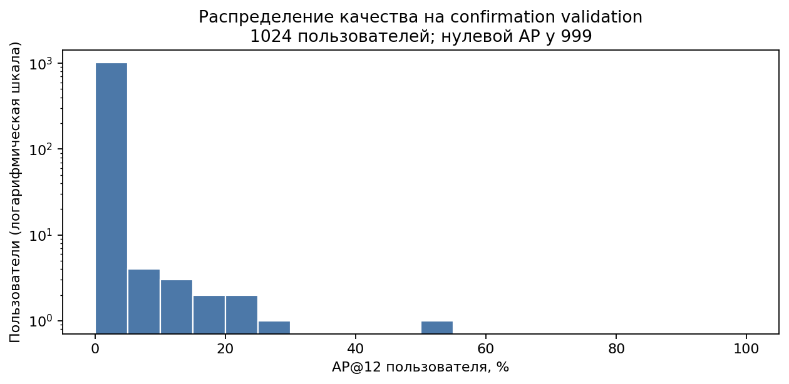

# Ход поиска признаков LLM-FE v2

Промежуточные validation-результаты. Полная каталожная оценка приостановлена пользователем. Оценка на общих кандидатах — [отдельный отчёт](../shared_idgnn/report.md).

Кривые loss по итерациям LightGBM текущий запуск не сохранял.

Обновить: `RelBenchGNN/.venv-wsl/bin/python LLMFeatures/plot_progress.py`.
