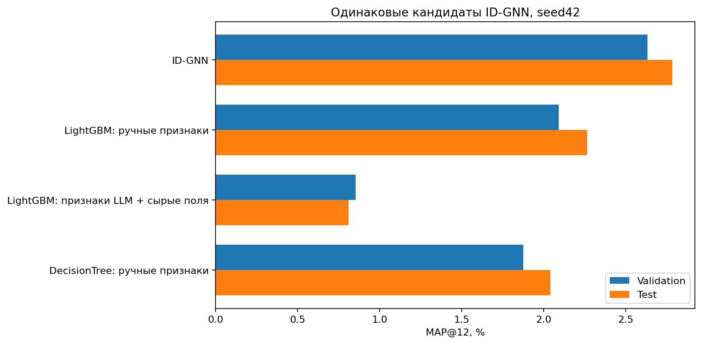
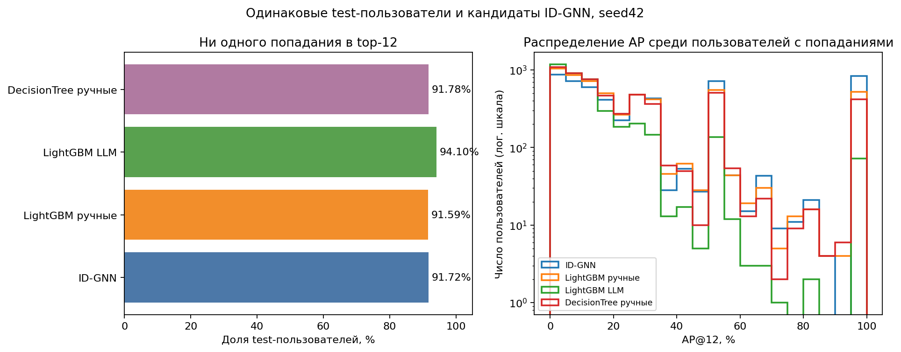
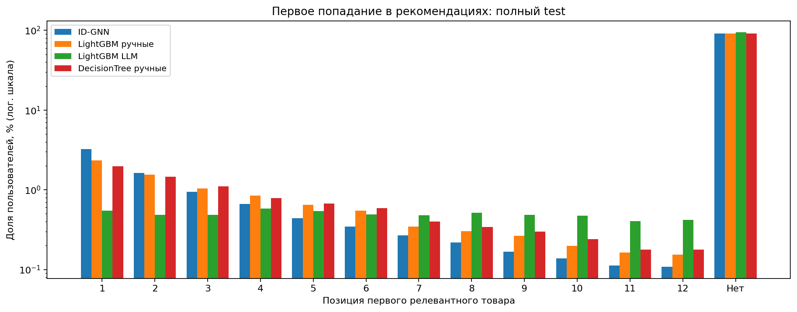
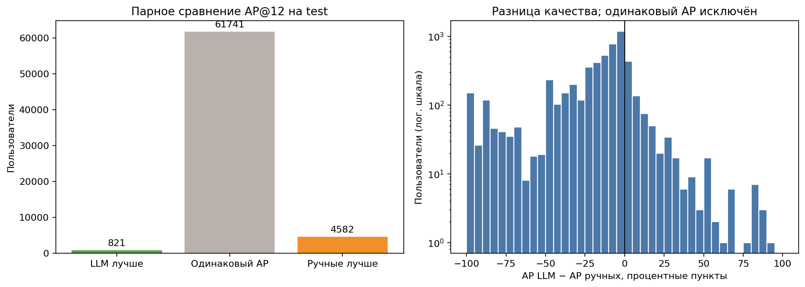

# LLM-FE: оценка на общих кандидатах ID-GNN

Проверенная полная оценка этого протокола: все validation/test пользователи, seed42.
Полная каталожная оценка приостановлена пользователем; её неполные результаты сюда не включены.

| Модель | Validation MAP@12, % | Test MAP@12, % |
|---|---:|---:|
| ID-GNN | 2.63442 | 2.78432 |
| LightGBM: ручные признаки | 2.09318 | 2.26608 |
| LightGBM: признаки LLM + сырые поля | 0.85428 | 0.81175 |
| DecisionTree: ручные признаки | 1.87661 | 2.04076 |

Validation: 74,575 пользователей / 2,088,583 пар.
Test: 67,144 пользователей / 1,892,405 пар.
Кандидаты и порядок пользователей точно совпадают с сохранённым инференсом ID-GNN seed42.
Полный независимый повтор из сохранённой модели на 2 CPU-потоках воспроизвёл все top-12 и MAP.
Обучение/поиск не повторялись. Выбран прежний candidate08 до чтения test-результатов.
LLM-LightGBM и ручной LightGBM используют те же 803,377 train пар / 50,000 user-times; ID-GNN обучалась с большим бюджетом.
Протоколы подбора и производные seeds LightGBM различаются: это сопоставление конвейеров, не строго изолированный эффект признаков.
LLM-признаки включают сырые статические поля; ручные агрегаты и GNN-представления не используются.
При равных scores LightGBM использует article_id ascending. Показан один seed, без оценки устойчивости.

## Гистограммы и сравнение по пользователям

Исходные AP по пользователям: test_user_ap.csv. Средние AP проверены на совпадение с итоговыми MAP.
