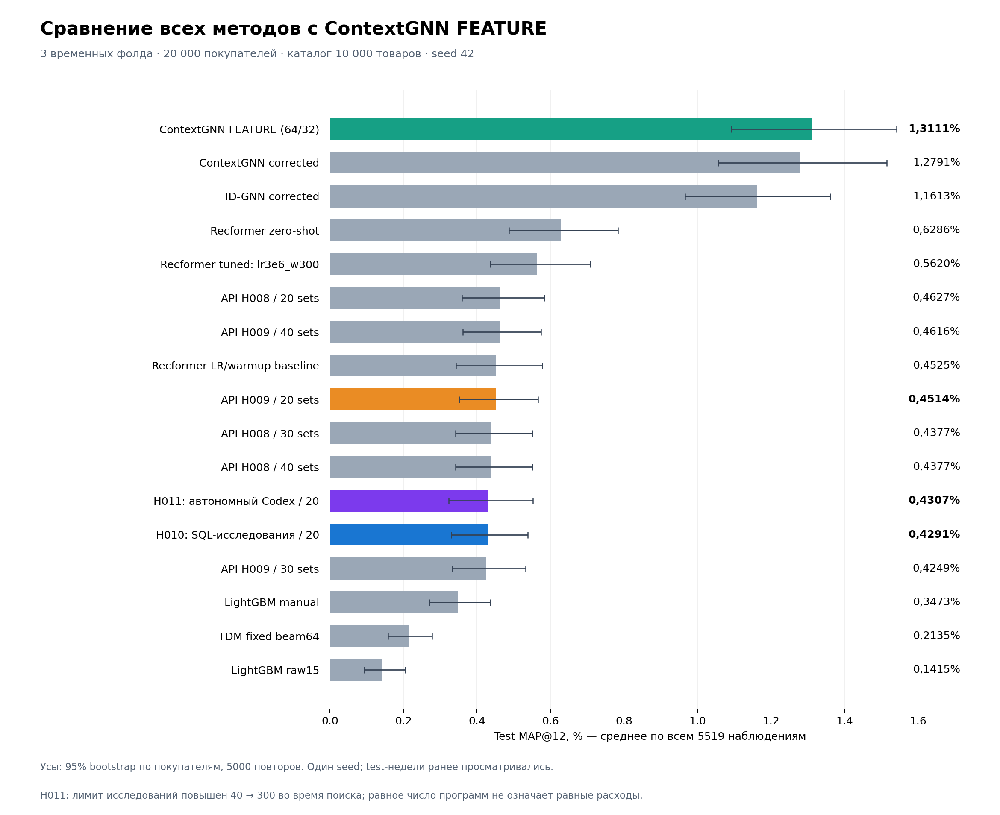

# Все методы и ContextGNN FEATURE

FEATURE добавлен к прежним 16 строкам после test-инференса фиксированных checkpoint. Все остальные значения и интервалы сохранены. Исходный график не изменён. Обучения, переотбора эпох или API-запросов не было.

FEATURE test MAP@12: **1.3111%**, 95% интервал [1.0913%; 1.5411%]. Фолды: 1.3933% / 1.1091% / 1.4577%.

Те же 5519 наблюдений / 4548 покупателей, три medium-v2 недели, каталог10000. MAP по всем исходным целям, включая недоступные среди кандидатов. Интервал — 5000 bootstrap по исходным покупателям, seed42. Один seed, эти test-недели уже просматривались: внутреннее сравнение.

FEATURE: fanout64/32, восемь categorical-кодов, без lookup ID-компоненты RHS, исходный CE без дополнительного global loss; выбранные ранее validation checkpoint. Строка прежнего ContextGNN corrected сохранена, её параметры отличаются от FEATURE также fanout и типами кодов; это не чистая парная FEATURE/FUSION абляция.

H011: бюджет исследований вырос40→300 во время поиска; равное число программ не означает равные расходы. Все прежние ограничения сравнения сохраняются.

Проверки reload, перестановки top12 и чувствительность AP — verification.json каждого фолда.

График проверен визуально; 17 строк. Исходные файлы и результаты 16 методов не изменились. Повторный инференс: перестановки top-12 в 0 строках; максимальное изменение пользовательского AP=0.
