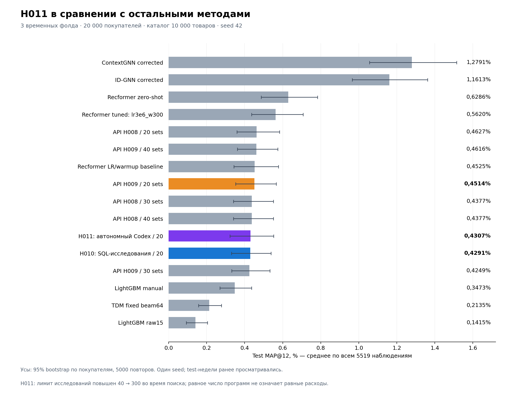
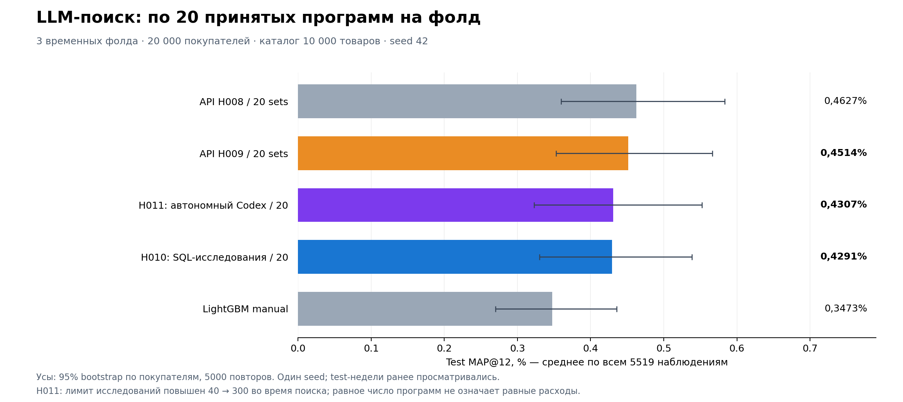

# Сравнение методов с H010 и H011

Одинаковые три medium-v2 фолда, каталог и исходные test-цели. Pooled MAP взвешен по1839/1982/1698 наблюдениям.

| Метод | Test MAP@12 | Фолд0 | Фолд1 | Фолд2 |
|---|---:|---:|---:|---:|
|ContextGNN corrected|1.2791%|1.5325%|1.1048%|1.2081%|
|ID-GNN corrected|1.1613%|1.4695%|0.8939%|1.1395%|
|Recformer zero-shot|0.6286%|0.8613%|0.4664%|0.5660%|
|Recformer tuned: lr3e6_w300|0.5620%|0.5861%|0.4450%|0.6724%|
|API H008 / 20 sets|0.4627%|0.5226%|0.4439%|0.4198%|
|API H009 / 40 sets|0.4616%|0.4641%|0.3867%|0.5465%|
|Recformer LR/warmup baseline|0.4525%|0.4928%|0.3784%|0.4953%|
|API H009 / 20 sets|0.4514%|0.4641%|0.3867%|0.5134%|
|API H008 / 30 sets|0.4377%|0.4476%|0.4439%|0.4198%|
|API H008 / 40 sets|0.4377%|0.4476%|0.4439%|0.4198%|
|H011: автономный Codex / 20|0.4307%|0.1952%|0.6795%|0.3955%|
|H010: SQL-исследования / 20|0.4291%|0.4207%|0.3324%|0.5509%|
|API H009 / 30 sets|0.4249%|0.4641%|0.3867%|0.4272%|
|LightGBM manual|0.3473%|0.2506%|0.4128%|0.3755%|
|TDM fixed beam64|0.2135%|0.1953%|0.1596%|0.2962%|
|LightGBM raw15|0.1415%|0.1972%|0.1266%|0.0985%|

Усы: ранее рассчитанные95% customer-bootstrap интервалы,5000 повторов,seed42; это неопределённость для фиксированных моделей и недель, не разброс повторных обучений. Один seed, test-недели уже просматривались. Бюджеты20/30/40 — продолжения поисков, не независимые повторы. H011 продолжен после увеличения исследовательского бюджета40→300 на первом фолде. Равенство числа программ не означает равенство токенов, вычислений или инструкций. Новые ContextGNN validation-only опыты не включены в test-сравнение. Ограничение численного replay ContextGNN fold2 описано в исходном final_comparison/report.md.

Источники и ихSHA256: comparison.json. Таблица: summary.csv. Новых обучений и API-запросов не было.
