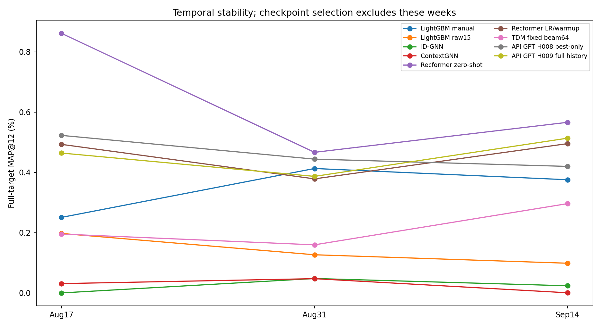
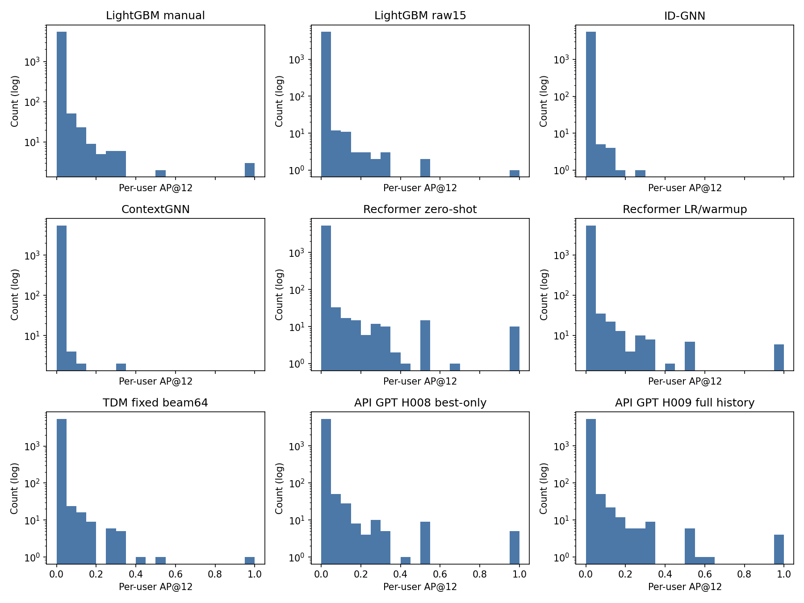
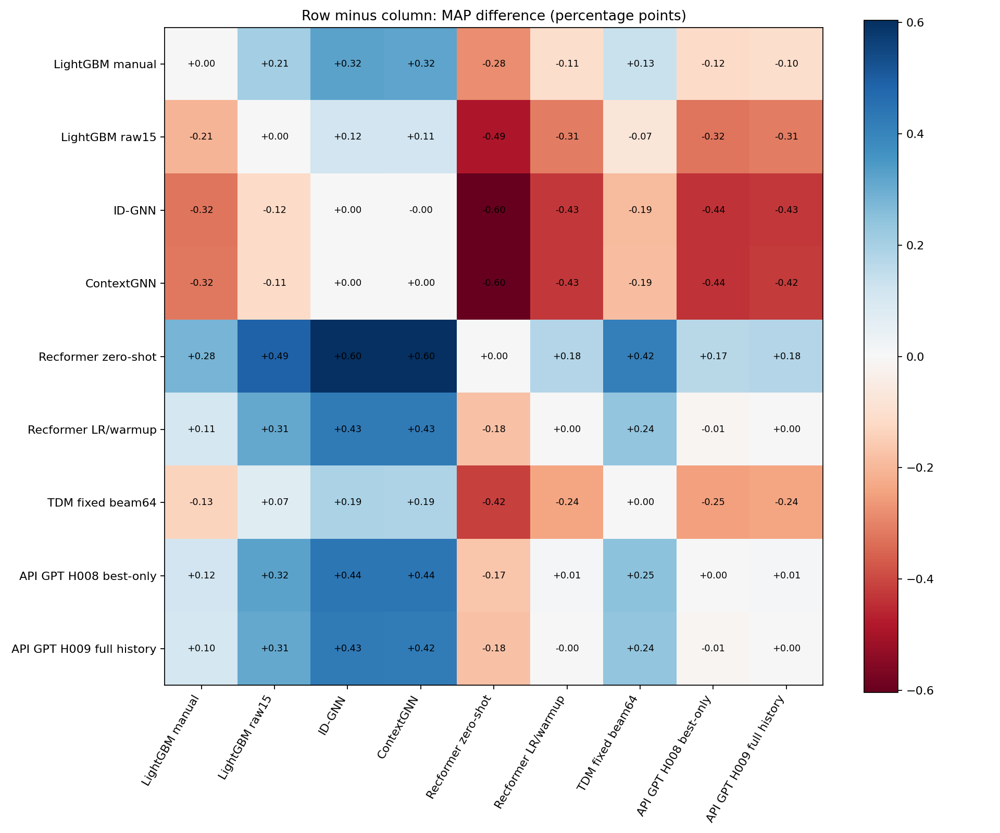

> Исправление 2026-10-18: результаты ContextGNN и ID-GNN в этом историческом отчёте невалидны из-за ошибки единиц timestamp при validation/test. См. ../../CVFollowup/GNN_TIMEFIX_PROTOCOL.md. Остальные цифры этим аудитом не опровергнуты.

# Nine methods on larger H&M: temporal cross-validation

20000 customers,10000 eligible items,5519 outer user-times across3 weeks; one model seed42.
All original positives/users remain in primary MAP, including purchases outside the eligible catalog.
All selections finished before outer scoring. Every trained model was reloaded and checked; API message histories audited.

| Method | Fold0 MAP,% | Fold1 | Fold2 | Equal-fold mean | Pooled MAP,% | Customer95% CI | Catalog-conditional MAP,% |
|---|---:|---:|---:|---:|---:|---|---:|
|Recformer zero-shot|0.8613|0.4664|0.5660|0.6312|0.6286|[0.4869,0.7855]|1.5645|
|API GPT H008 best-only|0.5226|0.4439|0.4198|0.4621|0.4627|[0.3595,0.5814]|1.2283|
|Recformer LR/warmup|0.4928|0.3784|0.4953|0.4555|0.4525|[0.3439,0.5732]|1.0772|
|API GPT H009 full history|0.4641|0.3867|0.5134|0.4547|0.4514|[0.3533,0.5614]|1.2289|
|LightGBM manual|0.2506|0.4128|0.3755|0.3463|0.3473|[0.2690,0.4371]|1.0349|
|TDM fixed beam64|0.1953|0.1596|0.2962|0.2170|0.2135|[0.1573,0.2781]|0.6040|
|LightGBM raw15|0.1972|0.1266|0.0985|0.1408|0.1415|[0.0930,0.2012]|0.4624|
|ContextGNN|0.0309|0.0473|0.0005|0.0262|0.0274|[0.0112,0.0486]|0.0648|
|ID-GNN|0.0000|0.0478|0.0237|0.0238|0.0245|[0.0107,0.0408]|0.0701|

Intervals resample original customers jointly across folds. They do not quantify training-seed variability or performance on unseen time regimes.

## Confidence interval calculation

The intervals use a paired customer-cluster percentile bootstrap of the frozen
**outer-test predictions**, with no validation observations or model refitting.
There are 5,519 customer-week observations belonging to 4,548 unique customers.
For each replicate, draw 4,548 customers uniformly with replacement, carrying
all observed test weeks of each customer together and repeating them with the
customer's sampling multiplicity. Use the identical draw for every method.
Compute each method's pooled MAP@12 as the sum of included AP@12 values divided
by the number of included customer-week observations. That denominator may
vary between replicates; this is not an equal-fold mean or a mean of customer means.

For a comparison A minus B, subtract the two MAP values within each replicate.
Use 5,000 replicates and take the 2.5th and 97.5th percentiles of these paired
differences with `numpy.quantile(..., [0.025, 0.975])`. Individual-method intervals
use the same percentiles of that method's bootstrap MAP values.
The RNG is `numpy.random.default_rng(42)`; the exact draw order is retained in
[CVBenchmark/report.py](../../CVBenchmark/report.py).

For H008 minus manual features, the observed difference is +0.1154 percentage
points and the 95% interval is [-0.0089, +0.2434] percentage points. The interval
crosses zero despite H008's positive difference on all three original folds.
The CSV stores this pair in the reverse direction, manual minus H008; reversing
the direction negates the estimate and transforms the bounds to `[-upper, -lower]`.

Models and feature selections remain fixed during resampling. These intervals
condition on the fitted models and observed weeks; they do not capture full
training-seed, repeated feature-search or future-time variation. Bootstrap
intervals are separate from the exploratory sign-flip p-values and Holm correction.
See the [Russian step-by-step explanation](summary_ru.md#как-рассчитаны-95-интервалы).

All36 pair differences, individual-fold differences and exploratory Holm-adjusted sign-flip p-values are in paired_differences.csv.
A positive average alone is insufficient to label an idea good. Assess magnitude, consistency across3 folds, intervals, runtime and API cost together.
Tests were inspected in earlier project iterations, although these customers were excluded from the old small cohort; this is internal comparison, not a fresh external benchmark.
Requested API model name is gpt-6.1-sol; provider implementation/identity cannot be independently attested.
All six selected API programs and their configuration/provenance are retained in selected_programs/. Constant-control selections, if any, are flagged in api_usage.csv.
costs.csv records native training/search timers. Setup boundaries differ; zero-shot external pretraining and item encoding are excluded. This is not a standardized speed benchmark.

[Protocol](../../CVBenchmark/PROTOCOL.md) · [Fold metrics](fold_metrics.csv) · [API usage](api_usage.csv)

[Russian summary](summary_ru.md) · [Review notes and timing limitations](review_notes_ru.md) · [Final visual/checkpoint review](final_visual_review.json)
