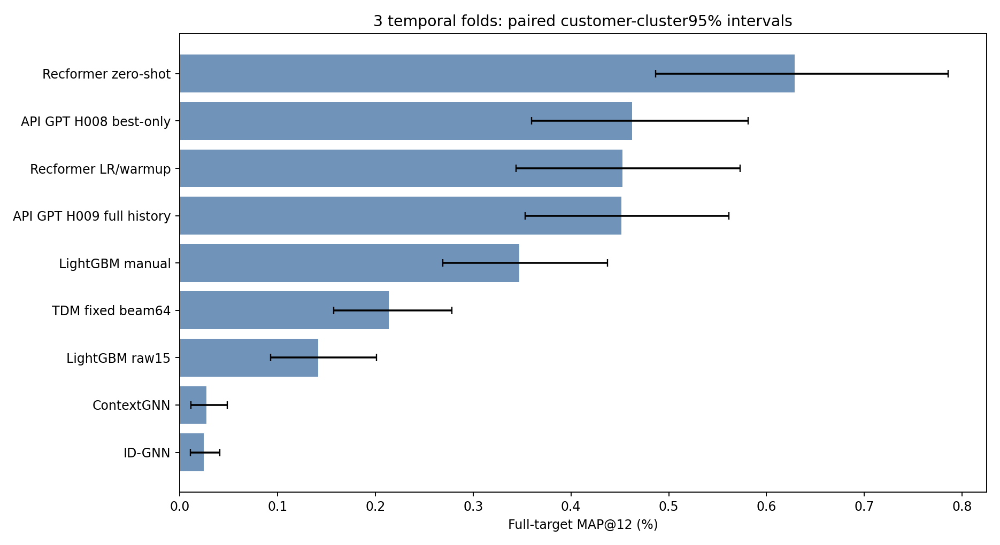

# Итоги сравнения девяти методов

Завершено 18 октября 2026 года. Все 27 оценок (9 методов × 3 временных фолда)
прошли проверки. Обучение и выбор признаков закончились до тестового скоринга;
45 сохранённых контрольных сумм выбранных программ/моделей не изменились.
Четыре итоговых графика просмотрены. Нового обучения после просмотра тестовых
результатов не проводилось.

Основная оценка — MAP@12 по всем 5 519 случаям «покупатель — тестовая неделя».
Реальные покупки вне каталога остаются в знаменателях. Это результат для
фиксированных 20 000 покупателей и каталога 10 000 товаров, не для всего H&M.

| Метод | Общая MAP@12, % | 95% интервал по покупателям, % |
|---|---:|---:|
| Recformer zero-shot | 0,6286 | 0,4869–0,7855 |
| API GPT H008, лучший вариант своей популяции | 0,4627 | 0,3595–0,5814 |
| Recformer LR/warmup | 0,4525 | 0,3439–0,5732 |
| API GPT H009, полная история своей популяции | 0,4514 | 0,3533–0,5614 |
| LightGBM с ручными признаками | 0,3473 | 0,2690–0,4371 |
| TDM fixed beam64 | 0,2135 | 0,1573–0,2781 |
| LightGBM raw15 | 0,1415 | 0,0930–0,2012 |
| ContextGNN | 0,0274 | 0,0112–0,0486 |
| ID-GNN | 0,0245 | 0,0107–0,0408 |

Самое высокое среднее у Recformer zero-shot. Он обошёл свою дообученную версию
на всех трёх неделях. Однако его парный 95% интервал разницы с H008 включает
ноль: одних этих результатов недостаточно для уверенного превосходства над H008.

H008 обошёл ручные признаки на всех трёх фолдах, но парный 95% интервал разницы
тоже включает ноль. Это перспективный результат, требующий дополнительной проверки.
H009 не показал убедительного преимущества над H008: разность невелика и
меняет знак по неделям. В H009 передано примерно в 4,31 раза больше входных
токенов (602 739 против 139 937); это не расчёт денежной стоимости.

GNN и TDM уступили лидерам при текущем протоколе и параметрах. Это ограниченный
результат конкретных реализаций, а не доказательство бесперспективности подходов.
В дополнительной [диагностике ContextGNN](contextgnn_regression_notes_ru.md)
обнаружено вырождение ранжирования:8–11разных списков top12 для примерно
1 700–2 000пользователей на фолд, против248списков для250пользователей старого
запуска. Точная причина требует отдельной проверки; нельзя приписывать
падение одной только сложности большей выборки.
Всего три временных блока и один seed; интервалы по покупателям не измеряют
полный разброс новых недель и повторных обучений. Парные p-value после поправки
Holm приведены в CSV и являются исследовательскими.

Каждая API-ветка получила по 20 принятых программ на фолд. Численно различных
матриц на обучающих строках оказалось 17/15/19 у H008 и 20/17/18 у H009.
Программы с одинаковыми матрицами не удалялись задним числом, отбор не менялся.
Точное содержимое сообщений и сохранённые модели проверены.

## Как рассчитаны 95% интервалы

Использован **парный кластерный percentile-bootstrap по покупателям** на
итоговых тестовых предсказаниях. Validation служила для отбора моделей и
признаков и в этот расчёт не входит.

1. Исходные данные — AP@12 каждого метода для 5 519 случаев
   «покупатель — тестовая неделя», относящихся к 4 548 уникальным покупателям.
2. В каждой перевыборке случайно выбираются 4 548 покупателей с возвращением.
   Один покупатель может встретиться несколько раз, другой — ни разу.
   Все тестовые недели выбранного покупателя переносятся вместе и повторяются
   столько раз, сколько раз он выбран. Для всех методов используются одни
   и те же выбранные покупатели: поэтому сравнение парное.
3. Для каждого метода рассчитывается MAP@12 как среднее AP@12 всех включённых
   случаев. Число случаев может отличаться от 5 519, поскольку у покупателей
   разное число тестовых недель. Это среднее по случаям «покупатель — неделя»,
   а не среднее трёх фолдов и не среднее индивидуальных средних покупателей.
4. Для сравнения A и B в каждой перевыборке вычисляется
   `delta = MAP@12(A) − MAP@12(B)`.
5. Выполняются 5 000 перевыборок, генератор `numpy.random.default_rng(42)`.
   Реализация и порядок генерации случайных чисел сохранены в
   [CVBenchmark/report.py](../../CVBenchmark/report.py).
6. Нижняя и верхняя границы — 2,5-й и 97,5-й процентили полученных разниц,
   рассчитанные через `numpy.quantile(..., [0.025, 0.975])`. Интервалы отдельной
   модели строятся аналогично по её MAP, а не по разницам.

**Пример H008 − ручные признаки:** на исходных тестовых данных разница равна
**+0,1154 процентного пункта MAP@12**, а 95% интервал составляет
**от −0,0089 до +0,2434 п.п.** Он пересекает ноль, поэтому при этом способе
оценки нельзя уверенно отделить наблюдаемый прирост от разброса из-за состава
покупателей. Это согласуется с тем, что H008 выше на всех трёх исходных неделях:
средние по неделям и неопределённость по покупателям — разные характеристики.
В `paired_differences.csv` эта пара записана как `manual − h008`; для направления
`h008 − manual` знак разницы меняется, а границы преобразуются в `[-upper, -lower]`.

Модели при bootstrap не переобучались, признаки не перевыбирались. Интервал
условен на уже обученные модели и три наблюдавшиеся недели; он не учитывает
полностью разброс по seed, повторному поиску признаков и новым временным режимам.
Bootstrap-интервалы являются отдельной процедурой от исследовательских
sign-flip p-value и их поправки Holm в парных сравнениях.

[Результаты каждого фолда и все графики](report.md) ·
[Ограничения и замечания по времени/стоимости](review_notes_ru.md) ·
[Парные сравнения](paired_differences.csv) ·
[Использование API](api_usage.csv) ·
[Метрики в JSON](comparison.json) ·
[Визуальная проверка и контрольные суммы](final_visual_review.json)
