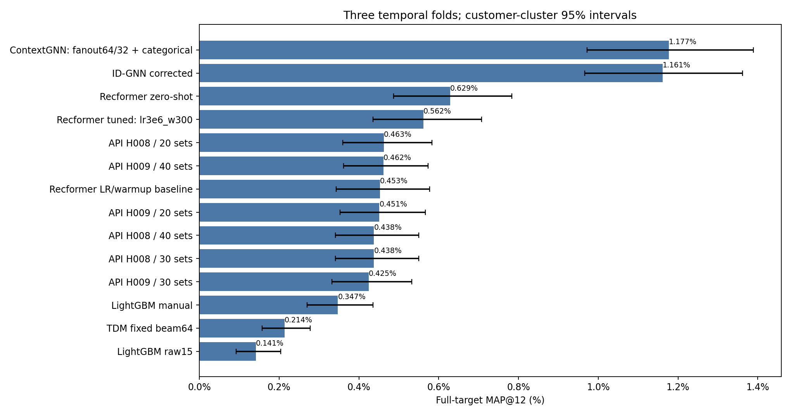

# Сравнение с новым ContextGNN

В исходном test-графике заменён только ContextGNN: fanout64/32 и восемь категориальных кодов. Все три checkpoint были выбраны и зафиксированы до новой test-оценки. Нового обучения и отбора нет.

Test pooled MAP@12=1.1766%, 95% customer-bootstrap интервал [0.9716%; 1.3890%].

Те же5519наблюдений,4548покупателей,10000товаров, полные исходные цели и5000bootstrap. Остальные методы и их интервалы воспроизведены точно. Веса перезагружены; AP каждого пользователя совпал, полные/ранжированные скоры проверены установленным FP32-допуском. Недели test уже просматривались, модель выбрана после серии validation-проверок; это внутреннее сравнение, не независимое подтверждение.

