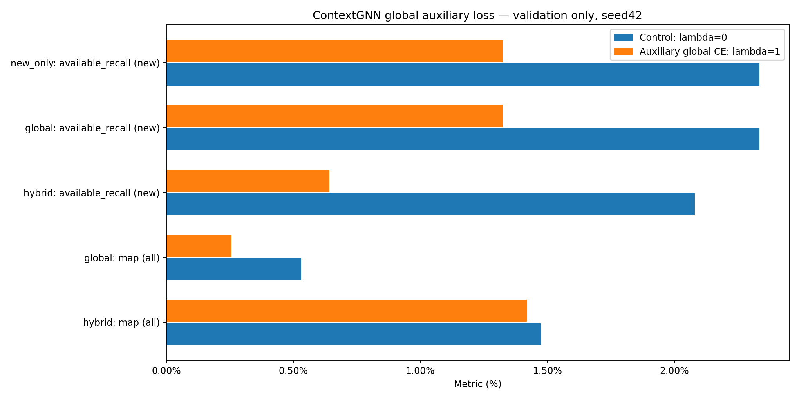

# Дополнительный global loss в ContextGNN

Три фолда, seed42, 768 validation-наблюдений. Контроль lambda=0 и эксперимент lambda=1 обучены заново с одинаковой инициализацией, fanout64/32, восемью категориальными кодами и прежними параметрами. Сравнение проводится со свежим контролем lambda0; побитовое воспроизведение прежнего обучения не утверждается. Начальные веса и обучающие графы совпали между парными вариантами. Эпоха выбрана по обычному hybrid MAP, коэффициент не подбирался. Test не оценивался.

| Режим | Метрика | Контроль, % | +global loss, % | Разница, п.п. | 95% интервал, п.п. |
|---|---|---:|---:|---:|---:|
| hybrid | map / all | 1.4754 | 1.4194 | -0.0560 | [-0.3678; +0.2570] |
| global | map / all | 0.5316 | 0.2565 | -0.2751 | [-0.5301; -0.0635] |
| hybrid | available_recall / new | 2.0810 | 0.6423 | -1.4387 | [-2.3907; -0.6165] |
| global | available_recall / new | 2.3346 | 1.3252 | -1.0094 | [-2.0150; -0.0512] |
| new_only | available_recall / new | 2.3346 | 1.3252 | -1.0094 | [-2.0150; -0.0512] |

Global — оценки до локальной перезаписи. New-only — исключены все прошлые покупки из исходной истории до cutoff; затем заново выбран top12. Новые товары определены относительно доступной истории, а не всей жизни пользователя. Отсутствующие среди кандидатов цели сохранены в полных MAP/recall; available_recall рассчитан отдельно на одинаковом для обоих вариантов подмножестве наблюдений.

| Группа | Всего целей | Доступно |
|---|---:|---:|
| all | 2477 | 1038 |
| new | 2373 | 972 |
| new_product_known_type | 1364 | 503 |
| new_type | 890 | 408 |
| new_variant | 119 | 61 |
| repeat | 104 | 66 |
| unknown_metadata | 0 | 0 |

Интервалы: 5 000 парных bootstrap по исходным покупателям, без поправки за множество сравнений. Это повторно использованная validation и один seed; результат не является независимым подтверждением. Полная диагностика групп и фолдов сохранена в CSV/Parquet.

## Уточнение проверки перезагрузки

Пять fit прошли проверку точного top-12. У последнего fit (fold2, lambda1) проверка точного top-12 остановилась при оценках внутри исходного допуска FP32. Выполнен отдельный повторный инференс без обучения. Исходные checkpoint и оценки выбранной эпохи сохранены; основные таблицы рассчитаны по этим исходным оценкам. Ни один повтор не выбирался по лучшим метрикам.

| Ветка | Максимальная разница оценок | Допуск | Строк с изменением top12 | MAP исходный, % | MAP replay, % |
|---|---:|---:|---:|---:|---:|
| hybrid | 1.7166138e-05 | 4.8583297e-05 | 1 | 1.633030 | 1.633030 |
| global | 1.7166138e-05 | 4.8583297e-05 | 0 | 0.075231 | 0.075231 |

Все проверенные пользовательские MAP/recall совпали: True. Подробности по группам, режимам и изменениям ранжирования — last_fit_replay_diagnostics.json. Требование точного top-12 для всех шести fit не выполнено; результат завершён с этой явной оговоркой.
