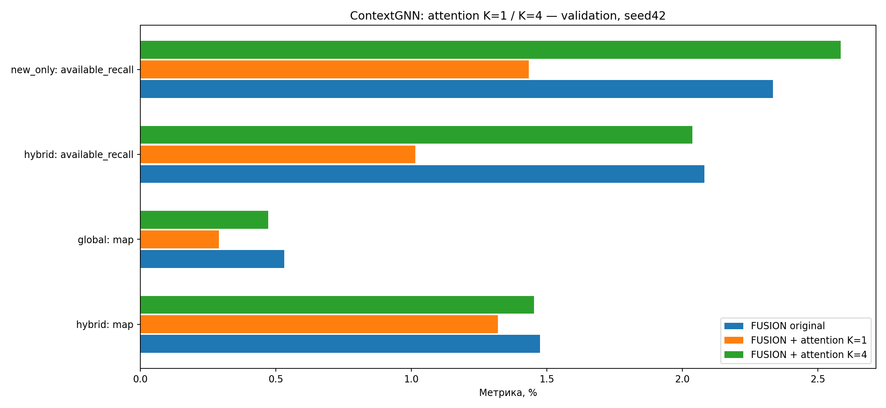

# ContextGNN: один и четыре интереса

Три прежних validation-среза,768 наблюдений/753 покупателя. Шесть новых fit, три исходных FUSION-контроля сохранены. Общие начальные веса и обучающие sampled-графы сверяются. Один seed42, Adam .001, batch128, fanout64/32, восемь categorical-кодов, max10/patience3 по hybrid MAP. Исходный CE без дополнительного global loss. Test не оценивался.

Из прошлых товаров текущего sampled-графа attention получает K взвешенных векторов; они проецируются и добавляются к исходному вектору пользователя. Для товара используется максимальный dot product по K интересам. Локальная формула и offsets исходного root-вектора сохранены. История модели не расширена; будущих покупок во входах нет.

Адаптация идеи ComiRec-SA, а не воспроизведение статьи: нет отдельной последовательности с positional embedding, target-conditioned sampled-softmax readout и reranker разнообразия. [Оригинальный код](https://github.com/THUDM/ComiRec/blob/master/src/model.py), [статья](https://arxiv.org/abs/2005.09347).

| Метрика | FUSION | attention K=1 | attention K=4 |
|---|---:|---:|---:|
|hybrid: map|1.4754%|1.3197%|1.4528%|
|global: map|0.5316%|0.2902%|0.4715%|
|hybrid: available_recall|2.0810%|1.0142%|2.0368%|
|new_only: available_recall|2.3346%|1.4334%|2.5845%|

| Сравнение | Метрика | Разница, п.п. | 95% интервал, п.п. |
|---|---|---:|---:|
|interest1 − control|hybrid/map|-0.1556|[-0.4143; +0.1077]|
|interest1 − control|global/map|-0.2415|[-0.4789; -0.0294]|
|interest1 − control|hybrid/available_recall|-1.0668|[-2.1018; -0.1016]|
|interest1 − control|new_only/available_recall|-0.9012|[-2.0314; +0.1577]|
|interest4 − control|hybrid/map|-0.0226|[-0.2718; +0.2153]|
|interest4 − control|global/map|-0.0602|[-0.2578; +0.1316]|
|interest4 − control|hybrid/available_recall|-0.0442|[-1.2983; +1.2279]|
|interest4 − control|new_only/available_recall|+0.2499|[-0.9614; +1.5589]|
|interest4 − interest1|hybrid/map|+0.1330|[-0.1023; +0.3700]|
|interest4 − interest1|global/map|+0.1813|[-0.0063; +0.4009]|
|interest4 − interest1|hybrid/available_recall|+1.0227|[+0.0170; +2.1174]|
|interest4 − interest1|new_only/available_recall|+1.1511|[+0.0016; +2.3620]|

Основное сравнение K4−K1 отделяет несколько интересов от нового pooling; K4−FUSION вторичное. 5000 paired bootstrap по исходным покупателям, без поправки за несколько сравнений. Один seed и повторно используемая validation: это диагностический эксперимент, не независимое подтверждение.

Все будущие цели, включая недоступные, сохранены в MAP/полном recall (CSV). Условный recall новых — на одинаковых493наблюдениях; всего целей2477/доступно1038, новых2373/доступно972. New-only: маска всей прошлой истории перед top12 полного каталога.

Проверки начальных весов, обучающих графов, FP32 replay и чувствительности top12/AP сохраняются; канонические оценки не подменяются. Распределение выбранных голов и сходство векторов — head_diagnostics.json каждого fit.

## Проверки и использование голов

Все шесть fit и три прежних контроля проверены. Native/reload: 1 строк с изменением top12 (сумма проверок), максимальная чувствительность AP=0. Канонические оценки сохранены. После маски всей истории hybrid совпадает с global: локальные замены относятся к прошлым товарам.

| Фолд K=4 | Доли побед голов по всему каталогу | Средний cosine запросов | Средний cosine attention |
|---|---|---:|---:|
|0|14.7% / 7.6% / 65.7% / 12.1%|0.9997|0.9986|
|1|10.2% / 6.1% / 5.0% / 78.7%|0.9998|0.9952|
|2|86.3% / 3.7% / 5.7% / 4.3%|0.9991|0.9885|

Это описательные признаки сходства/использования голов; распределение побед само по себе не доказывает наличие четырёх разных семантических интересов.

## Группы новизны после исключения прошлых покупок

| Новые товары | Наблюдений с доступной целью | FUSION | attention K=1 | attention K=4 |
|---|---:|---:|---:|---:|
|new_variant|53|5.6604%|1.8868%|5.6604%|
|new_product_known_type|295|3.5851%|1.5367%|3.2994%|
|new_type|247|0.7422%|1.5182%|1.3495%|

Подгруппы описательные, малые и без отдельных интервалов значимости; те же доступные цели/наблюдения во всех вариантах.
