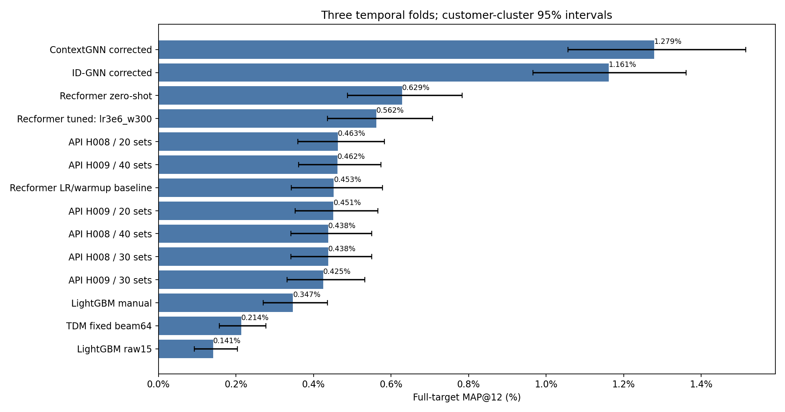
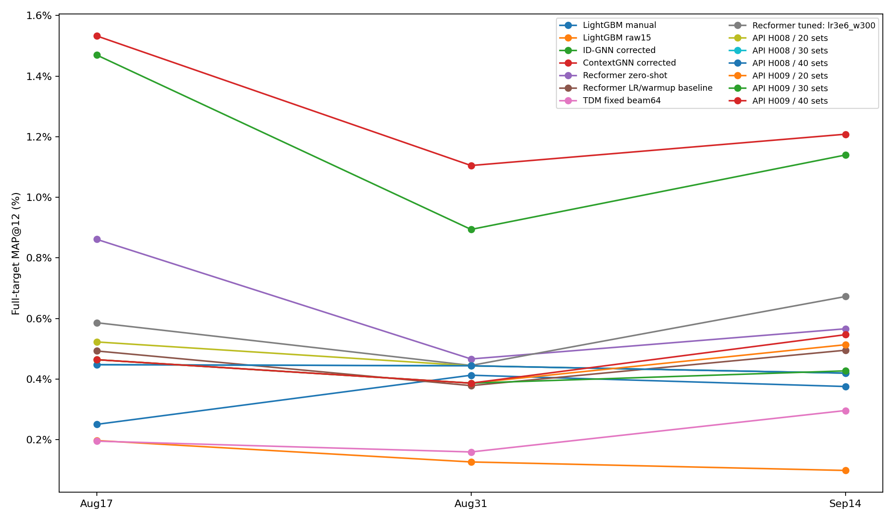
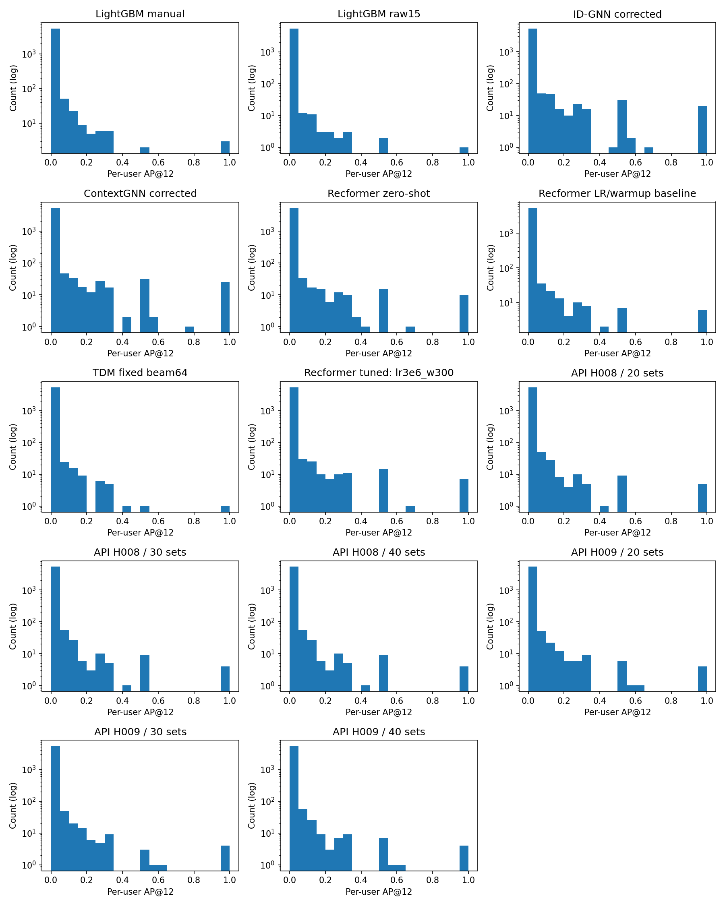

# Сравнение после исправления GNN

Те же три временных фолда, пользователи и полные исходные цели. Старые ошибочные GNN-метрики исключены.
Столбец графика — MAP@12 по всем user-times; интервалы: 5000 парных bootstrap по исходным покупателям.
Выбор checkpoint/настроек использует inner validation. Outer-недели ранее просматривались; это внутреннее сравнение.

| Метод | Fold0, % | Fold1, % | Fold2, % | Среднее фолдов, % | Pooled MAP, % |
|---|---:|---:|---:|---:|---:|
|ContextGNN corrected|1.5325|1.1048|1.2081|1.2818|1.2791|
|ID-GNN corrected|1.4695|0.8939|1.1395|1.1676|1.1613|
|Recformer zero-shot|0.8613|0.4664|0.5660|0.6312|0.6286|
|Recformer tuned: lr3e6_w300|0.5861|0.4450|0.6724|0.5678|0.5620|
|API H008 / 20 sets|0.5226|0.4439|0.4198|0.4621|0.4627|
|API H009 / 40 sets|0.4641|0.3867|0.5465|0.4658|0.4616|
|Recformer LR/warmup baseline|0.4928|0.3784|0.4953|0.4555|0.4525|
|API H009 / 20 sets|0.4641|0.3867|0.5134|0.4547|0.4514|
|API H008 / 30 sets|0.4476|0.4439|0.4198|0.4371|0.4377|
|API H008 / 40 sets|0.4476|0.4439|0.4198|0.4371|0.4377|
|API H009 / 30 sets|0.4641|0.3867|0.4272|0.4260|0.4249|
|LightGBM manual|0.2506|0.4128|0.3755|0.3463|0.3473|
|TDM fixed beam64|0.1953|0.1596|0.2962|0.2170|0.2135|
|LightGBM raw15|0.1972|0.1266|0.0985|0.1408|0.1415|

Интервалы разностей всех пар — paired_differences.csv. Пересечение нуля не подтверждает превосходство.
Ограничение replay ContextGNN fold2: исходная проверка полных скоров не прошла; max |delta|=2.72e-5. Дополнительный replay сохранил test top12 точно; validation имел перестановки почти равных скоров при точном AP каждого пользователя. Применена явно документированная bounded-FP32/tie-aware проверка; исходный failure сохранён. См. ../../../CVFollowup/NUMERIC_REPLAY_AMENDMENT.md.
Один seed и три недели не позволяют оценить устойчивость к другим обучениям и временным режимам.

Сетка Recformer неполная: доступны3 из4 новых настроек плюс прежний baseline. LR=3e-6/warmup100 не запустилась в Kaggle и исключена по доступности, не по качеству. Выбор сделан по среднему inner validation только среди готовых настроек. Протокол сводки: hm_medium_followup_available_summary_v1.
