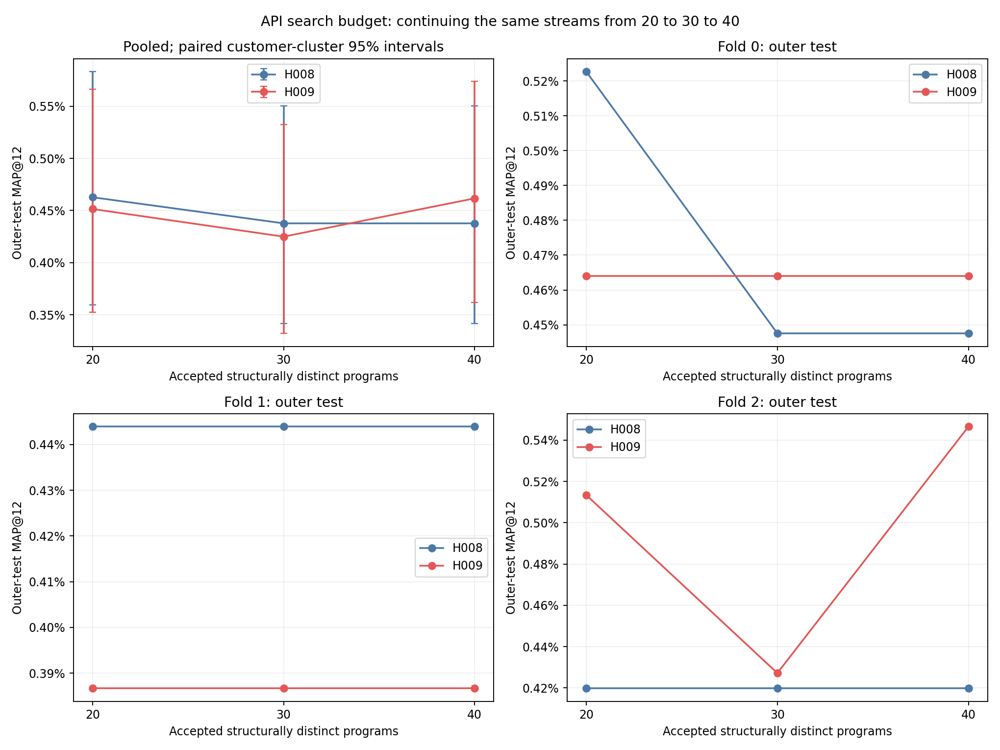
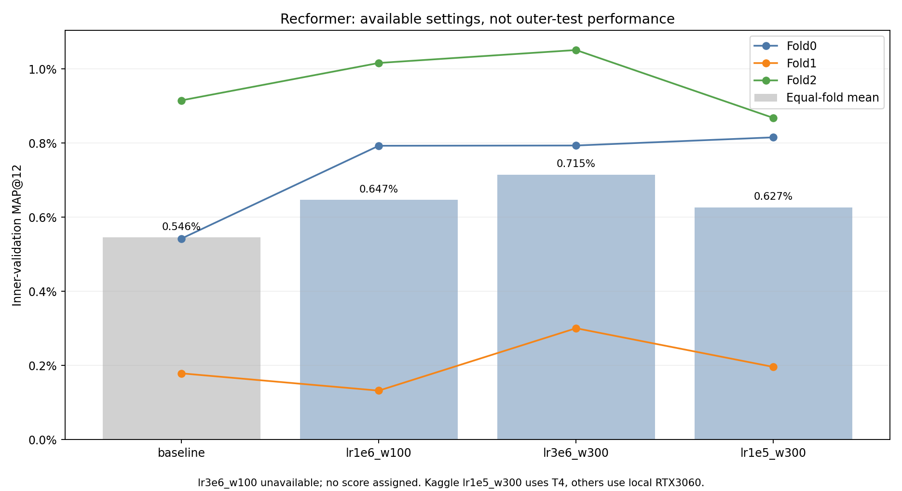

# Сводка доступных результатов

Данные: 20 000 покупателей, 10 000 товаров, три временных фолда, seed 42. Итоговая метрика — full-target MAP@12 по 5519 наблюдениям «покупатель — тестовая неделя» (4548 разных покупателей). В целях сохранены покупки вне доступного каталога.
Столбец общего графика — среднее AP@12 по всем 5519 наблюдениям. Это среднее результатов трёх фолдов с весами 1839, 1982 и 1698 пользователей, а не простое среднее трёх чисел. Простое среднее и отдельные фолды сохранены в report.md и summary.csv. Каждый метод ранжирует один и тот же каталог из 10 000 товаров.

| Метод | Test MAP@12 | 95% customer-bootstrap интервал |
|---|---:|---:|
|ContextGNN corrected|1.2791%|[1.0560%; 1.5152%]|
|ID-GNN corrected|1.1613%|[0.9662%; 1.3615%]|
|Recformer zero-shot|0.6286%|[0.4873%; 0.7833%]|
|Recformer tuned: lr3e6_w300|0.5620%|[0.4359%; 0.7073%]|
|API H008 / 20 sets|0.4627%|[0.3595%; 0.5832%]|
|API H009 / 40 sets|0.4616%|[0.3618%; 0.5737%]|
|Recformer LR/warmup baseline|0.4525%|[0.3429%; 0.5777%]|
|API H009 / 20 sets|0.4514%|[0.3526%; 0.5663%]|
|API H008 / 30 sets|0.4377%|[0.3414%; 0.5505%]|
|API H008 / 40 sets|0.4377%|[0.3414%; 0.5505%]|
|API H009 / 30 sets|0.4249%|[0.3322%; 0.5326%]|
|LightGBM manual|0.3473%|[0.2702%; 0.4357%]|
|TDM fixed beam64|0.2135%|[0.1574%; 0.2777%]|
|LightGBM raw15|0.1415%|[0.0925%; 0.2043%]|

## API: увеличение бюджета

| Режим | 20 наборов | 30 наборов | 40 наборов |
|---|---:|---:|---:|
|H008|0.4627%|0.4377%|0.4377%|
|H009|0.4514%|0.4249%|0.4616%|

Это продолжение одних и тех же поисков, не независимые перезапуски. Все 18 отборов 20/30/40 зафиксированы до новой outer-оценки. Все выбранные API-модели прошли повторный расчёт предсказаний и независимый расчёт AP. H008 передаёт лучшие решения своей популяции, H009 дополнительно сохраняет историю её сообщений. В обоих режимах LightGBM получает только возвращённые программой признаки; 15 исходных полей автоматически не добавляются.
Важная особенность: shortlist из трёх лучших search-программ пересобирается на каждом бюджете; старый победитель confirmation не сохраняется автоматически. Это может ухудшить итог даже при расширении пула программ. Аудит: incumbent_selection_audit.json. Старые результаты не переотбирались задним числом. Проверить сохранение incumbent — отдельный будущий эксперимент.

## Парные разницы

| Сравнение A−B | Разница, п.п. | 95% интервал, п.п. |
|---|---:|---:|
|h008_40 − h008_20|-0.0250|[-0.0599; +0.0030]|
|h009_40 − h009_20|+0.0102|[-0.0454; +0.0668]|
|h009_40 − h008_40|+0.0240|[-0.0438; +0.0929]|
|recformer_tuned − recformer_baseline|+0.1095|[+0.0020; +0.2191]|
|recformer_tuned − recformer_zero|-0.0667|[-0.1943; +0.0609]|
|contextgnn − idgnn|+0.1179|[-0.0016; +0.2397]|
|h008_40 − manual|+0.0904|[-0.0280; +0.2116]|
|h009_40 − manual|+0.1144|[+0.0009; +0.2323]|
|contextgnn − h008_40|+0.8414|[+0.5884; +1.0990]|

## Как читать результаты

ContextGNN и IDGNN следует оценивать по исправленным результатам. Причиной прежнего провала была ошибка единиц времени: даты validation/test в миллисекундах обрабатывались как наносекунды, и при построении графа история покупок оказывалась за пределами ошибочного cutoff. Исправление затронуло общий загрузчик двух GNN. Обе модели заново обучены и оценены; старые результаты сохранены отдельно.
Увеличение бюджета API до 40 наборов не дало последовательного роста тестового MAP. Поиск, отбор на confirmation и случайность отдельных ответов нужно различать. Текущая серия — одно продолжение на каждом фолде, поэтому она не доказывает, что больший бюджет сам по себе бесполезен.
Для оценки преимуществ используются парные интервалы разности из таблицы выше. Пересечение интервалов отдельных столбцов само по себе не является проверкой разницы. Интервал разности, содержащий ноль, означает, что это сравнение не подтвердило преимущество в рамках применённой проверки; это также не доказывает равенство методов.
Отбор top-3 по search сам по себе допустим. Его ограничение для продолженного поиска: ранее найденный победитель confirmation может быть исключён. Например, на fold0 H008 программа №8 имела confirmation MAP 0,7180% при бюджете 20, но при 30/40 в shortlist остались №26, №36 и №14; победила №14 с 0,6966%. Сохранение прежнего победителя обеспечит неубывание лучшего известного confirmation, но не гарантирует роста test и может усиливать подгонку к confirmation.
Следующий контролируемый эксперимент API: сохранять прежнего победителя confirmation вместе с новыми кандидатами из search. Новый протокол нужно зафиксировать до запуска и оценивать на новых отложенных неделях. По этой сводке нельзя задним числом выбирать программу с лучшим test.

## Recformer

Проверены 3 из 4 новых настроек на всех 3 фолдах. LR=3e-6/warmup100 не запустилась в Kaggle и отсутствует в сравнении; это не отрицательный результат качества. Существующий baseline также участвует в отборе.
Выбрана lr3e6_w300 по среднему inner validation; веса зафиксированы до новой test-оценки. Нового обучения при составлении сводки не было.

| Настройка | Val fold0 | Val fold1 | Val fold2 | Среднее val |
|---|---:|---:|---:|---:|
|baseline|0.5424%|0.1787%|0.9154%|0.5455%|
|lr1e6_w100|0.7929%|0.1321%|1.0163%|0.6471%|
|lr3e6_w300|0.7936%|0.3005%|1.0513%|0.7151%|
|lr1e5_w300|0.8156%|0.1961%|0.8681%|0.6266%|

## Ограничения выводов

95%-интервалы: 5000 парных bootstrap по исходным покупателям, seed 42. В каждом повторе выбираются с возвращением 4548 ID покупателей; для выбранного ID берутся все его наблюдения в разных фолдах. Для каждого метода заново считается среднее AP по полученным наблюдениям, затем разница A−B на той же выборке. Границы — 2,5-й и 97,5-й процентили 5000 разностей. Это условная неопределённость для этих недель и обученных моделей, не независимые обучения и не новые временные режимы. Указанные интервалы разностей не скорректированы за множество сравнений.
Сравниваемые деревья используют одинаковые train-пары. GNN/Recformer/TDM имеют собственные objectives и эффективные примеры обучения. Статические поля взяты из снимка H&M; их полная историческая доступность не установлена.
В GNN исправлена подтверждённая ms/ns-ошибка. В таблице только исправленные результаты. Ограничение численного replay ContextGNN fold2 сохранено в отчёте report.md и NUMERIC_REPLAY_AMENDMENT.md.
Kaggle-настройка Recformer обучена на T4, локальные — на RTX3060. AMP/численная воспроизводимость могут различаться; исходные версии, данные и параметры сохранены.
Сырые проценты MAP — не доля довольных пользователей или угаданных покупок. Недоступные товары остаются в знаменателе. Полный H&M каталог здесь не оценивался.
Test-недели ранее просматривались: это внутреннее сравнение. Не выбирать будущие решения только по лучшему outer-test столбцу; подтверждать на новых заранее выделенных неделях.

## Артефакты

Все парные интервалы: paired_differences.csv. Выбранные вызовы и число признаков: api_selected_calls.csv. Код 18 выбранных наборов: selected_programs/. Запросы и известные токены: api_usage.csv.
