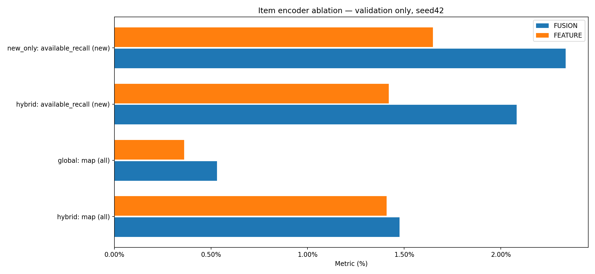

# FEATURE / FUSION и семантический граф товаров

Три фолда, seed42, 768 validation-наблюдений. Исходный CE, без дополнительного global loss. Прежние проверенные FUSION-контроли переиспользованы. Общие начальные веса и обучающие графы совпадают; эпоха выбирается по обычному hybrid MAP, max10/patience3. Test не оценивался.

| Метрика | FUSION | FEATURE |
|---|---:|---:|
| hybrid: map (all) | 1.4754% | 1.4084% |
| global: map (all) | 0.5316% | 0.3618% |
| hybrid: available_recall (new) | 2.0810% | 1.4199% |
| new_only: available_recall (new) | 2.3346% | 1.6481% |

## Разности с FUSION и парные интервалы

| Вариант | Режим / метрика | Разница, п.п. | 95% интервал, п.п. |
|---|---|---:|---:|
| FEATURE | hybrid / map | -0.0669 | [-0.3099; +0.1680] |
| FEATURE | global / map | -0.1699 | [-0.5045; +0.2272] |
| FEATURE | hybrid / available_recall | -0.6612 | [-1.6871; +0.3748] |
| FEATURE | new_only / available_recall | -0.6865 | [-1.7773; +0.4461] |

Новые товары определены по полной доступной исходной истории до cutoff, входы модели не расширялись. Недоступные будущие цели сохранены в полных MAP/recall. Условный recall доступных новых рассчитан на одинаковых 493 наблюдениях. Всего 2477 целей / 1038 доступных, новых 2373 / 972 доступных.

FEATURE удаляет только lookup ID-компоненту RHS. Локальный GNN encoder не меняется. Семантический граф использует только характеристики и описания фиксированного каталога (TFIDF + one-hot, cosine top20). Один шаг e=.5*e_FUSION+.5*P@e_FUSION обучается end-to-end, но сами рёбра зафиксированы. Изображения локально не найдены. Это наша адаптация идеи графа товаров, а не воспроизведение FREEDOM или PinSage.

Исходные оценки лучших эпох сохраняются; FP32-перестановки при replay и их влияние на AP измеряются в replay_verification.json каждого fit. Лучший replay по целям не выбирается. Перезапуски/исторические результаты не подменяются.

Интервалы: 5000 парных bootstrap по покупателям, без поправки за множество сравнений. Один seed и уже использованная validation; независимого подтверждения нет.

Финальная проверка: FP32-допуски соблюдены. Суммарное число строк с перестановками в native/reload проверках показанных вариантов: 0 (включая повторные проверки одних строк); максимальное изменение пользовательского AP=0. Политика и исходные оценки не менялись.

## Группы новых товаров после исключения покупок

| Группа | Наблюдений с доступной целью | FUSION | FEATURE |
|---|---:|---:|---:|
| new_variant | 53 | 5.6604% | 1.8868% |
| new_product_known_type | 295 | 3.5851% | 1.5738% |
| new_type | 247 | 0.7422% | 1.2146% |

Подгрупповые значения описательные, без отдельных интервалов значимости. Доступные цели и подмножество наблюдений для каждого столбца одинаковы.
