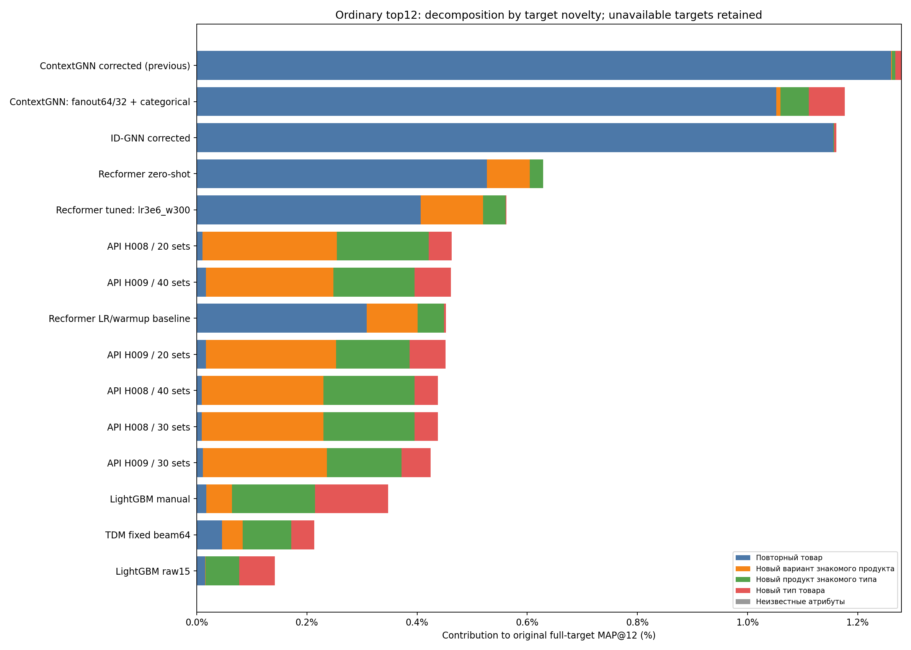
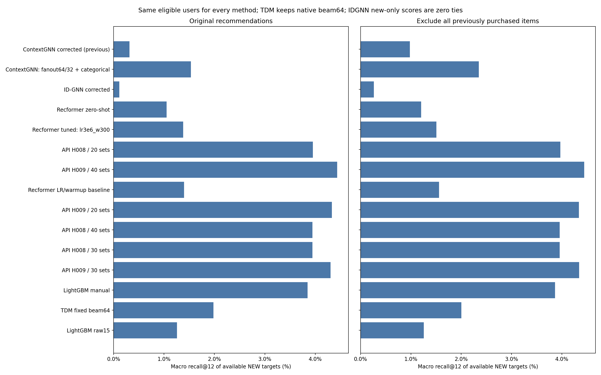

# Повторные и новые товары: диагностика всех методов

Три прежние test-недели,5 519 наблюдений / 4 548 покупателей. Никакого нового обучения, настройки моделей или API-запросов. Исходные предсказания воспроизведены и сохранены.

## Доступность целей в каталоге

| Группа | Всего целей | Доступно | Вне каталога | Покрытие | Пользователей-недель с целями | Из них только недоступные |
|---|---:|---:|---:|---:|---:|---:|
| Все товары | 18193 | 6733 | 11460 | 37.01% | 5519 | 2179 |
| Повторный товар | 737 | 435 | 302 | 59.02% | 597 | 213 |
| Новый вариант знакомого продукта | 900 | 464 | 436 | 51.56% | 695 | 302 |
| Новый продукт знакомого типа | 10157 | 3389 | 6768 | 33.37% | 3833 | 1857 |
| Новый тип товара | 6399 | 2445 | 3954 | 38.21% | 3164 | 1581 |
| Все новые товары | 17456 | 6298 | 11158 | 36.08% | 5358 | 2180 |

Группы определяются относительно всей доступной исходной истории H&M строго до cutoff включительно, включая покупки вне каталога и до начала ограниченной истории моделей. Оригинальные признаки/история моделей при инференсе не расширялись. Категория — product_type_no, знакомый продукт — product_code. Производитель не предполагается.

Все будущие покупки сохранены. Недоступные цели остаются в знаменателях обычных метрик. Условные метрики по доступным целям показаны отдельно, на одном и том же наборе пользователей для всех методов. Пользователи без доступных целей не становятся «идеальными»: в полном recall они дают 0, в условной метрике не участвуют, их число указано.

## Обычный top12: откуда берётся MAP

| Метод | Исходный MAP,% | Повторные: вклад, п.п. | Доля MAP от повторных | Новые: вклад, п.п. | Recall новых, все цели,% | Recall новых, доступные цели,% |
|---|---:|---:|---:|---:|---:|---:|
| ContextGNN corrected (previous) | 1.2791 | 1.2607 | 98.56% | 0.0184 | 0.1312 | 0.3136 |
| ContextGNN: fanout64/32 + categorical | 1.1766 | 1.0524 | 89.45% | 0.1242 | 0.5387 | 1.5327 |
| ID-GNN corrected | 1.1613 | 1.1559 | 99.54% | 0.0054 | 0.0435 | 0.1154 |
| Recformer zero-shot | 0.6286 | 0.5271 | 83.85% | 0.1015 | 0.3604 | 1.0497 |
| Recformer tuned: lr3e6_w300 | 0.5620 | 0.4069 | 72.40% | 0.1551 | 0.5244 | 1.3813 |
| API H008 / 20 sets | 0.4627 | 0.0102 | 2.20% | 0.4525 | 1.3719 | 3.9542 |
| API H009 / 40 sets | 0.4616 | 0.0165 | 3.58% | 0.4451 | 1.5465 | 4.4350 |
| Recformer LR/warmup baseline | 0.4525 | 0.3083 | 68.13% | 0.1442 | 0.5423 | 1.3960 |
| API H009 / 20 sets | 0.4514 | 0.0166 | 3.68% | 0.4348 | 1.5362 | 4.3307 |
| API H008 / 30 sets | 0.4377 | 0.0093 | 2.12% | 0.4284 | 1.3790 | 3.9424 |
| API H008 / 40 sets | 0.4377 | 0.0093 | 2.12% | 0.4284 | 1.3790 | 3.9424 |
| API H009 / 30 sets | 0.4249 | 0.0114 | 2.69% | 0.4135 | 1.5198 | 4.3037 |
| LightGBM manual | 0.3473 | 0.0172 | 4.96% | 0.3301 | 1.3077 | 3.8485 |
| TDM fixed beam64 | 0.2135 | 0.0456 | 21.35% | 0.1679 | 0.6679 | 1.9792 |
| LightGBM raw15 | 0.1415 | 0.0150 | 10.63% | 0.1265 | 0.3740 | 1.2573 |

Вклады групп сохраняют исходный знаменатель AP по всем целям и precision на исходных позициях. Сумма пяти непересекающихся вкладов точно равна исходному MAP. Доля MAP — доля метрики, а не доля будущих покупок. Recall усредняется по наблюдениям с хотя бы одной целью соответствующей группы. Micro recall и hit rate также сохранены в metrics.csv; подробные строки — per_user_metrics.parquet.

## Только ранее не покупавшиеся товары

| Метод | Recall новых, все цели,% | Recall новых, доступные,% | Hit rate новых, все цели,% | MAP по новым целям,% | Условный MAP доступных новых,% |
|---|---:|---:|---:|---:|---:|
| API H009 / 40 sets | 1.5492 | 4.4429 | 4.5726 | 0.5061 | 1.4013 |
| API H009 / 30 sets | 1.5317 | 4.3430 | 4.4606 | 0.4726 | 1.2978 |
| API H009 / 20 sets | 1.5389 | 4.3385 | 4.4420 | 0.4994 | 1.3798 |
| API H008 / 20 sets | 1.3813 | 3.9699 | 4.1060 | 0.5048 | 1.3832 |
| API H008 / 30 sets | 1.3884 | 3.9581 | 4.0687 | 0.4786 | 1.3381 |
| API H008 / 40 sets | 1.3884 | 3.9581 | 4.0687 | 0.4786 | 1.3381 |
| LightGBM manual | 1.3123 | 3.8643 | 4.2180 | 0.3631 | 1.0850 |
| ContextGNN: fanout64/32 + categorical | 0.8523 | 2.3511 | 2.4076 | 0.2334 | 0.7027 |
| TDM fixed beam64 | 0.6764 | 2.0028 | 2.1090 | 0.1936 | 0.5699 |
| Recformer LR/warmup baseline | 0.5948 | 1.5597 | 1.5677 | 0.2156 | 0.5872 |
| Recformer tuned: lr3e6_w300 | 0.5760 | 1.5072 | 1.5491 | 0.2282 | 0.5990 |
| LightGBM raw15 | 0.3740 | 1.2573 | 1.3065 | 0.1389 | 0.4553 |
| Recformer zero-shot | 0.4212 | 1.2018 | 1.2131 | 0.1770 | 0.5061 |
| ContextGNN corrected (previous) | 0.3853 | 0.9798 | 1.1198 | 0.1437 | 0.3517 |
| ID-GNN corrected | 0.0853 | 0.2633 | 0.2800 | 0.0225 | 0.0698 |

Новые top12 получены после исключения всех ранее купленных candidate ID из полных скоров GNN/Recformer и полного повторного инференса сохранённых деревьев. Это не обрезание готового top12. TDM сохраняет исходное внутреннее отсечение beam64; маска применяется перед финальным выбором из всех достигнутых листьев. Цели, не достигнутые beam, остаются в знаменателе и считаются пропусками.

У ID-GNN все содержательные локальные скоры относятся к прошлым покупкам. После исключения прошлых покупок оставшиеся рекомендации с нулевыми скорами разрешаются по ID. Эти строки измерены, но не являются персональным ранжированием новых товаров. См. positive_new_scores в model_verification.json.

## Новые варианты, знакомые и новые типы

| Метод | Режим | Новый вариант: доступный recall,% | Новый продукт знакомого типа,% | Новый тип,% |
|---|---|---:|---:|---:|
| ContextGNN corrected (previous) | normal | 0.3817 | 0.2210 | 0.3906 |
| ContextGNN corrected (previous) | new_only | 1.9084 | 0.6863 | 1.1387 |
| ContextGNN: fanout64/32 + categorical | normal | 2.2901 | 1.2950 | 1.5882 |
| ContextGNN: fanout64/32 + categorical | new_only | 4.3257 | 2.0485 | 2.3673 |
| ID-GNN corrected | normal | 0.0000 | 0.0759 | 0.1790 |
| ID-GNN corrected | new_only | 0.0000 | 0.2024 | 0.4106 |
| Recformer zero-shot | normal | 8.5666 | 0.6663 | 0.0000 |
| Recformer zero-shot | new_only | 10.0933 | 0.6832 | 0.0632 |
| Recformer tuned: lr3e6_w300 | normal | 11.6624 | 0.7906 | 0.0126 |
| Recformer tuned: lr3e6_w300 | new_only | 12.1713 | 0.9762 | 0.0442 |
| API H008 / 20 sets | normal | 24.2154 | 2.9802 | 1.2493 |
| API H008 / 20 sets | new_only | 24.2154 | 2.9802 | 1.3125 |
| API H009 / 40 sets | normal | 21.9042 | 3.6186 | 1.7646 |
| API H009 / 40 sets | new_only | 22.1586 | 3.6186 | 1.7646 |
| Recformer LR/warmup baseline | normal | 9.4572 | 1.2478 | 0.0284 |
| Recformer LR/warmup baseline | new_only | 10.3478 | 1.4122 | 0.0916 |
| API H009 / 20 sets | normal | 25.0848 | 3.0712 | 1.5645 |
| API H009 / 20 sets | new_only | 25.3393 | 3.0712 | 1.5645 |
| API H008 / 30 sets | normal | 23.9186 | 2.9900 | 1.2935 |
| API H008 / 30 sets | new_only | 23.9186 | 2.9900 | 1.3567 |
| API H008 / 40 sets | normal | 23.9186 | 2.9900 | 1.2935 |
| API H008 / 40 sets | new_only | 23.9186 | 2.9900 | 1.3567 |
| API H009 / 30 sets | normal | 25.0848 | 3.0830 | 1.4593 |
| API H009 / 30 sets | new_only | 25.5937 | 3.0830 | 1.4593 |
| LightGBM manual | normal | 7.7396 | 3.7130 | 2.9875 |
| LightGBM manual | new_only | 7.7396 | 3.7383 | 2.9875 |
| TDM fixed beam64 | normal | 3.4097 | 1.8362 | 1.4668 |
| TDM fixed beam64 | new_only | 3.4097 | 1.8995 | 1.4668 |
| LightGBM raw15 | normal | 0.3393 | 0.8263 | 2.0725 |
| LightGBM raw15 | new_only | 0.3393 | 0.8263 | 2.0725 |

## Неопределённость и ограничения

paired_novelty_contrasts.csv содержит 5 000 парных bootstrap-оценок по исходным покупателям для сравнения нового ContextGNN с прежним ContextGNN, ID-GNN, Recformer, manual, H008/H009 по recall доступных новых товаров и MAP всех новых целей. Это условные интервалы для этих недель/моделей, без поправки за множество сравнений; не новые seeds или независимое подтверждение. Типы товаров — более узкая группировка, чем «одежда вообще». Статические атрибуты взяты из снимка H&M; историческая доступность снимка не доказана.

