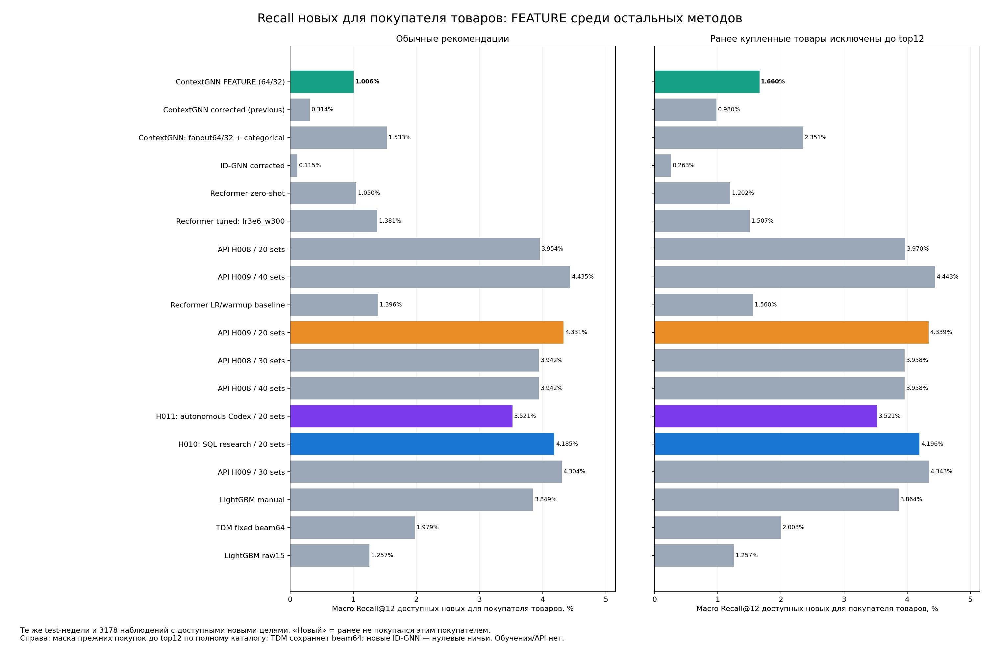

# Recall новых товаров: FEATURE среди остальных методов

Сохранены все 17 методов исходного графика; FEATURE добавлен зелёным. Исходный график не изменён.

| Режим FEATURE | Recall всех новых целей | Recall доступных новых целей |
|---|---:|---:|
|normal|0.3976%|1.0061%|
|new_only|0.6102%|1.6605%|

Слева обычные рекомендации, справа исключены все ранее купленные товары до выбора top12 из 10000 кандидатов. Пересортированы сохранённые полные оценки FEATURE; повторного инференса, обучения и выбора checkpoint не было.

Новый товар ранее не покупался этим пользователем по полной исходной истории до cutoff включительно. Все 17456 новых целей сохранены в полной метрике; 6298 доступны и 11158 вне каталога. Полный macro recall усреднён по 5358 наблюдениям с новыми целями. На графике условный macro recall по доступным новым целям на тех же 3178 наблюдениях для всех методов; остальные 2180 с исключительно недоступными новыми целями в условной метрике не участвуют.

Один seed, уже просмотренные test-недели; диагностика фиксированных моделей. FEATURE 64/32 + восемь категориальных кодов; это не чистая FEATURE/FUSION абляция относительно старого corrected. TDM beam64 и нулевые ничьи ID-GNN сохранены.

