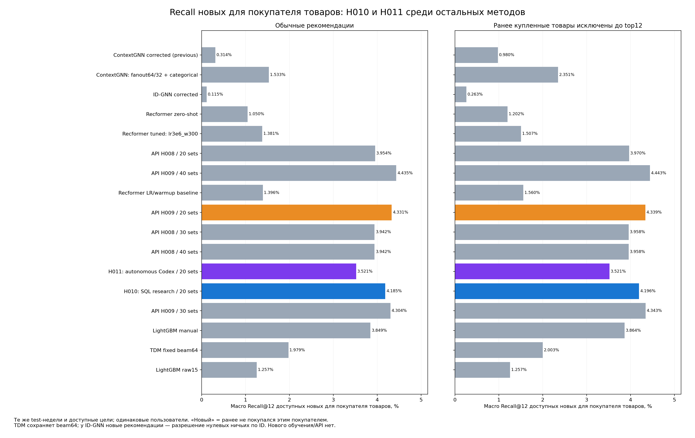

# Recall новых товаров: H010 и H011

Метрика и маски повторяют исходный novelty-аудит. Новые товары ранее не покупались данным пользователем; условная доступная метрика использует только цели в каталоге. Полная метрика сохраняет недоступные цели.

| Метод | Режим | Recall всех новых целей | Recall доступных новых целей | Наблюдений с доступными целями |
|---|---|---:|---:|---:|
|H010: SQL research / 20 sets|normal|1.4650%|4.1854%|3178|
|H010: SQL research / 20 sets|new_only|1.4681%|4.1958%|3178|
|H011: autonomous Codex / 20 sets|normal|1.1145%|3.5212%|3178|
|H011: autonomous Codex / 20 sets|new_only|1.1145%|3.5212%|3178|

Все шесть исходных top12 воспроизведены точно; AP независимо сверены с сохранёнными AP. В new_only маска применяется к полному каталогу до top12, а не к сохранённому списку. Обучения, новых API-запросов и переотбора моделей нет. Парные95% customer-bootstrap интервалы разностей с H009/20,5000 повторов,seed42: paired_recall_differences.csv. Это диагностика уже просмотренных test-недель, не независимое подтверждение. Предыдущий novelty-аудит сохранён без изменений.

