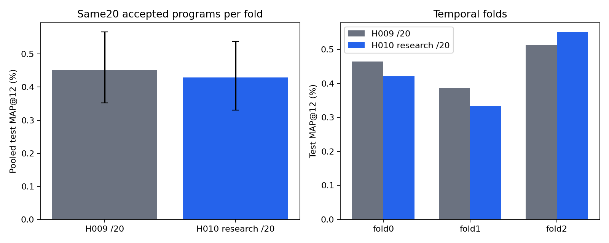
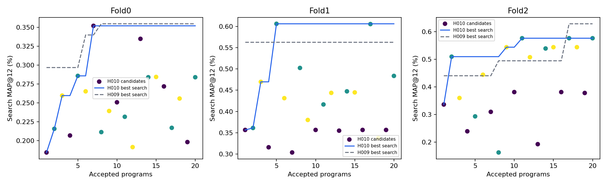

# H010: исследование train-данных через API

Сопоставление с исходным H009 при20 проверенных программах на каждый фолд. Три временных фолда, seed42, одинаковые train-пары, каталог10000 и LightGBM. Единственное запланированное изменение — SQL-инструмент исследования train-данных и сохранение его ответов в собственной истории популяции.

| Метод | Pooled test MAP@12 | 95% customer-bootstrap |
|---|---:|---:|
|H009 /20|0.4514%|[0.3526%; 0.5663%]|
|H010 research /20|0.4291%|[0.3302%; 0.5386%]|

Разница H010−H009: -0.0224п.п.; парный95% интервал [-0.1327; +0.0880]п.п.

| Фолд | H009 | H010 | Разница, п.п. | Запросы статистики | API POST |
|---|---:|---:|---:|---:|---:|
|0|0.4641%|0.4207%|-0.0434|9|38|
|1|0.3867%|0.3324%|-0.0543|6|30|
|2|0.5134%|0.5509%|+0.0375|4|30|

Всего19 исследовательских запросов;98 API POST; известные input/output токены:1409848/82813.
Все60 AST-программ проверены. Сохранены выбранные программы, полные запросы/ответы, SQL и результаты. Победители зафиксированы до новой outer-оценки; полные frozen replays и независимый AP прошли. Аудит проверил точную историю каждого фактического API-запроса, изоляцию популяций и лимиты.

Bootstrap:5000 повторов по исходным покупателям с сохранением их наблюдений во всех фолдах, seed42. Это неопределённость для данных недель и фиксированных моделей. Один поиск/seed; бюджеты программ равны, расходы токенов, объём информации и исследовательских вычислений различаются. Нельзя приписывать всю стохастическую разницу только инструментам.
Test-недели ранее просматривались. Это внутренний эксперимент; подтверждение на новых неделях требует отдельного протокола. Неиспользуемые каталожные цели сохранены в знаменателе MAP. Старые результаты не изменены.

Предварительная optional-tool серия v1 остановлена без outer-оценки после первых ответов без исследовательских запросов. Её программы не переиспользованы и не входят в60 программ v2; её API-затраты сохранены отдельно в reports/medium_h010_research_v1/. Правило обязательного первого исследования зафиксировано до запросов v2.

Диагностика численных дубликатов: sampled_matrix_diversity.json,64 фиксированные train-пары последнего cutoff каждого фолда; совпадение на выборке не доказывает совпадения полных матриц. AST-уникальность сама по себе не означает уникальность значений.

Артефакты: comparison.json, fold_metrics.csv, research_queries.csv, api_usage.csv, candidate_metrics.csv, paired_AP.csv, selected_programs/.
