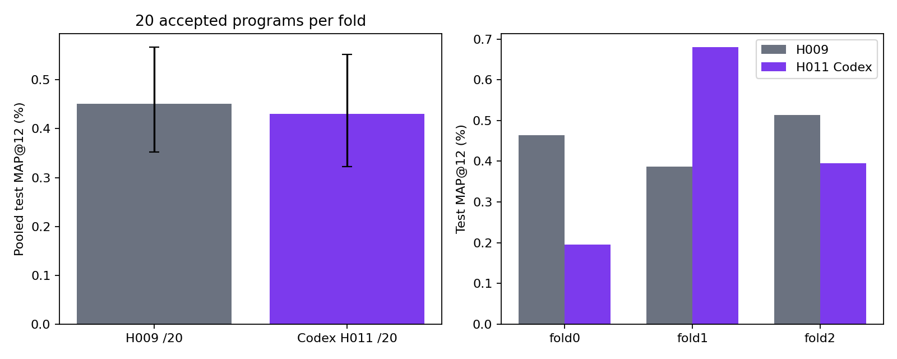

# H011: автономный Codex GPT-6.1 Sol

Три отдельные популяции на каждом из трёх исходных medium-v2 фолдов. Агент сам исследовал train-данные в изолированном терминале, записывал гипотезы и проверял программы через прежний оценщик H009. Все60 проверок завершены; выборы зафиксированы до новой outer-оценки, полные replay и независимый AP прошли.

| Метод | Pooled test MAP@12 | 95% customer-bootstrap |
|---|---:|---:|
|H009 /20|0.4514%|[0.3526%; 0.5663%]|
|H011 Codex /20|0.4307%|[0.3228%; 0.5521%]|

Разница H011−H009: -0.0207п.п.; парный95% интервал [-0.1445; +0.1073]п.п.

Bootstrap:5000 выборок исходных покупателей с сохранением их наблюдений по фолдам, seed42. Фолды и расходы — fold_metrics.csv и api_usage.csv. Гипотезы/ошибки — hypotheses_and_trials.csv; код — selected_programs/.

Это отдельный агентный протокол: системные инструкции Codex, native tools, контекст, расходы и управление sampling отличаются от H009/H010. Равны бюджеты20 успешных программ, но не токены или вычисления. Один seed; test-недели уже просматривались. Новых временных режимов и независимых повторных обучений этот опыт не подтверждает. Исходные цели вне каталога сохранены в знаменателе MAP. AST-уникальность не доказывает численную уникальность признаков.

График просмотрен; итоговая визуальная проверка пройдена.

Фолд | Test MAP@12 | Исследовательские вызовы | API POST
---|---:|---:|---:
0|0.1952%|30|134
1|0.6795%|29|138
2|0.3955%|25|173

Изменение бюджета во время поиска: после14 принятых программ фолда0 пользователь увеличил исследовательский лимит40 до300/фолд (100/популяцию). Продолжены прежние разговоры, программы и счётчики; это продолжение с изменённым протоколом, не независимый перезапуск. Исходное состояние сохранено в reports/medium_h011_codex_v1/before_budget300/.

Всего84 исследовательских вызова,445 API POST. Известные входные токены:10931402 (включают историю/кеш), выходные:124566. Неизвестный usage у3 попыток. Парный интервал разницы включает ноль; улучшение относительно H009 не подтверждено.
