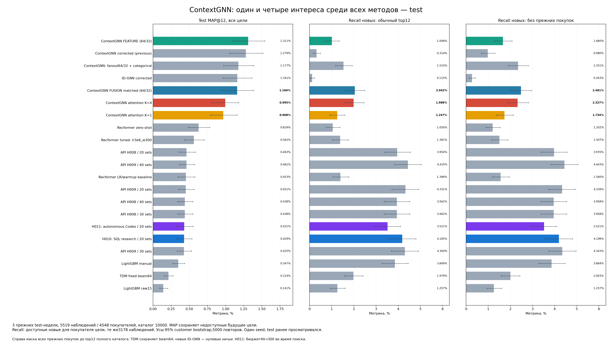

# Multi-interest ContextGNN: общий test-график

Те же5519наблюдений/4548покупателей/10000кандидатов. Веса девяти моделей зафиксированы до test; обучения и переотбора нет. Все18 прежних методов сохранены. FUSION matched — контроль именно новой серии; старый fanout64/32 — отдельный исторический запуск.

| Новый вариант | MAP@12, все цели | Recall новых, все цели | Recall новых, доступные | Recall новых new-only, все | Recall новых new-only, доступные |
|---|---:|---:|---:|---:|---:|
|ContextGNN FUSION matched (64/32)|1.1595%|0.7912%|2.0417%|0.9412%|2.4806%|
|ContextGNN attention K=1|0.9677%|0.4159%|1.2466%|0.6222%|1.7343%|
|ContextGNN attention K=4|0.9952%|0.6610%|1.9878%|0.7900%|2.3266%|

Доступных новых целей6298 из17456; недоступных11158. Полный recall усреднён по5358наблюдениям с новыми целями, условный по3178 с доступными. 2180наблюдений только с недоступными новыми целями не входят в условный recall; в полном дают0. Маски полной исходной прошлой истории прежние. Новые списки получены пересортировкой всех10000сохранённых оценок после маски.

Усы —95% bootstrap по исходным покупателям,5000повторов seed42. Парные разности K4−K1 и каждого варианта−matched FUSION в paired_differences.csv, без поправки за множество сравнений. Один seed и уже просмотренные test-недели: внутреннее сравнение. FP32 replay и влияние перестановок на AP измерены; канонические первые оценки сохранены.

## Глобальная ветка отдельно

| Вариант | Global-only test MAP@12 | 95% интервал |
|---|---:|---:|
|fusion_matched|0.2904%|[0.2165%; 0.3786%]|
|multi_interest1|0.2140%|[0.1554%; 0.2818%]|
|multi_interest4|0.2890%|[0.2162%; 0.3727%]|

Все9checkpoint и исходные18методов проверены; график открыт и проверен визуально. Reload: 9 строк top12 с перестановками, максимальное изменение пользовательского AP=0; первые канонические оценки не подменялись. Подробности в final_verification.json.

## Вывод по текущей реализации

K=4 улучшает recall новых относительно K=1: +0.7412п.п. в обычном режиме
(95%парныйCI[+0.3801;+1.1236]) и +0.5923п.п. new-only
([+0.2037;+0.9958]). Разница MAP K4-K1 +0.0275п.п., CI[-0.0760;+0.1296].
Относительно matched FUSION улучшения нет: MAP K4-FUSION -0.1644п.п.,
CI[-0.2974;-0.0348]; обе разности recall новых включают0.
Global-only MAP практически тот же:0.2890% против0.2904%,
разница -0.0015п.п., CI[-0.0891;+0.0856]. Интервалы условные для фиксированных
моделей, без поправки за множество сравнений и без учёта разброса обучения.

Диагностика на validation: средний попарный cosine четырёх запросов
0.99915–0.99981; cosine attention0.98846–0.99858. На разных фолдах одна голова
выигрывает66–86%каталожных сравнений. Это указывает на слабую специализацию
и очень близкие интересы; четыре головы не означают четыре разных вкуса.
Текущий вариант не заменяет исходный FUSION. Это отрицательный результат
конкретной адаптации/настроек, не опровержение идеи multi-interest или ComiRec.
