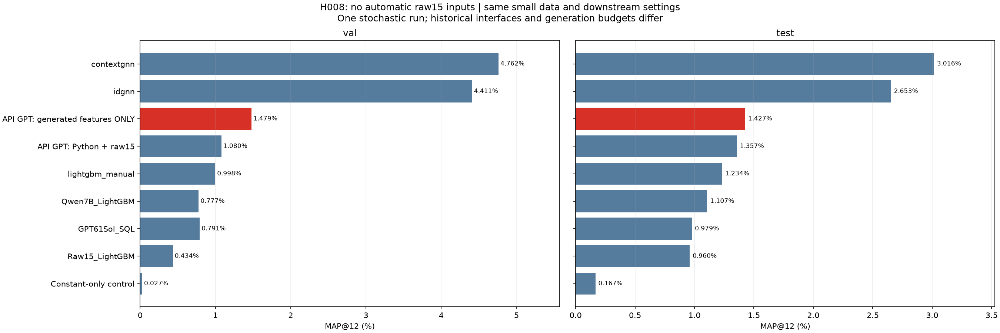
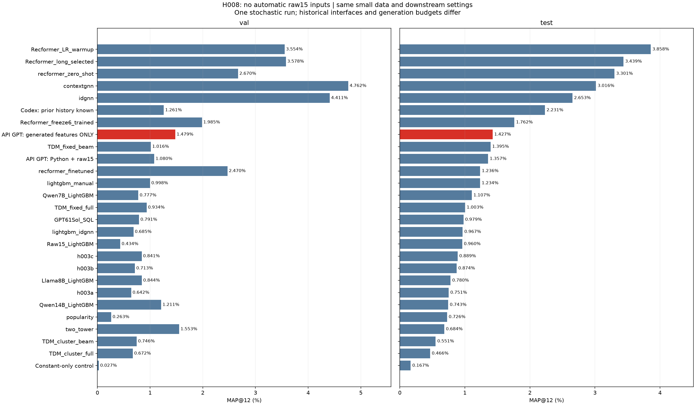
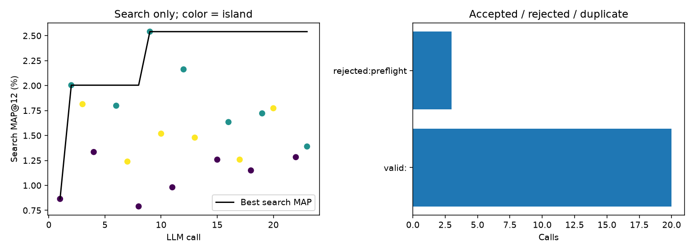
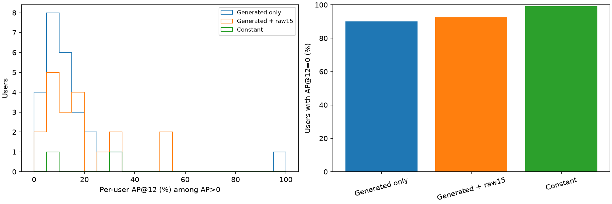
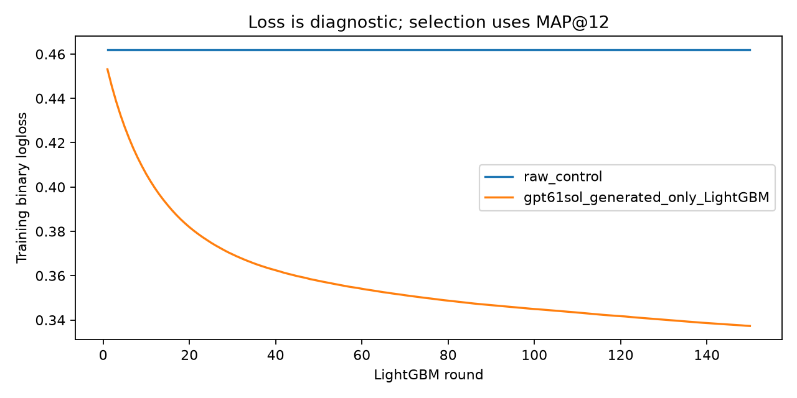

# H008: GPT API — только сгенерированные признаки

Реальный новый API-поиск, независимый от потока H006. Точная реализация провайдера не аттестована.
Хост не добавлял исходные15 полей. Все входы каждой обученной модели — возвращённые f_*; при этом модель могла явно вернуть выбранные статические поля. Контроль — одна константа.
20 валидных программ, 19 численно разных наборов; 23 фактическихPOST; статусы: {'valid': 20, 'rejected': 3}; HTTP/transport 0.
Выбранный ответ: 12; отбор top3 search + константный контроль → confirmation88 до test.
В выбранной модели 25 входов; 7 из них — явно возвращённые моделью копии статических полей: ['f_static_u_age', 'f_static_u_club_member_status', 'f_static_u_fashion_news_frequency', 'f_static_i_product_code', 'f_static_i_product_type_no', 'f_static_i_section_no', 'f_static_i_garment_group_no']. Это проверка отсутствия автоматического добавления raw15, а не запрет модели выбирать исходные атрибуты.

```text
                 model                                                                                                                       source  search_map_percent  confirm_map_percent  heldout_val_map_percent  val_map_percent  test_map_percent
       ConstantControl                                      LLMFeatures/results/hm_small_gpt61sol_generated_only_seed42_v1_1257cedd9dde/raw_control            0.000000             0.000000                 0.094697         0.027412          0.166667
GPT61Sol_GeneratedOnly LLMFeatures/results/hm_small_gpt61sol_generated_only_seed42_v1_1257cedd9dde/gpt61sol_generated_only/candidates/candidate_012            2.162423             0.973514                 0.988907         1.478563          1.426760
```

Те же72813пар/LightGBM150/31/4CPU/seed42/каталог5000. Память по-прежнему: лучший код своей популяции плюс ошибки текущего предложения, без полной истории. Валидатор проверен до API; все матрицы, имена входов дерева, search/confirmation/finalAP и frozen replay проверены.
Один seed; test250 уже просматривался в проекте. Разные API-поиски могут давать разные наборы даже при неизменной политике входов. Не следует приписывать всю разницу одному удалению raw15.
Парная разница test относительно H006: +0.069399п.п., 95% user-bootstrap [-1.0340782828282826, 1.273127344877345]; это не неопределённость между запусками.










