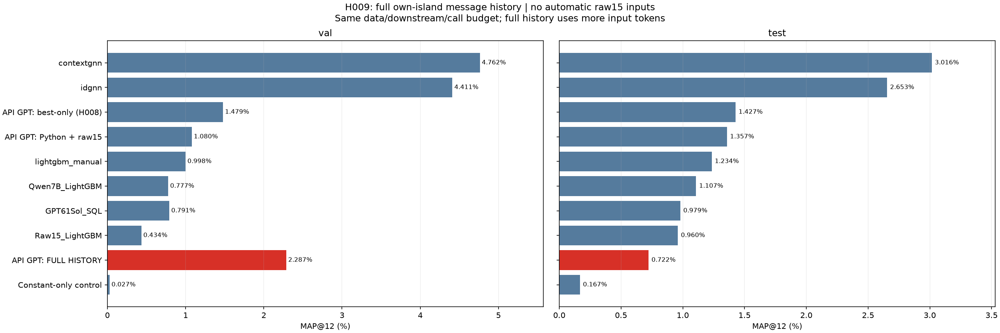
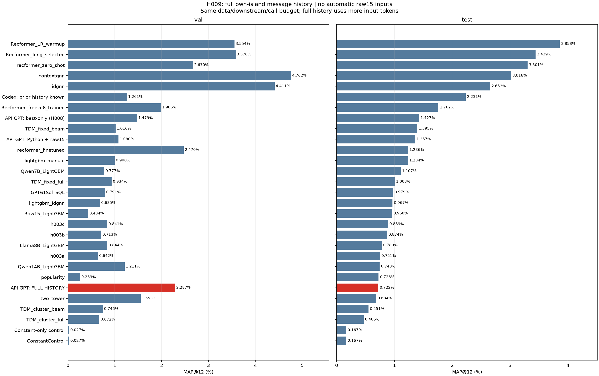
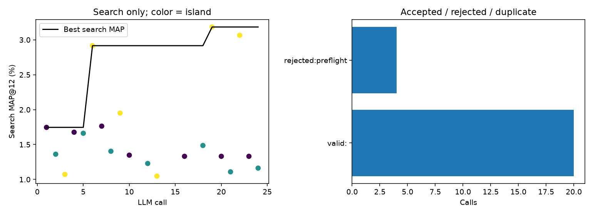
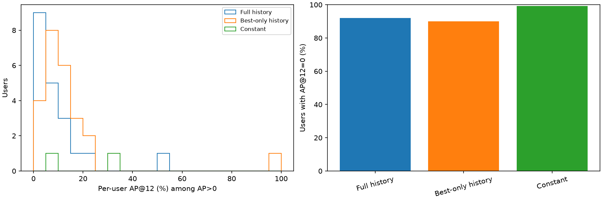
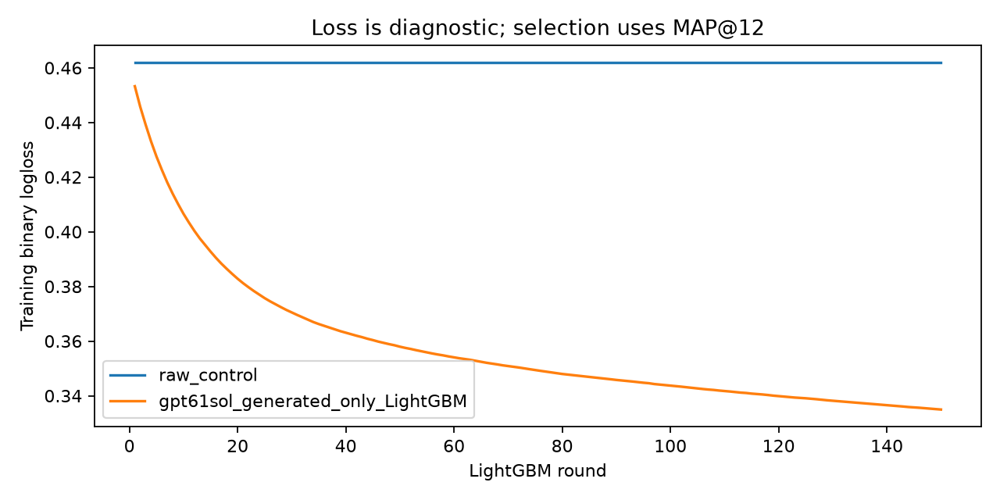
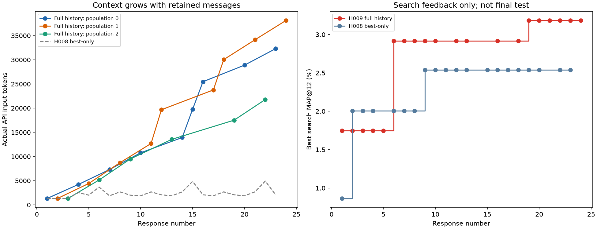

# H009: GPT API — полная история сообщений каждой популяции

Реальный новый API-поиск, независимый от потока H008. Точная реализация провайдера не аттестована.
Хост не добавлял исходные15 полей. Все входы каждой обученной модели — возвращённые f_*; при этом модель могла явно вернуть выбранные статические поля. Контроль — одна константа.
20 валидных программ, 18 численно разных наборов; 24 фактическихPOST; статусы: {'valid': 20, 'rejected': 4}; HTTP/transport 0.
Выбранный ответ: 6; отбор top3 search + константный контроль → confirmation88 до test.
В выбранной модели 32 входов f_*. Имена с префиксом f_static_: []. Статические атрибуты могут возвращаться моделью и под другими именами. Автоматического raw15 нет в обоих сравниваемых режимах. Изменено хранение истории сообщений.

```text
                 model                                                                                                                     source  search_map_percent  confirm_map_percent  heldout_val_map_percent  val_map_percent  test_map_percent
HistoryConstantControl                                      LLMFeatures/results/hm_small_gpt61sol_full_history_seed42_v1_93021ef262b0/raw_control            0.000000             0.000000                 0.094697         0.027412          0.166667
  GPT61Sol_FullHistory LLMFeatures/results/hm_small_gpt61sol_full_history_seed42_v1_93021ef262b0/gpt61sol_generated_only/candidates/candidate_006            2.916202             1.674032                 1.984728         2.286989          0.721596
```

Те же72813пар/LightGBM150/31/4CPU/seed42/каталог5000. Память: все прошлые запросы и ответы своей популяции плюс результаты проверок/search, включая неудачные попытки. История не обрезается. Валидатор проверен до API; все матрицы, имена входов дерева, search/confirmation/finalAP и frozen replay проверены.
Один seed; test250 уже просматривался в проекте. Разные API-поиски могут давать разные наборы даже при неизменной политике входов. Разница не доказывает эффект памяти по одному запуску; полный контекст использует больше входных токенов.
Парная разница test относительно H008: -0.705165п.п., 95% user-bootstrap [-1.366352453102453, -0.15425787091696186]; это не неопределённость между запусками.












Из отказов отдельно выделена попытка15: hasattr отсутствует в ограниченном namespace хоста. Это ограничение исполнителя, а не ошибка обычного Python. В отдельной диагностической копии разрешён только hasattr при сохранении AST/I/O проверок: preflight проходит, все72813train-пары дают точно те же значения, что принятый ответ16. Текущий runtime не менялся, дополнительного обучения/API не было. Нельзя считать все отклонения этого запуска ошибками модели.


Полная история проверена в каждом фактическом запросе: максимум 18 messages, 38143 входных токенов. Данные message_count/own_history_calls/prompt_tokens — в dialog_audit.csv. Первый API-payload побайтно совпадает с H008: True. Seed провайдера не гарантирует детерминированность; различие первых ответов до накопления истории также ограничивает вывод о причинном эффекте памяти.


