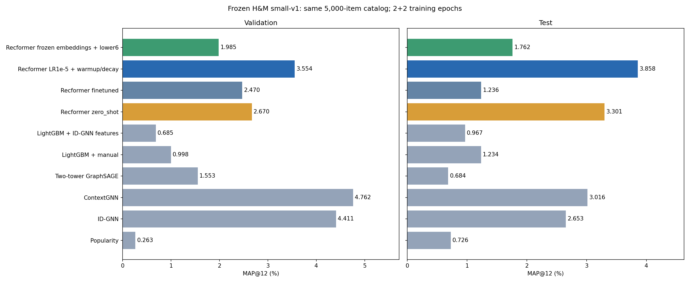
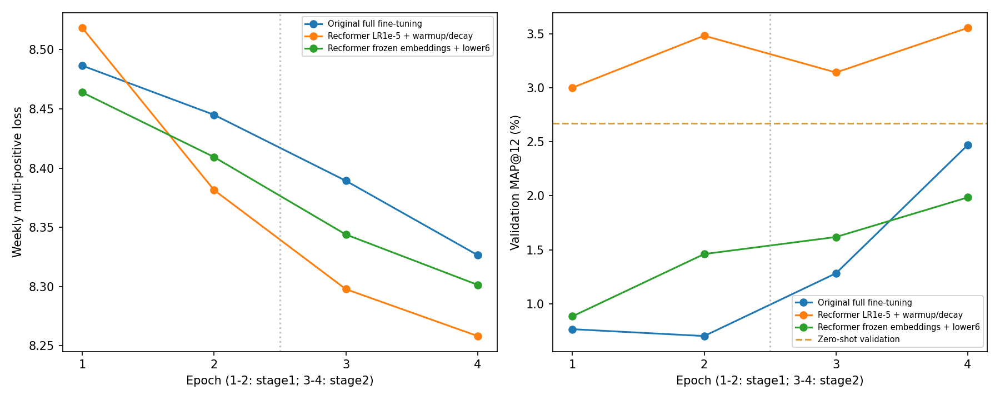
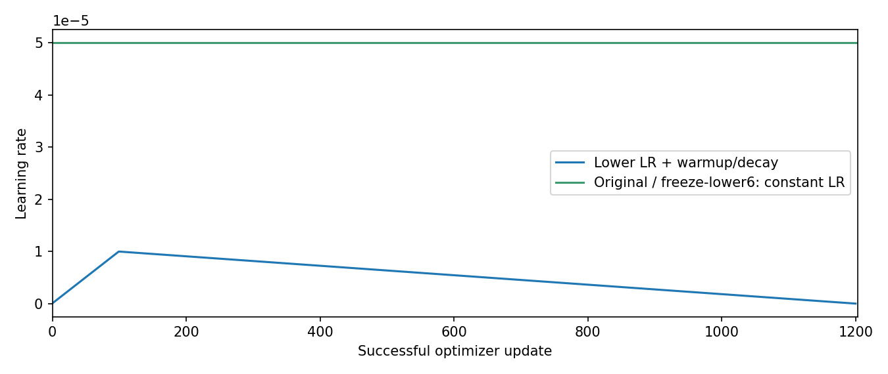

# Recformer: learning rate и заморозка нижних слоёв

Меньший LR с warmup/decay исправил ухудшение относительно прежнего дообучения
в этом запуске: test MAP@12 вырос с 1.23556% до 3.85751%. Разница +2.62196 п.п.,
парный bootstrap 95% [0.59927; 4.81070]. Эффекты меньшего LR и расписания отдельно
не разделены. Преимущество над zero-shot и ContextGNN статистически не установлено:
их интервалы разницы пересекают ноль.

Отдельная заморозка при прежнем LR дала test 1.76156%, но по validation уступила
zero-shot, поэтому правило выбора с допустимой эпохой0 сохранило zero-shot.
Концентрация рекомендаций ослабла: LR/warmup рекомендует1757различныхтоваров
в совокупности testtop12,freeze1104,прежнийfine600. Самыйчастыйтовар встречается
у5.6%,28.4%и54.8%testпользователей соответственно. Это описание результатов,
а не доказательство единственного механизма улучшения.

Два отдельных запуска от одних предобученных весов. Старые результаты сохранены.
Данные и оценка одинаковы: small-v1,4804train/304val/250test,все5000товаров,MAP@12.
В каждом запуске2+2эпохи,seed42. Сначала оба обучены и выбраны поval,только затем оценены наtest.
График показывает лучшие обученные checkpoints; выбор с допустимой эпохой0 показан отдельно.

| Модель | Validation MAP, % | Test MAP, % |
|---|---:|---:|
| Popularity | 0.26256 | 0.72645 |
| ID-GNN | 4.41072 | 2.65341 |
| ContextGNN | 4.76193 | 3.01558 |
| Two-tower GraphSAGE | 1.55256 | 0.68368 |
| LightGBM + manual | 0.99832 | 1.23388 |
| LightGBM + ID-GNN features | 0.68531 | 0.96667 |
| Recformer zero_shot | 2.66996 | 3.30054 |
| Recformer finetuned | 2.47022 | 1.23556 |
| Recformer LR1e-5 + warmup/decay | 3.55434 | 3.85751 |
| Recformer frozen embeddings + lower6 | 1.98481 | 1.76156 |

## Recformer LR1e-5 + warmup/decay

Лучший обученный checkpoint: стадия2,эпоха2. Обучение+validation:18.22мин.
Пик выделеннойCUDA памяти:3.19GiB.
Параметры:{'total': 148110336, 'trainable': 148110336, 'frozen': 0}. РежимLR:100 successful optimizer updates warmup, then linear decay over1204 updates.
Успешных обновлений:1201;пропусковAMP:3.
При разрешённой эпохе0 поvalidation выбран:finetuned; val/testMAP:3.55434%/3.85751%.

| Сравнение обученного варианта | Разница test MAP, п.п. | Парный bootstrap95%, п.п. |
|---|---:|---:|
| против zero_shot | +0.5570 | [-1.0519; +2.2097] |
| против finetuned | +2.6220 | [+0.5993; +4.8107] |
| против contextgnn | +0.8419 | [-0.9205; +2.7222] |

## Recformer frozen embeddings + lower6

Лучший обученный checkpoint: стадия2,эпоха2. Обучение+validation:13.04мин.
Пик выделеннойCUDA памяти:2.13GiB.
Параметры:{'total': 148110336, 'trainable': 53157888, 'frozen': 94952448}. РежимLR:constant; same as original.
Успешных обновлений:1204;пропусковAMP:0.
При разрешённой эпохе0 поvalidation выбран:zero_shot; val/testMAP:2.66996%/3.30054%.

| Сравнение обученного варианта | Разница test MAP, п.п. | Парный bootstrap95%, п.п. |
|---|---:|---:|
| против zero_shot | -1.5390 | [-3.1884; +0.0251] |
| против finetuned | +0.5260 | [-0.9082; +1.9766] |
| против contextgnn | -1.2540 | [-2.9155; +0.3478] |

LR1e-5 иwarmup/decay изменены совместно: отдельно их эффекты не разделены.
Заморозка проверена отдельно при прежнемconstantLR5e-5; embeddings+нижние6из12слоёв не менялись поSHA.
Полные scores/top12 обоих вариантов повторены в независимых процессах. Zero-shot точно совпал с прежним контролем.
Одинseed и250test пользователей ограничивают выводы; bootstrap описывает фиксированные модели,а не вариативность обучения.
Настройки поtest не выбирались; большее число эпох требует отдельного протокола. Это адаптация Recformer к недельным целям H&M,не воспроизведение метрик статьи.
