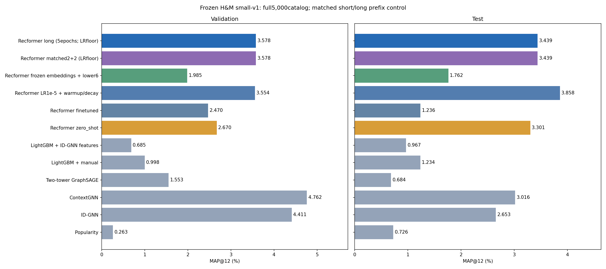
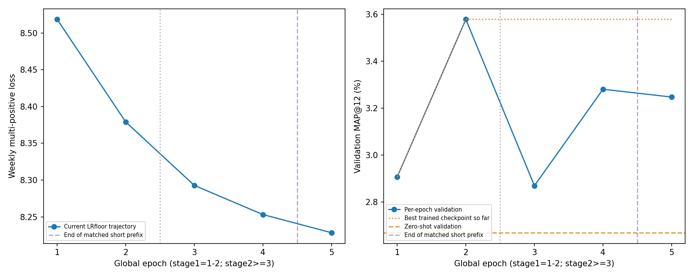
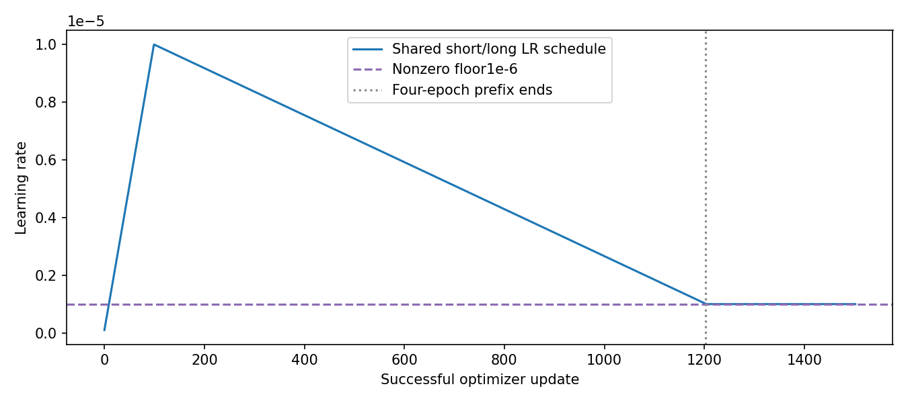

# Recformer: больше эпох и сопоставимый короткий контроль

Дополнительные эпохи в этом запуске не улучшили выбранную модель: короткий
контроль (выбор по validation среди первых 4 эпох) и длинный (среди всех 5)
выбрали одинаковые веса после 2-й эпохи. У обоих validation MAP@12=3.57807%,
test MAP@12=3.43889%. Максимальные 8 эпох не достигнуты: сработала остановка
после трёх эпох без улучшения validation. Вывод относится к этому расписанию
LR и одному seed; прежний опыт с другим расписанием не является контролем
для оценки влияния только числа эпох.

Выполнено 5полных эпох:2первой стадии и3второй. Причина остановки:stage2_patience3.
Обучение+validation:20.45мин;короткий префикс:16.45мин.
Это одна траектория обучения с одинаковыми первыми4эпохами,из которой сохранены два правила выбораcheckpoint.
LRwarmup100до1e-5,decayдо1e-6кupdate1204,далееconstant. Прежний4эпохrunсdecayк0показан как отдельный reference,не matchedконтроль.
Малый набор/разбиения/полный5000каталог не менялись;train4804,val304,test250;seed42.
Все решения поvalidation записаны доtest. Epoch0допустимвотдельных selection_short/long.json.
Длинныйbestvalне может быть ниже короткого поопределению:выбирается из большего множества checkpoints.

| Модель | Validation MAP, % | Test MAP, % |
|---|---:|---:|
| Popularity | 0.26256 | 0.72645 |
| ID-GNN | 4.41072 | 2.65341 |
| ContextGNN | 4.76193 | 3.01558 |
| Two-tower GraphSAGE | 1.55256 | 0.68368 |
| LightGBM + manual | 0.99832 | 1.23388 |
| LightGBM + ID-GNN features | 0.68531 | 0.96667 |
| Recformer zero_shot | 2.66996 | 3.30054 |
| Recformer finetuned | 2.47022 | 1.23556 |
| Recformer LR1e-5 + warmup/decay | 3.55434 | 3.85751 |
| Recformer frozen embeddings + lower6 | 1.98481 | 1.76156 |
| Recformer matched2+2 (LRfloor) | 3.57807 | 3.43889 |
| Recformer long (5epochs; LRfloor) | 3.57807 | 3.43889 |

Короткий checkpoint:stage1,epoch2;длинный:stage1,epoch2. Совпадают поSHA:True.

| Длинный минус | Разница test MAP, п.п. | Парный bootstrap95%, п.п. |
|---|---:|---:|
| matched_short | +0.0000 | [+0.0000; +0.0000] |
| zero_shot | +0.1383 | [-1.0839; +1.3815] |
| previous_LR_warmup | -0.4186 | [-1.2990; +0.5017] |
| contextgnn | +0.4233 | [-1.1326; +2.1191] |

Все6полных val/testreplayпрошли,включаяполныеscores/top12. Zero-shotсовпалс прежним контролем.
Одинseed и250testпользователей;bootstrapописывает фиксированные модели,а не разброс обучения. Настройкипоtestнеподбирались.
Это адаптация Recformer к недельным H&M целям,не воспроизведение метрик статьи. Старые результаты и окружение сохранены.
