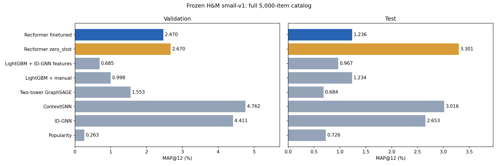
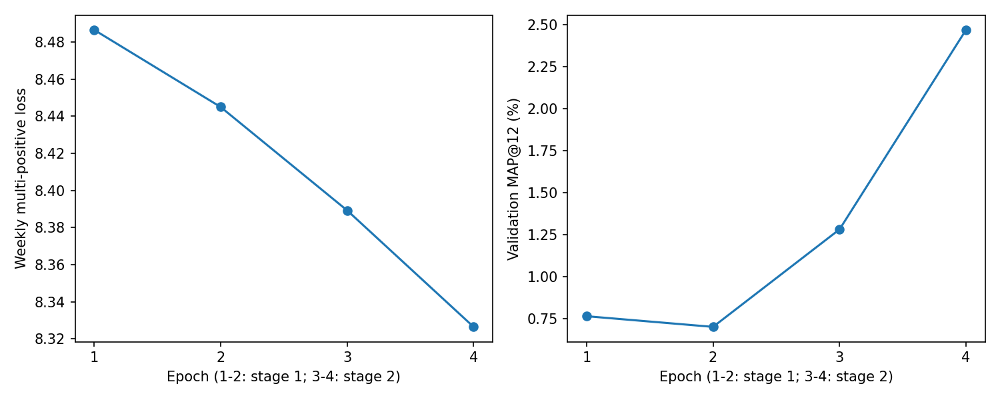

# Recformer на малом H&M

Лучший измеренный test MAP у zero-shot Recformer: 3.30054%, против 3.01558%
у ContextGNN. Разница +0.28497 п.п.; парный bootstrap 95% [-1.23318; 1.79754]
пересекает ноль, поэтому устойчивое превосходство над ContextGNN не установлено.
В этой конфигурации короткое дообучение ухудшило test MAP до 1.23556%.
Причину ухудшения этот эксперимент не устанавливает.

Результаты проверены повторным полным инференсом из checkpoint и сохранённого item cache.
Данные: неизменный small-v1; train4804, val304, test250; каталог5000; MAP@12.
Выбор только по validation. Zero-shot и дообученный варианты оценены на test после фиксации модели.

| Модель | Validation MAP, % | Test MAP, % |
|---|---:|---:|
| Popularity | 0.26256 | 0.72645 |
| ID-GNN | 4.41072 | 2.65341 |
| ContextGNN | 4.76193 | 3.01558 |
| Two-tower GraphSAGE | 1.55256 | 0.68368 |
| LightGBM + manual | 0.99832 | 1.23388 |
| LightGBM + ID-GNN features | 0.68531 | 0.96667 |
| Recformer zero_shot | 2.66996 | 3.30054 |
| Recformer finetuned | 2.47022 | 1.23556 |

Реализация: репликация AaronHeee/RecFormer commit26b00a58e7affe0c54a89c143ea7bce37f2e8e08.
Предобученные веса получены по ссылке репликации; их источник не назван проверенным авторским checkpoint.
Изменения: недельный многопозитивный fullsoftmax,256tokens,FP16,batch4,accum4,2+2эпохи,seed42.
Представления товаров обновляются в стадии1 и фиксированы в стадии2; сохраняются вместе с моделью.
Один seed и250test пользователей дают предварительную оценку. Внешнее предобучение отличается от GNN baseline.
Все10файлов subset проверены по прежним SHA256: subset_integrity.json. Состав и разбиения не менялись.
При выбранном текстовом представлении5000товаров дают4846уникальных токенизированных описаний. У модели нет содержательного признака для различения товаров с одинаковым входом; tie-break поID не добавляет предиктивной информации.
Метрики малого набора не сравнивать напрямую с полным H&M или статьёй.
Bootstrap интервалы являются описательным сравнением замороженных моделей, без выбора параметров по test.
Точные времена и GPU память: Recformer/results/hm_small_seed42_v1/{zero_shot,finetuned}/metrics.json.
Подготовка и smoke замер отделены от обучения; zero-shot training_seconds=0 не включает предобучение и кодирование каталога.

Выбранный дообученный checkpoint: стадия 2, эпоха 2.
Обучение и validation: 20.93 мин. Пик выделенной CUDA памяти: 3.19 GiB.

| Сравнение дообученного Recformer | Разница test MAP, п.п. | Парный bootstrap 95%, п.п. |
|---|---:|---:|
| против zero_shot | -2.0650 | [-4.1653; -0.0100] |
| против contextgnn | -1.7800 | [-3.9103; +0.2763] |
| против idgnn | -1.4179 | [-3.3889; +0.4898] |
| против lightgbm_manual | +0.0017 | [-1.3446; +1.3529] |
| против lightgbm_idgnn | +0.2689 | [-1.3757; +1.8756] |
| против two_tower | +0.5519 | [-0.8487; +2.0440] |

| Сравнение zero-shot Recformer | Разница test MAP, п.п. | Парный bootstrap 95%, п.п. |
|---|---:|---:|
| против contextgnn | +0.2850 | [-1.2332; +1.7975] |
| против idgnn | +0.6471 | [-0.8770; +2.1684] |
| против lightgbm_manual | +2.0667 | [+0.1121; +4.1404] |
| против lightgbm_idgnn | +2.3339 | [+0.9034; +3.9708] |
| против two_tower | +2.6169 | [+0.7060; +4.6970] |

Эти интервалы описывают сравнение уже зафиксированных моделей; дополнительные настройки и запуски по test не выбирались.
