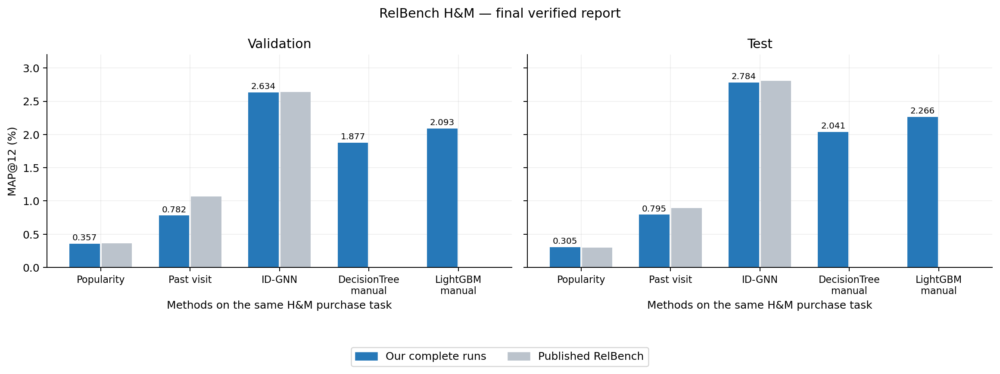
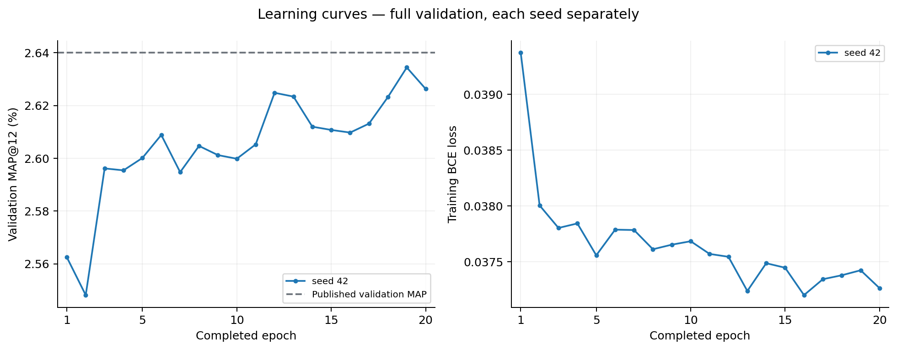
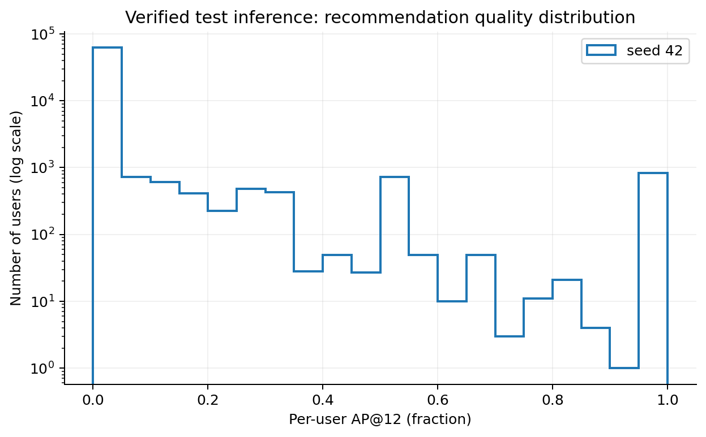

# RelBench H&M: результаты воспроизведения

Обновлено: 2026-10-14T19:47:16+03:00 (Москва).

**Финальный отчёт: GNN, инференс и обе модели на ручных признаках завершены.**

Завершено обучение: 1/1. Проверено независимым инференсом: 1/1.

MAP@12 указан в процентах. Локальный эксперимент использует один seed 42 по просьбе пользователя. Статья сообщает среднее пяти запусков; локальный разброс по seeds не оценён.

Источник опубликованных значений: [RelBench, таблица 8](https://arxiv.org/html/2407.20060v1). Усы на столбцах ID-GNN показывают стандартное отклонение между завершёнными seeds.

| Метод | Validation MAP, % | Test MAP, % | Test в статье, % | Разница, п.п. |
|---|---:|---:|---:|---:|
| Global popularity | 0.35739 | 0.30456 | 0.30000 | 0.00456 |
| Past visit | 0.78166 | 0.79466 | 0.89000 | -0.09534 |
| ID-GNN (1/1 completed) | 2.63442 | 2.78432 | 2.81000 | -0.02568 |
| DecisionTree + manual (1/1 completed) | 1.87661 | 2.04076 | — | — |
| LightGBM + manual (1/1 completed) | 2.09318 | 2.26608 | — | — |

Все столбцы по оси X — методы на одной задаче H&M user-item-purchase, а не разные задачи.

## Справочные результаты статьи

| Метод в статье | Validation MAP, % | Test MAP, % |
|---|---:|---:|
| Popularity | 0.36 | 0.30 |
| Past visit | 1.07 | 0.89 |
| LightGBM: сырые признаки + история/популярность | 0.44 | 0.38 |
| RDL GraphSAGE | 0.92 | 0.80 |
| RDL ID-GNN | 2.64 | 2.81 |

Наши DecisionTree/LightGBM manual — отдельные локальные baseline с 126 вручную заданными признаками.
Это адаптированное подмножество экспертных user-churn/item-sales SQL плюс наши признаки пары; авторы не публиковали этот набор для ранжирования.
Опубликованные 0.38% LightGBM относятся к другому набору входов, не к нашей адаптации.
Для основных сравнений каждая модель дерева использует тот же evaluation pool, что и соответствующий seed ID-GNN.
Деревья обучаются на 50,000 user-time строках train; ID-GNN имеет больший supervised бюджет. Test полный; tuning деревьев на 10,000 validation пользователей.
[Протокол ручных признаков](../../baseline/MANUAL_BASELINE.md)

## Запуски и независимый инференс

| Seed | Эпохи | Лучший validation пока, % | Финальный test, % | Инференс |
|---|---:|---:|---:|---|
| 42 | 20 | 2.63442 | 2.78432 | пройден |

## Локальные модели на ручных признаках

| Модель | Seed | Validation MAP, % | Test MAP, % | Инференс из сохранённой модели |
|---|---:|---:|---:|---|
| decision_tree | 42 | 1.87661 | 2.04076 | проверен |
| lightgbm | 42 | 2.09318 | 2.26608 | проверен |

В новом процессе best.pt загружается строго, затем повторяется полный validation/test.
Проверяются конечность оценок, размеры предсказаний, диапазон и уникальность ID, совпадение MAP с сохранённым результатом (допуск 1e-6 в долях).
Побитовое совпадение записывается отдельно: CUDA может давать небольшие численные различия.

Таблицы: [comparison.csv](comparison.csv), [seeds.csv](seeds.csv). Графики также доступны как SVG.

Протокол: last соответствует исходному коду, статья указывает uniform; seed 42 выбран нами; число запусков сокращено пользователем до одного; оценочный batch 128 вместо 512.
Past visit отличается от статьи; причина пока не установлена. Smoke-метрики сюда не включены.

[Протокол](../../RelBenchGNN/README.md) · [Контекст](../../CONTEXT.md) · [История](../../WORK_LOG.md)
