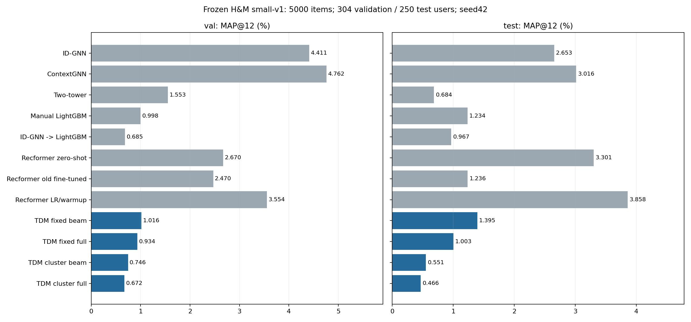
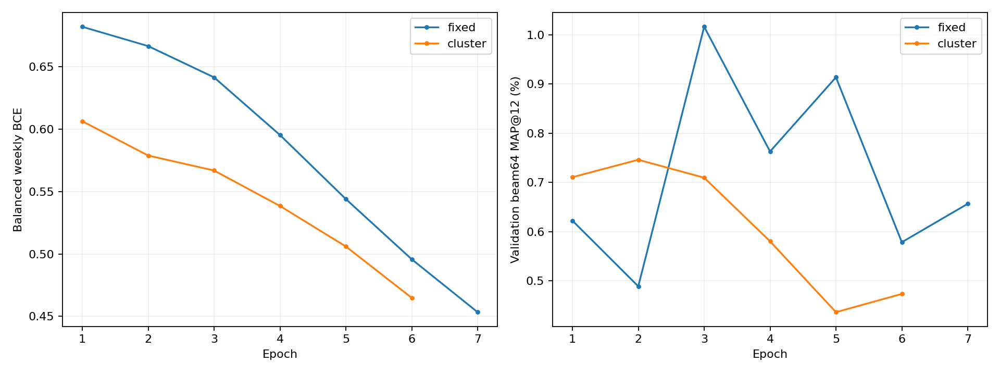
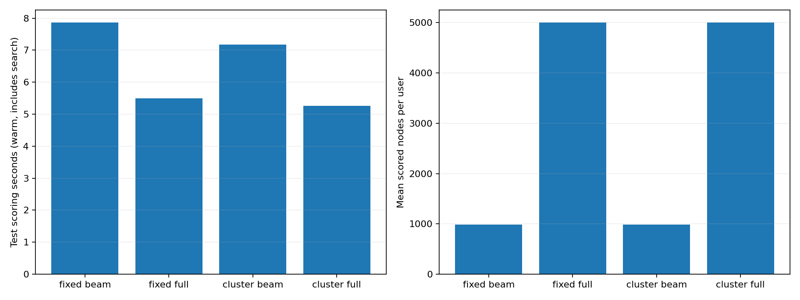

# TDM: fixed and embedding-cluster trees on H&M small-v1

Fixed-tree TDM beam obtained test MAP@12=1.395195%; after embedding clustering it was0.551263%. The cluster-minus-fixed paired-user95% interval is[-2.14275;+0.21911]percentage points: these point results do not establish a stable effect across users or training seeds. ContextGNN and Recformer LR/warmup reference test MAPs are3.015575% and3.857513%.

Both models were selected by beam64 validation MAP before either test evaluation.
Local PyTorch adaptation of TDM; not unchanged TorchEasyRec and not JTM.
Frozen4804train/304val/250test, full5000item candidate catalog, weekly multi-positive targets, one seed42.

| Model | Validation MAP, % | Test MAP, % |
|---|---:|---:|
| ID-GNN | 4.410716 | 2.653413 |
| ContextGNN | 4.761926 | 3.015575 |
| Two-tower | 1.552564 | 0.683677 |
| Manual LightGBM | 0.998319 | 1.233880 |
| ID-GNN -> LightGBM | 0.685307 | 0.966667 |
| Recformer zero-shot | 2.669956 | 3.300544 |
| Recformer old fine-tuned | 2.470220 | 1.235556 |
| Recformer LR/warmup | 3.554340 | 3.857513 |
| TDM fixed beam | 1.016010 | 1.395195 |
| TDM fixed full | 0.934150 | 1.002919 |
| TDM cluster beam | 0.745875 | 0.551263 |
| TDM cluster full | 0.672455 | 0.466389 |

| TDM variant | Selected epoch | Epochs | Train+validation seconds | Peak CUDA GiB | Stop |
|---|---:|---:|---:|---:|---|
| fixed | 3 | 7 | 188.61 | 0.095 | patience4 |
| cluster | 2 | 6 | 132.85 | 0.095 | patience4 |

Clustering prerequisite: {"source_checkpoint_sha256": "fec5341ae294b62220e1989c1ea10a8213985d57528f3df4a2e5f36b04c30766", "clustering_seconds": 13.290499057999114, "method": "recursive balanced KMeans2 distance difference; no JTM", "initialization": "fresh seed42; no weight warm start", "fixed_training_seconds": 188.6061899560009}

| Test comparison | Difference, pp | Paired bootstrap95%, pp |
|---|---:|---|
| TDM cluster beam minus TDM fixed beam | -0.84393 | [-2.142747113997114, 0.21910840548340527] |
| TDM fixed beam minus TDM fixed full | +0.39228 | [-0.217825974025974, 1.1273543650793647] |
| TDM cluster beam minus TDM cluster full | +0.08487 | [0.007500000000000001, 0.16881502525252523] |
| TDM fixed beam minus ContextGNN | -1.62038 | [-3.843799920978492, 0.4537329073043358] |
| TDM cluster beam minus ContextGNN | -2.46431 | [-4.3847107125678555, -0.7609954476740202] |
| TDM fixed beam minus Recformer LR/warmup | -2.46232 | [-4.864092352092351, -0.19301960076960162] |
| TDM cluster beam minus Recformer LR/warmup | -3.30625 | [-5.436087662337663, -1.394525853775854] |

All8beam/full ×val/test independent replays match arrays, scores, traces, top12 and AP exactly.
References are recomputed from frozen top12, not retrained. Old artifacts remain untouched.
Full-leaf scoring uses the exact same selected checkpoint as beam; it is a diagnostic of routing, not another tuned model.
Tree clustering uses the fixed model own train-learned leaf embeddings; clustered model retrains from scratch.
Cluster total prerequisite cost includes fixed model training and clustering. Early stopping budgets can differ in realized epochs.
No claim of general superiority:250testusers,one seed,different model/pretraining budgets. Bootstrap describes users, not training randomness.
Native retrieval includes the full catalog as eligible leaves while evaluating a subset of nodes. Repeat purchases allowed.
Warm inference times exclude environment/checkpoint initialization and data loading; no speed claim from node counts alone.

[Protocol](../../TDM/PROTOCOL_SMALL.md) · [Research/provenance](../tdm_assessment/report.md)

Final artifact audit passed; all3 PNGs visually reviewed. The maximum difference between scores of beam-visited leaves and exhaustive scoring was below1e-6. All independent same-mode replays matched exactly.

Timing clarification: the chart uses one pass with an already loaded model; there was no explicit warmup before every mode or repeated timing benchmark. This is an observed execution-time comparison, not a robust hardware speed benchmark.

Frozen source copies retained under TDM/results/hm_small_v1/source/.
