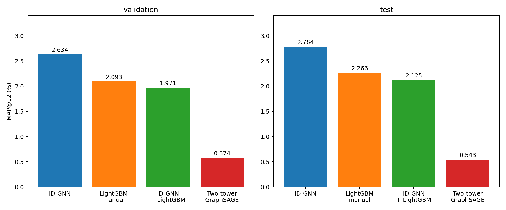
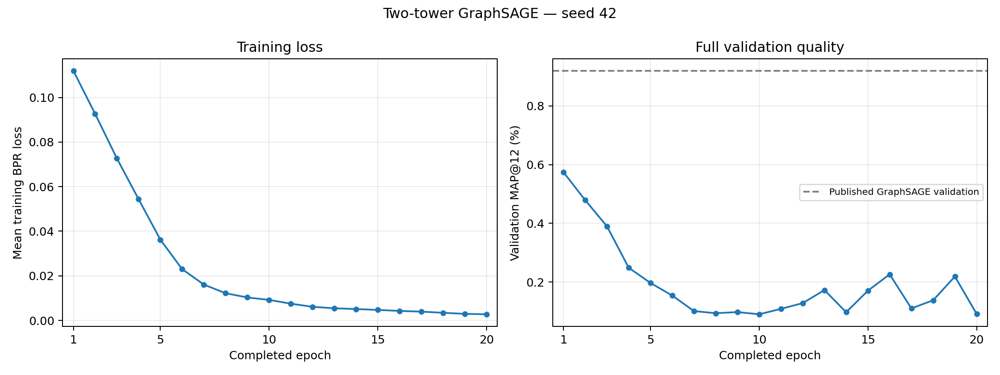

# Двухбашенная GraphSAGE: H&M

Эпох завершено: 20/20. Финальный проверенный результат: True.

| Метод | Validation MAP, % | Test MAP, % |
|---|---:|---:|
| ID-GNN | 2.63442 | 2.78432 |
| LightGBM manual | 2.09318 | 2.26608 |
| ID-GNN + LightGBM | 1.97116 | 2.12451 |
| Two-tower GraphSAGE | 0.57431 | 0.54301 |

Графики показывают только завершённые эпохи: средний тренировочный BPR loss и полный validation MAP@12. Обновляются после каждой эпохи; численные значения доступны в learning_curves.csv.

Пользователь и каждый товар кодируются отдельными forward с общими весами GraphSAGE, без ID-awareness. Скор пары — скалярное произведение 128-мерных представлений. BPR loss, shallow embedding товара включён, как в исходном примере.
Оценка двухбашенной модели охватывает весь каталог 105,542 товаров. Предыдущие ID-GNN/manual эксперименты используют локальные кандидаты; это сравнение итоговых конвейеров, не изолированная замена головы при одинаковых кандидатах.
Статья RelBench RDL GraphSAGE: validation 0.92%, test 0.80% MAP@12. Это опубликованная двухбашенная архитектура; наш один seed сравнивается со средним пяти запусков.
[Статья](https://arxiv.org/html/2407.20060v1)
Отклонения от стандартного примера: train batch 256 вместо 512 для памяти GPU; строго 2000 шагов вместо исходного условия на 2001; фиксированное RNG-состояние для каждого evaluation split. Temporal sampling uniform в обучении и оценке.
Все пользовательские и товарные val/test эмбеддинги сохраняются вместе с ID и временем; исходный каталог покрыт полностью. После обучения проверяется инференс best.pt в новом процессе.
